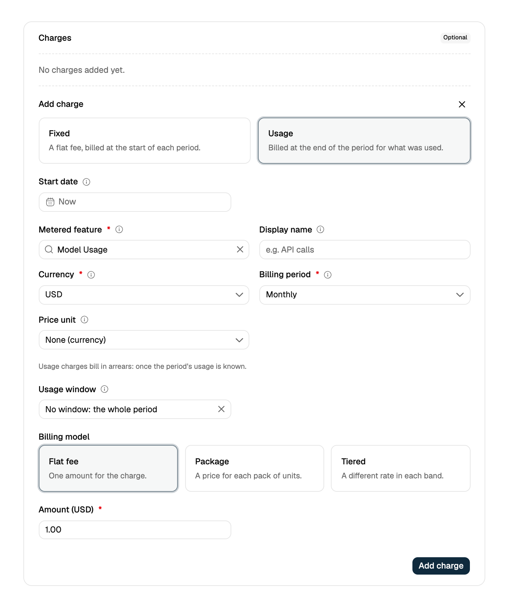
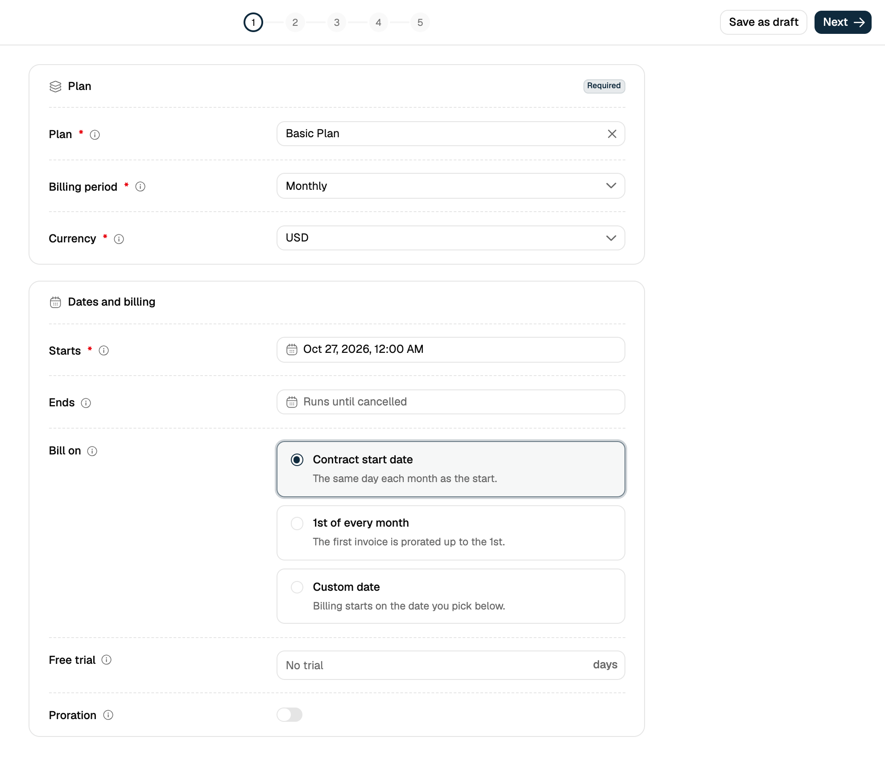
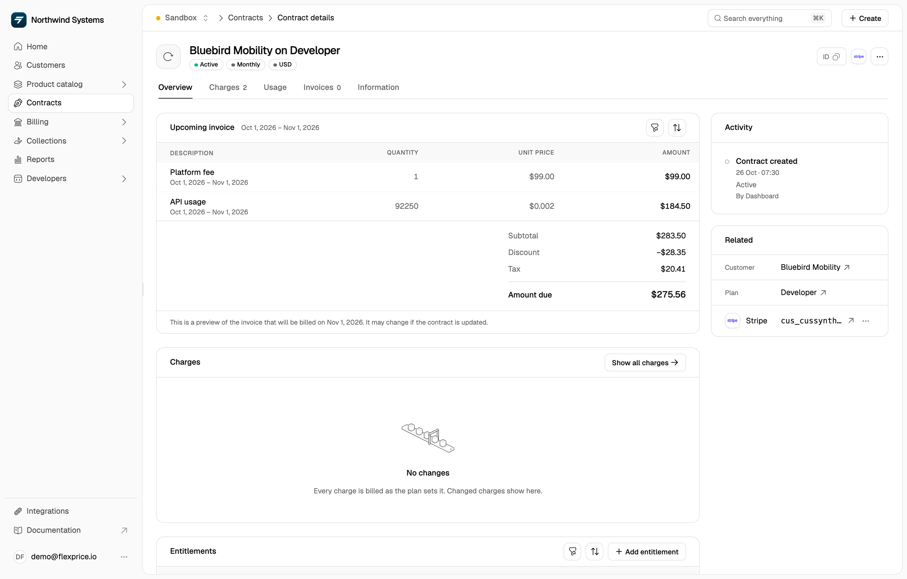

Events alone don't generate revenue - they need to be connected to pricing plans and customer subscriptions to create billable charges. This guide shows you how to transform your ingested events into actual invoices.

## How Events Flow to Billing

The complete flow from events to invoices:

1. **Events** → Usage data transmitted to Flexprice
2. **Features** → Define what you're tracking and how to aggregate
3. **Plans** → Set pricing for features
4. **Subscriptions** → Connect customers to plans
5. **Invoices** → Automatic billing based on usage

## Prerequisites

- A metered feature created and configured
- Events being transmitted and validated
- A customer created in Flexprice

## Step 1: Create a Pricing Plan

### Navigate to Plans

1. Log into your Flexprice dashboard
2. In the left sidebar, go to **Product catalog** → **Plans**
3. Click **New plan**

### Configure the Plan

1. **Name**: Give your plan a descriptive name (e.g., "Basic Plan", "Pro Plan")
2. **Lookup key**: A unique identifier for the plan in API calls
3. **Description**: Optional description of what the plan includes

Click **Next**. How often customers are billed (monthly, annually, etc.) is set on each charge, not on the plan.

### Add Your Feature

1. On the **Charges** step, click **Add charge** and choose **Usage**
2. In **Metered feature**, select your metered feature
3. Configure the pricing:

- **Currency** and **Billing period**: how the charge is billed (e.g., USD, monthly)
- **Billing model**: **Flat fee** for a price per unit
- **Amount**: Set the price per unit (e.g., \$1 per credit)
- For free usage before billing starts, use the **Tiered** billing model, set **Tier mode** to **Slab**, and price the first tier at 0. The default mode, **Volume**, bills the whole quantity at one rate, so once usage passes the first tier, the free units are billed too.

Then click **Add charge**.

**Example Configuration:**

- Feature: Model Usage
- Billing model: Flat fee
- Amount: \$1.00 per credit

<Frame>
  
</Frame>

### Advanced Pricing Options

**Tiered** (tier mode **Slab**: each band at its own rate):

- First 1000 credits: $1.00 each
- Next 1000 credits: $0.80 each
- Additional credits: $0.60 each

**Package**:

- 1000 credits for \$800 (effective \$0.80 per credit)

**Tiered** with tier mode **Volume**:

- One rate for the whole quantity, chosen by the total. With the tiers above, 1500 credits are all billed at \$0.80 each.

### Save the Plan

Click **Next** through the remaining steps, then click **Create plan** to create your pricing plan.

## Step 2: Assign Plan to Customer

In the dashboard, subscriptions are called **contracts**.

### Create Subscription

1. Go to **Customers** in the left sidebar
2. Find and click on your customer
3. Click **Create contract**
4. In **Plan**, select the plan you just created
5. Set when the contract **Starts**
6. Click **Next** through the remaining steps, then click **Create contract** on the **Review** step

<Frame>
  
</Frame>

### Verify Subscription

After creating the contract, it appears in the **Contracts** card on the customer's page. Open it to see:

- Status: Active
- Plan name, billing period, and currency
- The upcoming invoice and the date it will be billed

## Step 3: Monitor Usage and Billing

### Check Upcoming Invoices

1. Open the contract from the customer's page, or from **Contracts** in the left sidebar
2. The **Overview** tab opens with the **Upcoming invoice**: a preview of the next invoice with:
   - Usage quantities from your events
   - Calculated amounts based on your pricing
   - The billing period of each charge

<Frame>
  
</Frame>

**Example Invoice Preview:**

```
Description   Period                     Qty   Unit price   Amount
Model Usage   Oct 1, 2026 - Nov 1, 2026  2     $1.00        $2.00
```

### Understanding the Billing

- **Description**: The charge's name, with its billing period underneath
- **Quantity**: Total usage aggregated from your events
- **Unit price**: The price per unit from your plan
- **Amount**: Calculated based on your pricing plan

## Real-World Example

Let's walk through a complete example:

### 1. Feature Configuration

- **Feature Name**: Model Usage
- **Event Name**: `model.usage`
- **Aggregation**: Sum of `credits`
- **Usage Reset**: Periodic (monthly)

### 2. Events Transmitted

```json
[
  {
    "event_name": "model.usage",
    "external_customer_id": "cust_123",
    "properties": { "credits": 5 }
  },
  {
    "event_name": "model.usage",
    "external_customer_id": "cust_123",
    "properties": { "credits": 3 }
  }
]
```

### 3. Plan Configuration

- **Plan Name**: Basic Plan
- **Feature**: Model Usage
- **Pricing**: $1.00 per credit
- **Free Tier**: 10 credits per month

### 4. Billing Calculation

- **Total Usage**: 5 + 3 = 8 credits
- **Free Credits**: 10 (no charge for first 10)
- **Billable Credits**: 0 (8 < 10, so no charge)
- **Amount**: $0.00

### 5. If More Usage Occurs

If the customer uses 15 credits total:

- **Total Usage**: 15 credits
- **Free Credits**: 10
- **Billable Credits**: 5
- **Amount**: $5.00

## Advanced Billing Scenarios

### Multiple Features

You can add multiple metered features to a single plan:

**Plan: Pro Plan**

- Model Usage: $1.00 per credit
- API Calls: $0.01 per call
- Storage: $0.10 per GB

**Customer Usage:**

- 50 credits consumed
- 1000 API calls
- 5 GB storage

**Invoice:**

```
Model Usage     Usage Based     Aug 22 - Sep 22    50    $50
API Calls       Usage Based     Aug 22 - Sep 22    1000  $10
Storage         Usage Based     Aug 22 - Sep 22    5     $0.50
Total: $60.50
```

### Tiered Pricing

**Plan: Enterprise Plan**

- Model Usage:
  - First 1000 credits: $0.80 each
  - Next 1000 credits: $0.60 each
  - Additional: $0.40 each

**Customer Usage: 2500 credits**

- First 1000: $800
- Next 1000: $600
- Additional 500: $200
- **Total: $1600**

## Monitoring and Analytics

### Usage Trends

1. Go to **Customers** and open the customer
2. Open the **Analytics** tab, then pick the feature and date range
3. View usage over time to identify patterns

### Billing Analytics

1. Go to **Billing** → **Invoices**
2. View historical invoices and revenue
3. Analyze customer usage patterns

## Common Billing Issues

### 1. No Charges Appearing

**Possible Causes:**

- Feature not added to plan
- Customer not subscribed to plan
- Usage below free tier
- Wrong billing period

**Solutions:**

- Verify feature is in the plan
- Check subscription status
- Review free tier settings
- Confirm billing cycle dates

### 2. Wrong Amounts

**Possible Causes:**

- Incorrect pricing configuration
- Wrong aggregation values
- Billing period mismatch

**Solutions:**

- Review plan pricing settings
- Check event aggregation
- Verify billing cycle alignment

### 3. Unexpected Charges

**Possible Causes:**

- Events transmitted to wrong customer
- Incorrect usage reset setting
- Duplicate events

**Solutions:**

- Verify external_customer_id
- Check Usage Reset configuration
- Review event history for duplicates

## Best Practices

### 1. Test Billing Setup

Before going live:

1. Create a test customer
2. Transmit a few test events
3. Verify charges appear correctly
4. Check invoice calculations

### 2. Monitor Usage Patterns

Regularly check:

- Usage trends and spikes
- Customer behavior patterns
- Revenue impact of pricing changes

### 3. Set Up Alerts

Consider alerts for:

- Unusual usage spikes
- Failed billing attempts
- Revenue thresholds

### 4. Document Pricing

Keep clear documentation of:

- Feature pricing structure
- Free tier limits
- Billing cycle details
- Customer-specific overrides

## Pricing Strategies

### Usage-Based Pricing

**Pros:**

- Aligns cost with value
- Scales automatically
- Fair for customers

**Cons:**

- Revenue can be unpredictable
- Complex to forecast

### Tiered Pricing

**Pros:**

- Encourages higher usage
- Predictable revenue at scale
- Rewards loyal customers

**Cons:**

- More complex to configure
- Can be confusing for customers

### Hybrid Models

Combine multiple pricing approaches:

- Base subscription fee
- Usage-based charges
- Volume discounts

## Next Steps

After setting up billing:

1. **Monitor Performance** - Track usage and revenue
2. **Optimize Pricing** - Adjust based on customer behavior
3. **Scale Operations** - Add more features and customers
4. **Automate Processes** - Set up webhooks and integrations

## Troubleshooting

### "No charges in upcoming invoice"

- Check that events are being transmitted
- Verify feature is in the plan
- Confirm customer subscription is active
- Review free tier settings

### "Wrong billing amounts"

- Verify pricing configuration
- Check event aggregation values
- Review billing period dates
- Confirm usage reset settings

### "Unexpected charges"

- Review recent events for the customer
- Check for duplicate events
- Verify external_customer_id mapping
- Review plan configuration changes

## Getting Help

If you're experiencing billing issues:

1. Check the **[Event Debugger](/docs/event-ingestion/event-debugger)** for event processing status
2. Review your plan configuration carefully
3. Verify customer subscription status
4. Contact support with specific examples and error messages
