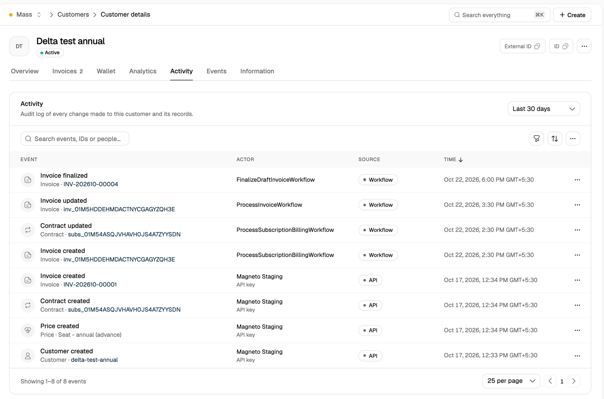
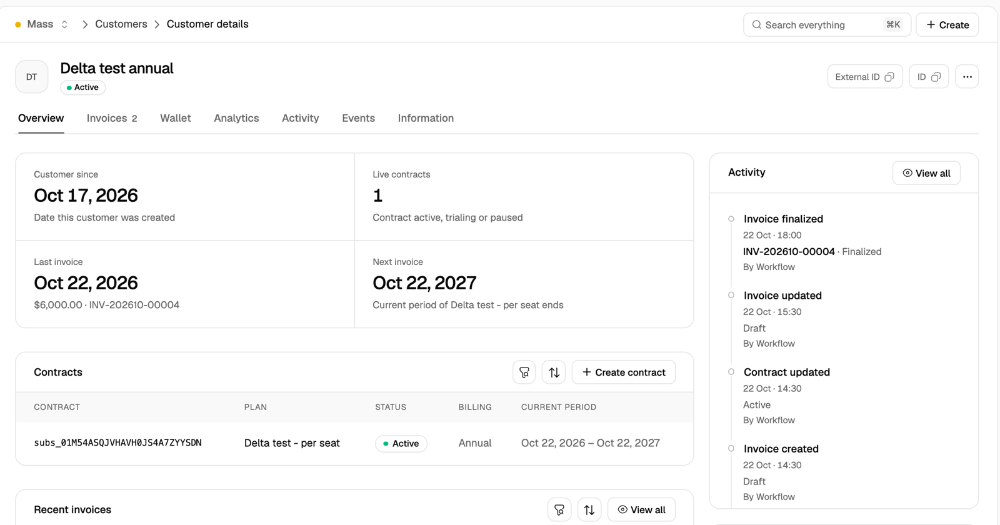
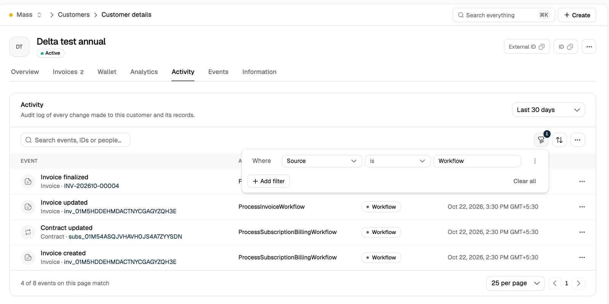
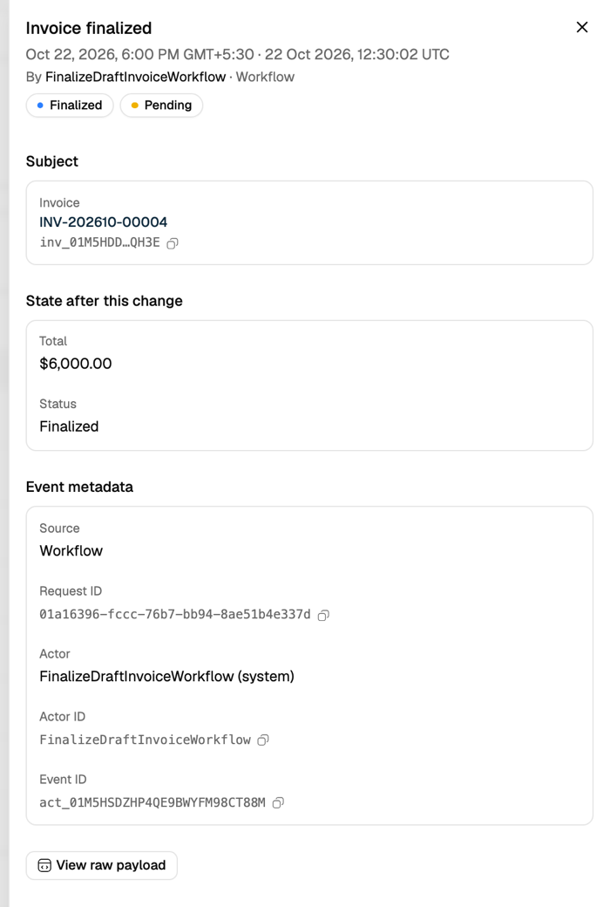

When an invoice is voided or a contract's plan changes, the first question is usually who did it and how. The activity log answers that for each customer. Every change to the customer and its billing records is recorded as an event with the action, the person, API key or system process behind it, the channel it came through and the record's state right after the change.

<Frame></Frame>

## How It Works

- **Recorded automatically:** Flexprice records an event whenever a tracked record is created or changed, from any channel. There is nothing to turn on.
- **One event per change:** each event names the action (for example, **Invoice finalized**), the record it applies to and the time of the change.
- **Who made the change:** the actor is a person signed in to the dashboard, an API key, the customer (through the customer portal) or the system, such as a scheduled billing run.
- **Where it came from:** the source is the channel the change came through: **Dashboard**, **API**, **Customer portal**, **Hosted invoice**, **Webhook**, **Workflow** or **Consumer**.
- **State after the change:** each event keeps the record as it stood right after the change, so you can see what an invoice total or a contract status was at that moment.
- **Newest first:** events are listed from the most recent change backwards.

Events appear a few seconds after the change is saved.

## What Is Recorded

A customer's activity covers the customer and the records that belong to it:

| Record | Actions |
| ------ | ------- |
| **Customer** | Created, updated, archived |
| **Contract** (subscription) | Created, updated, activated, plan changed, cancelled, archived |
| **Invoice** | Created, updated, finalized, paid, voided, refunded, deleted |
| **Credit memo** (credit note) | Created, updated, finalized, voided |
| **Wallet** | Created, updated, topped up, terminated |
| **Payment** | Created, updated, succeeded, failed, refunded, voided, archived |
| **Refund** | Created, updated, succeeded, failed |
| **Payment method** | Created |
| **Checkout session** | Created, updated, completed, failed, expired, archived |
| **Price** (contract-specific prices) | Created, updated, terminated |

Changes to plans, features and catalog prices are recorded too, but they belong to no customer, so they do not appear on a customer's activity. Read them with the [API](#from-the-api).

<Note>
Customer events leave out the customer's personal details: name, email, phone, contacts and address. `metadata` is left out of every record. A change to only those fields is still recorded as an event, but its state shows no difference.
</Note>

## Viewing Activity in the Dashboard

Open a customer under **Customers** and select the **Activity** tab. The table shows each event with its record, actor, source and time. Select a record name to open that invoice, contract or other record.

The **Activity** card on the customer's **Overview** tab shows the latest events. **View all** opens the **Activity** tab.

<Frame></Frame>

### Filtering

- **Date range:** the menu at the top right picks **Last 24 hours**, **Last 7 days**, **Last 30 days** (the default) or a **Custom range**. A custom range covers up to 30 days and can start up to one year back.
- **Filters:** the filter button adds rules on **Action** (for example, Invoice voided), **Actor** (People, API keys, Customers or System), **Person** (one team member) and **Source**.
- **Search:** the search box matches event titles, record names, actors and IDs, including request and event IDs.

<Frame></Frame>

Filters are saved in the page URL, so you can reload the page or share the link with a teammate and see the same events.

<Note>
Search and the **Source** filter narrow the events on the current page. The footer shows how many of them match. Date range, **Action**, **Actor** and **Person** apply to the customer's full history.
</Note>

### Event details

Select an event to open its details:

- **Subject:** the record the event applies to, with its ID.
- **State after this change:** the key values of the record right after the change, such as an invoice's total and status.
- **Event metadata:** the source, the request ID, the actor and their ID, the event ID, and the IP address and user agent for changes made over HTTP.
- **View raw payload:** the full event as JSON, including the complete record state.

<Frame></Frame>

<Tip>
Copy the **Request ID** when you contact support about a change. It identifies the exact API request that made it.
</Tip>

## From the API

List events with `POST /v1/activity`. Every filter is optional. This request lists the invoices voided for one customer in October:

```bash
curl -X POST https://us.api.flexprice.io/v1/activity \
  -H "x-api-key: <API_KEY>" \
  -H "Content-Type: application/json" \
  -d '{
    "customer_id": "cust_01M54AS62HS718D2Z5JB81HJDE",
    "actions": ["invoice.voided"],
    "start_time": "2026-10-01T00:00:00Z",
    "end_time": "2026-10-31T00:00:00Z",
    "limit": 50
  }'
```

```json
{
  "items": [
    {
      "id": "act_01M5HSDZHP4QE9BWYFM98CT88M",
      "occurred_at": "2026-10-22T12:30:02.393Z",
      "action": "invoice.voided",
      "entity": {
        "type": "invoice",
        "id": "inv_01M5HDDEHMDACTNYCGAGYZQH3E",
        "label": "INV-202610-00004"
      },
      "customer_id": "cust_01M54AS62HS718D2Z5JB81HJDE",
      "actor": {
        "type": "user",
        "id": "user_01M40KQNYGE6G0EFMVJ5GA56ER",
        "label": "Jane Doe"
      },
      "source": "dashboard",
      "request_id": "01a16396-fccc-76b7-bb94-8ae51b4e337d"
    }
  ],
  "pagination": {
    "limit": 50,
    "has_more": false
  }
}
```

### Filters

| Field | Description |
| ----- | ----------- |
| `customer_id` | Events for one customer and its records |
| `entity_type` and `entity_id` | Events for one record, for example `invoice` and its ID |
| `actions` | One or more actions, written as `<record>.<action>`, for example `subscription.plan_changed` |
| `actor_types` | One or more of `user`, `api_key`, `customer` and `system` |
| `actor_id` | Events made by one user, API key or system process |
| `request_id` | Every change made by one API request |
| `start_time` and `end_time` | The time window, in RFC 3339. Defaults to the last 30 days. A window covers up to 30 days and starts no more than one year back |
| `expand` | `["state"]` adds each record's state after the change to the list |
| `limit` | Events per page. Default 50, maximum 100, or 50 with `expand` |
| `cursor` | The `next_cursor` from the previous page |

Action names use the API's record names: `subscription` for contracts and `credit_note` for credit memos.

### Pagination

Results are newest first. When `pagination.has_more` is `true`, send the same request with `cursor` set to `pagination.next_cursor` to get the next page.

### One event

`GET /v1/activity/{id}` returns one event with the record's state after the change:

```bash
curl https://us.api.flexprice.io/v1/activity/act_01M5HSDZHP4QE9BWYFM98CT88M \
  -H "x-api-key: <API_KEY>"
```

Reading activity needs an API key with read access, such as one with the `all_reader` role. See [Roles](/docs/rbac/manage-roles).

## Related Articles

<CardGroup cols={2}>
  <Card icon="users" href="/docs/customers/overview" title="Customers">
    Create and manage the customers you bill.
  </Card>
  <Card icon="file-invoice" href="/docs/invoices/managing" title="Managing Invoices">
    View, update and void invoices.
  </Card>
  <Card icon="shield" href="/docs/rbac/overview" title="Role-Based Access Control">
    Control which people and API keys can read billing data.
  </Card>
  <Card icon="webhook" href="/docs/webhook/webhooks" title="Webhooks">
    Get notified of billing events as they happen.
  </Card>
</CardGroup>
