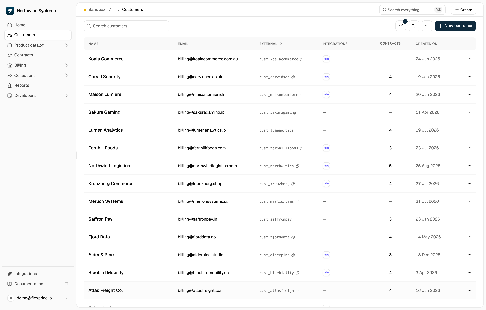
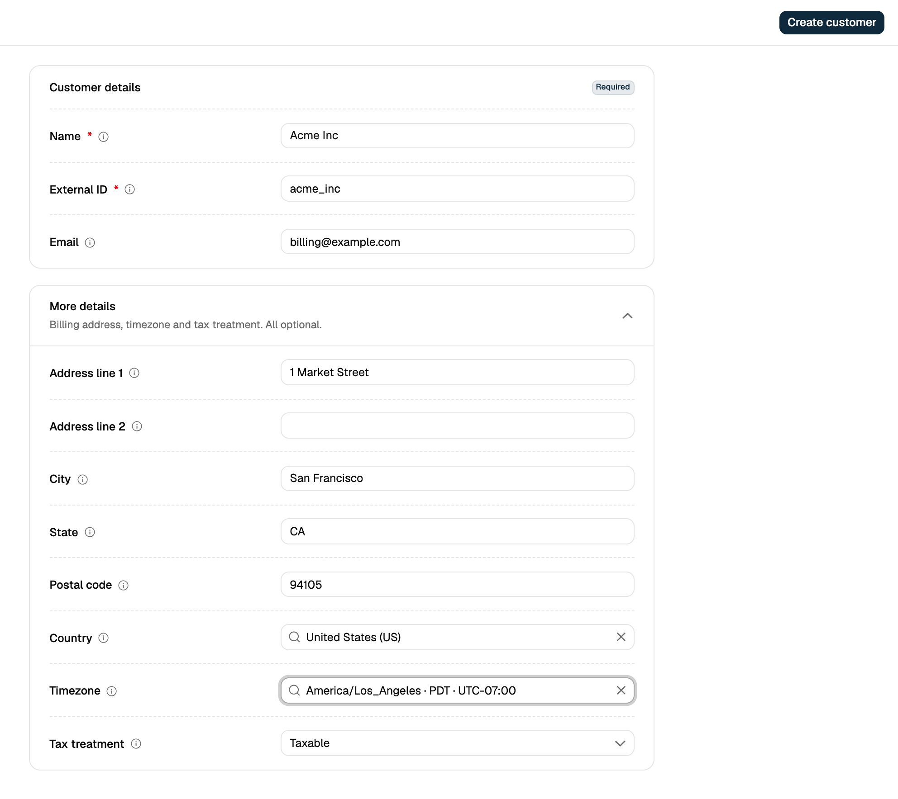
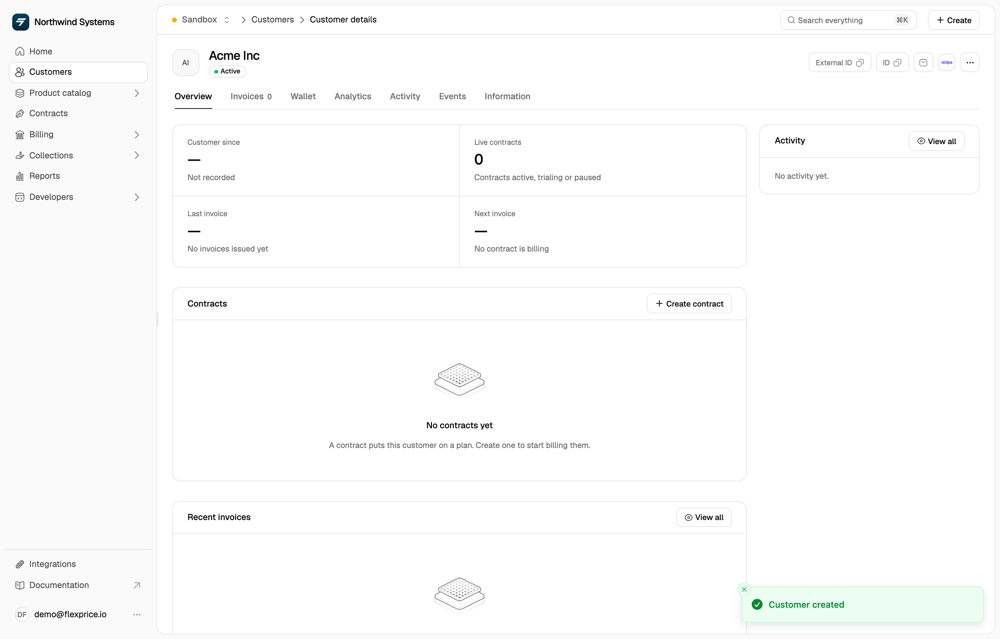

To create a new customer in Flexprice, follow these steps:

<Steps>
  <Step title="Open the Create customer form">
    Go to **Customers** in the left navigation and click **New customer**.

    <Frame>
      
    </Frame>
  </Step>

  <Step title="Enter the customer details">
    In the **Customer details** card, enter:

    - **Name**: the customer's display name on invoices and in the dashboard.
    - **External ID**: your own identifier for the customer. Usage events are matched to the customer by it.
    - **Email** (optional): the customer's default address and fallback for invoice and invoice payment reminder emails when no contact person is assigned to that type.
    * **Phone** (optional): choose a country code and enter the number. Flexprice saves it in E.164-style international format with a leading `+` and 8 to 15 digits (for example, `+919876543210`). Spaces, hyphens, and parentheses are removed.

    <Frame>
      
    </Frame>
  </Step>

  <Step title="Add billing details (optional)">
    Expand **More details** to add the billing address (address lines, city, state, postal code, and country), the customer's **Timezone** (see [Customer Timezones](/docs/customers/timezone-aware-billing)), and their **Tax treatment**. All of these are optional.

    <Frame>
      
    </Frame>
  </Step>

  <Step title="Choose an onboarding workflow (optional)">
    If named workflows are available, the **Onboarding workflow** selector appears. Choose **Default workflow** to use the default, or select a named workflow to run it instead. See [Customer onboarding settings](/docs/settings/settings#customer-onboarding).
  </Step>

  <Step title="Create the customer">
    Click **Create customer**. The customer's page opens with an **Active** status.

    <Frame>
      
    </Frame>
  </Step>
</Steps>

You are not required to fill in all details initially; additional information can be added later as needed.

## Route billing emails to contacts

You can route invoice emails and invoice payment reminder emails to customer contacts through the API. The dashboard does not expose the `email_types` field. Send this body to `PUT /v1/customers?id={customer_id}`:

```json
{
  "contact_persons": [
    {
      "first_name": "Ana",
      "email": "ap@example.com",
      "email_types": ["invoice"]
    },
    {
      "first_name": "Raj",
      "email": "dues@example.com",
      "email_types": ["invoice_payment_reminder"]
    }
  ]
}
```

Use `invoice` for automatic invoice emails and API invoice emails sent without a `to` address. Use `invoice_payment_reminder` for invoice payment reminders approved for sending. Flexprice sends to each distinct email address on a contact assigned to that type, and falls back to the customer's `email` when no contact is assigned. On update, `contact_persons` replaces the existing list, so include every contact you want to keep.