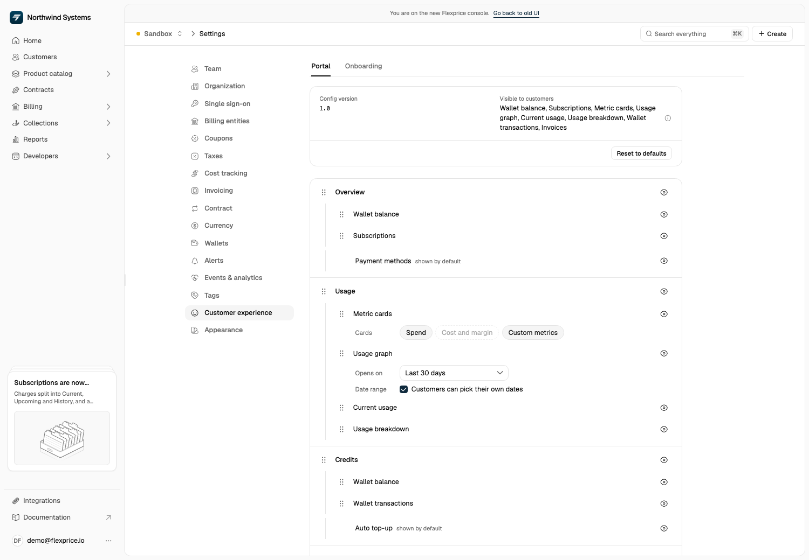

The Customer Portal is configured per tenant and environment. The configuration lists the portal's sections, the widgets inside each section, and three brand colours. It is stored under the `customer_portal_config` setting key, and the portal fetches it on load.

Anything you leave unset falls back to a default, so a tenant that has never touched the configuration still gets a complete portal.

## Dashboard settings

Open the account menu at the bottom of the left navigation, select **Settings**, then go to **Customer experience** → **Portal**. The panel edits the same `customer_portal_config` setting that the API writes:

| Setting | Controls |
| ------- | -------- |
| **Sections and tabs** | Every section and the tabs (widgets) inside it. Drag a row to reorder it, and use the eye icon to show or hide it. Hiding a section hides all its tabs |
| **Cards** | For a metric cards tab, which cards are on: **Spend**, **Cost and margin**, and **Custom metrics** |
| **Opens on** and **Date range** | For a usage graph tab, the date preset it opens on, and whether customers can pick their own dates |
| **Usage properties** | Whether customers can group and filter usage by allowed event properties. See [Usage by Properties](/docs/customers/customer-portal/usage-properties). |
| **Theme** | The primary colour used by the hosted portal |
| **Reset to defaults** | Deletes the stored configuration, so the server's standard layout applies again |

The top of the panel lists what is **Visible to customers**. Click **Save changes** to apply. Changes apply to every portal session opened in that environment from the next page load.

<Frame>
  
</Frame>

Cost and margin show what it costs your business to serve the customer and the margin on that usage. They are off by default. Enable them only when you intend to share those figures with customers.

<Warning>
**Saving the configuration requires Super Admin**

The portal configuration is stored through the settings API, whose writes are restricted to Super Admin regardless of the `portal:write` permission. A user without it sees the panel but cannot save. Through the API, use a Super Admin user's API key. A service account key is refused.
</Warning>

## Configuration schema

For anything the panel doesn't cover, write the configuration through the settings API with `PUT /v1/settings/customer_portal_config`, sending the configuration as `value`. `GET /v1/settings/customer_portal_config` returns the current configuration, with defaults for anything you haven't stored.

```json
{
  "version": "1.0",
  "theme": {
    "primary_color": "#15547c",
    "secondary_color": "#0e3a56",
    "tertiary_color": "#e8f1f7"
  },
  "sections": [
    {
      "id": "overview",
      "label": "Overview",
      "enabled": true,
      "order": 1,
      "tabs": [
        { "id": "9", "type": "wallet_balance", "enabled": true, "order": 1 },
        { "id": "10", "type": "subscriptions", "enabled": true, "order": 2 }
      ]
    }
  ]
}
```

The example shows one section. A write replaces each top-level key it contains (`theme`, `sections`, `analytics_config`) and keeps the keys it leaves out. Nothing below the top level is merged:

- **Send every section.** `sections` replaces the stored array, and once you have stored one, the default sections stop applying. Keep the full list when making an edit. To hide a section in the hosted portal, leave it in the list and set `enabled` to `false`.
- **Send all three colours.** `theme` replaces the stored theme, so a colour you leave out is cleared.
- **Fields outside the schema are dropped.** The server keeps only the fields on this page and discards anything else without an error, such as a `logo_url` in the theme or a `label` on a tab.

Start from the value `GET` returns, change it, and send the whole key back. **Reset to defaults** in the dashboard, or `DELETE /v1/settings/customer_portal_config`, deletes the stored setting, including `analytics_config`.

### Section fields

| Field | Type | Description |
| ----- | ---- | ----------- |
| `id` | string | Section identifier. The portal knows `overview`, `usage`, `credits` and `invoices`, and ignores any other id |
| `label` | string | Name shown in the dashboard and hosted portal |
| `enabled` | boolean | Whether the portal shows the section's tab |
| `order` | number | Position in the dashboard and hosted portal |
| `tabs` | array | The section's widgets, sorted by their `order` |

### Widget fields

| Field | Type | Description |
| ----- | ---- | ----------- |
| `id` | string | Unique instance key within the section |
| `type` | string | Which widget it is. See the widget types below |
| `enabled` | boolean | Whether the widget is on |
| `order` | number | Position within the section |
| `usage_graph` | object | Only read when `type` is `usage_graph` |
| `metric_cards` | object | Only read when `type` is `metric_cards` |

## Widget types

| Type | Widget |
| ---- | ------- |
| `account_summary` | Compact strip of balance, amount due and next billing date |
| `subscriptions` | Active subscriptions with plan, status, period and next billing |
| `invoices` | Invoice table with search, detail drawer, download and Pay now |
| `wallet_balance` | Wallet balance in credits and currency, with top-up actions |
| `wallet_transactions` | Full credit and debit history |
| `wallet_topup` | Standalone top-up card |
| `auto_topup` | Auto top-up summary and settings |
| `payment_methods` | Saved cards, with add, remove and set default |
| `usage_graph` | Usage trend chart with a date range selector |
| `usage_breakdown` | Per-feature table of usage, events and cost |
| `current_usage` | Consumption in the in-progress billing period |
| `metric_cards` | Revenue, custom analytics and optional cost metrics |

### Usage graph configuration

```json
{
  "id": "2",
  "type": "usage_graph",
  "enabled": true,
  "order": 2,
  "usage_graph": {
    "date_presets": ["today", "last_7_days", "last_30_days", "current_month", "last_month"],
    "default_preset": "last_7_days",
    "allow_custom_date_range": true,
    "feature_filter_mode": "all"
  }
}
```

| Field | Description |
| ----- | ----------- |
| `date_presets` | Which range presets the customer can pick from |
| `default_preset` | The range selected when the section opens |
| `allow_custom_date_range` | Whether a custom start and end date picker is offered |
| `feature_filter_mode` | Which features the graph covers, for example `all`. The schema has no field for a list of features |

Valid presets are `today`, `last_7_days`, `last_30_days`, `current_month` and `last_month`.

### Metric cards configuration

```json
{
  "id": "1",
  "type": "metric_cards",
  "enabled": true,
  "order": 1,
  "metric_cards": {
    "show_custom_metrics": true,
    "show_revenue_metric": true,
    "show_cost_metrics": false
  }
}
```

| Field | Default | Shows |
| ----- | ------- | ----- |
| `show_custom_metrics` | `true` | Cards defined in your revenue analytics custom metrics |
| `show_revenue_metric` | `true` | The customer's total spend |
| `show_cost_metrics` | `false` | Cost, Margin and Margin % |

<Warning>
**Cost metrics are your numbers, not the customer's**

`show_cost_metrics` exposes your cost to serve this customer and your margin on them. It is off by default. Turn it on only for a portal your own team uses.
</Warning>

## What the portal applies

The hosted portal applies the label, order, and visibility of Overview, Usage, Credits, and Invoices. Sections absent from the configuration retain their default visibility. If every supported section is hidden, the portal keeps Overview available.

The portal also honors visibility for supported widgets, metric card switches, and the usage graph's date settings. Custom metric cards appear when the API returns custom metrics for the selected period. The hosted portal has a fixed layout within each view; changing widget order does not rearrange that layout. The primary colour applies to the hosted portal. Secondary and tertiary colours are stored for custom front ends.

## Theming

The theme holds three colours, each a hex code such as `#15547c`, or empty:

| Field | Applies to |
| ----- | ---------- |
| `primary_color` | Buttons, the active tab and focus rings |
| `secondary_color` | Nothing in the hosted portal. Stored for your own front end |
| `tertiary_color` | Nothing in the hosted portal. Stored for your own front end |

With no primary colour, or a value that isn't a valid colour, the portal uses its own. The portal follows the customer's light or dark system setting, and has no logo or font setting.

<Tip>
Text on the primary colour is white, so pick a colour dark enough to read white text on.
</Tip>

## Reading the configuration from the portal

A portal session reads its own resolved configuration, already merged with the defaults:

```
GET /v1/customer/portal/config
X-Session-Token: <session_token>
```

Use this if you build your own portal front end against the Flexprice APIs and want to honour the same tenant configuration.

## Related resources

<CardGroup cols={2}>
  <Card title="Customer Portal" icon="browser" href="/docs/customers/customer-portal">
    Sessions, sections and the security model
  </Card>
  <Card title="Portal payments" icon="credit-card" href="/docs/customers/customer-portal/payments">
    Invoice payment, top-ups, auto top-up and saved cards
  </Card>
  <Card title="Settings" icon="gear" href="/docs/settings/settings">
    All tenant and environment setting keys
  </Card>
  <Card title="Exportable UI" icon="table-columns" href="/docs/exportable-ui/overview">
    Embed the same widgets directly in your own product
  </Card>
</CardGroup>
