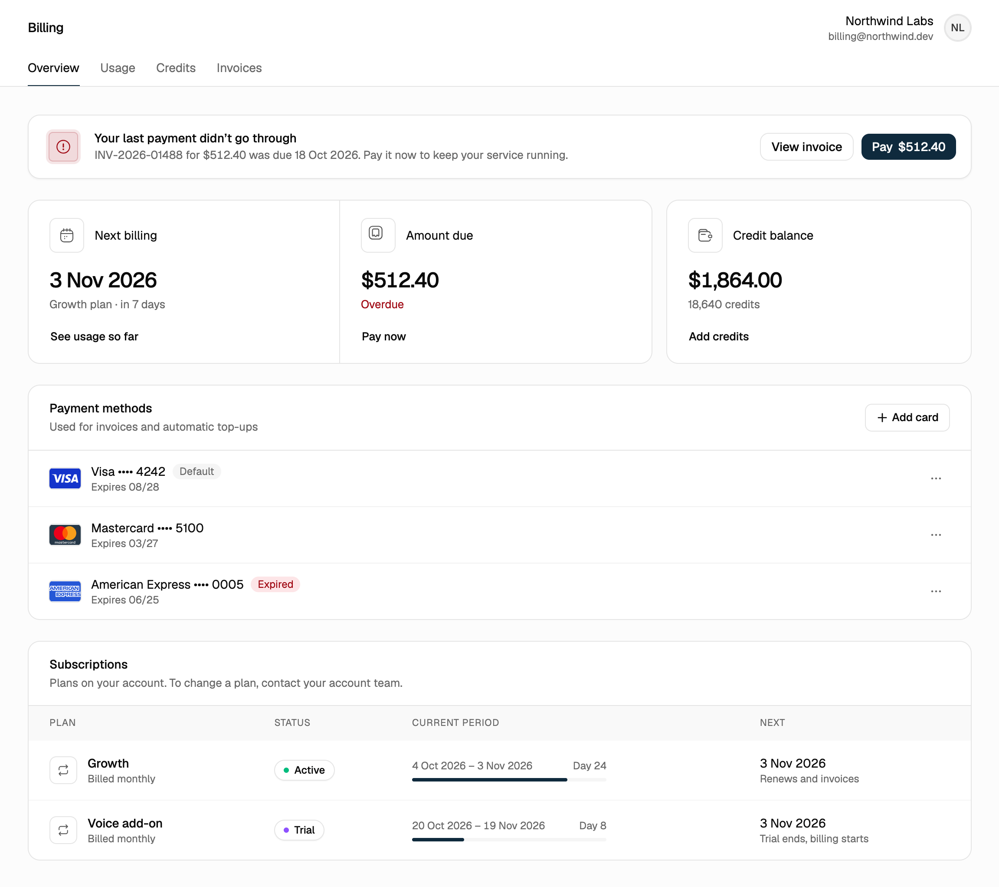
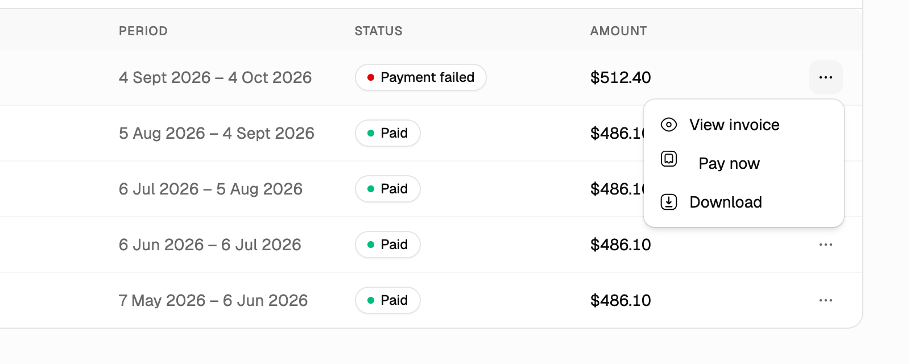
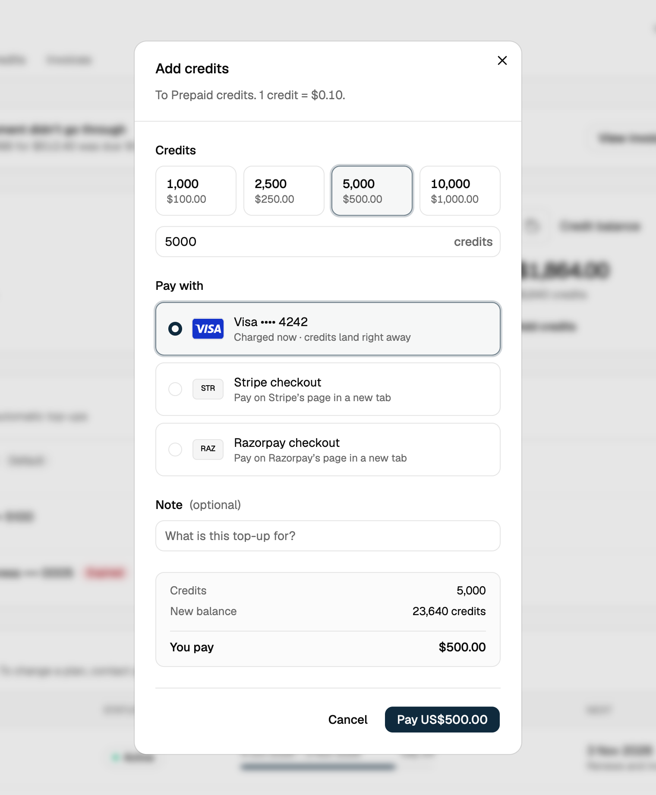
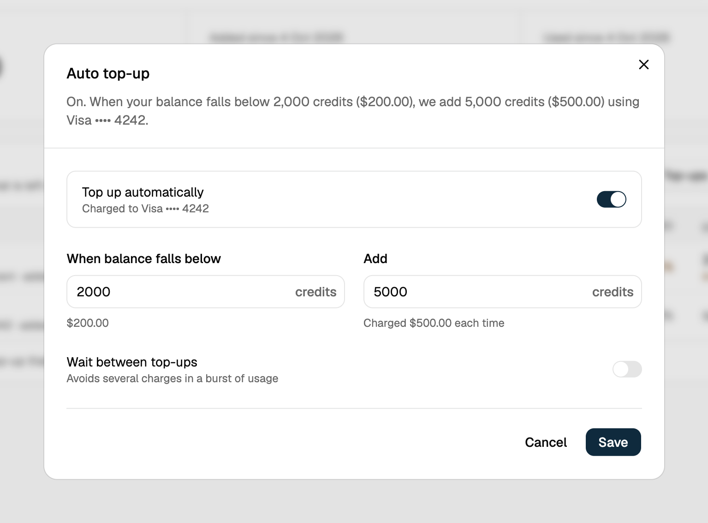
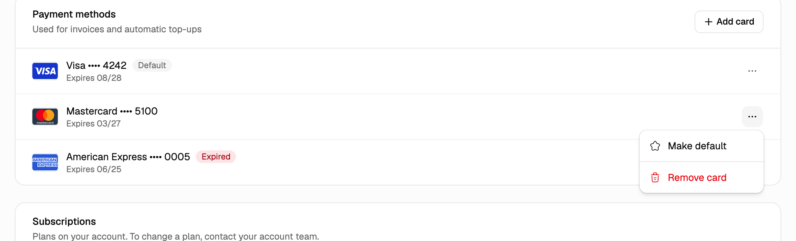

The Customer Portal turns billing from a support conversation into a self-service action. A customer with an outstanding invoice pays it from the invoice row. A customer running low on credits tops up, or turns on auto top-up so it never happens again. Cards are collected on the payment provider's own hosted page, so no card data reaches Flexprice or your servers.

The portal asks the API to start a payment and opens the provider page when the response includes a hosted payment action. Flexprice updates payment records and wallet credits after the provider confirms payment.

<Note>
The API examples on this page return to your own front end at `portal.yourapp.com`. Their `checkout_return` query parameter is an application-defined example, not a Flexprice requirement. The hosted Flexprice portal resumes the customer session after checkout. See [Returning from a hosted checkout](#returning-from-a-hosted-checkout) for the customer-facing return behavior. If you build your own portal, handle the return in your application.
</Note>

<Frame></Frame>

## Prerequisites

Portal payment actions require a payment provider connection published in the environment the session token was issued in. Without one, the portal renders its read-only surface and hides the payment actions.

<Steps>
  <Step title="Connect a payment provider">
    Set up a [Chargebee](/integrations/chargebee/connection-setup), [Razorpay](/integrations/razorpay/connection-setup) or [Stripe](/integrations/stripe/connection-setup) connection and publish it.
  </Step>

  <Step title="Check the capability you need is supported">
    Not every provider supports every action. See the capability matrix below.
  </Step>

  <Step title="Enable the portal sections">
    In **Settings**, turn on the sections that carry the actions. See [Portal configuration](/docs/customers/customer-portal/configuration).
  </Step>
</Steps>

## Provider capabilities

Flexprice names each payment operation as a capability and resolves the provider per capability from the connections published in the environment. A capability is what Flexprice implements for that gateway, not everything the gateway's own API can do.

| Capability | Chargebee | Razorpay | Stripe | Nomod |
| ---------- | :-------: | :------: | :----: | :---: |
| `checkout` (hosted payment page) | Yes | Yes | Yes | No |
| `payment_link` (invoice payment link) | Yes | Yes | Yes | Yes |
| `auto_charge` (charge a saved card off-session) | Yes | Yes | Yes | No |
| `payment_method_management` (list, add, remove cards) | Yes | No | Yes | No |
| `set_default_method` (promote a card to default) | Yes | No | Yes | No |
| `invoice_sync` (push invoices to the provider) | Yes | No | No | No |

Read the capabilities available to a session from `GET /v1/customer/portal/integrations`:

```json
{
  "payment_integrations": [
    {
      "provider": "chargebee",
      "capabilities": [
        { "type": "checkout", "is_default": true },
        { "type": "payment_link", "is_default": true },
        { "type": "auto_charge", "is_default": true },
        { "type": "payment_method_management", "is_default": true },
        { "type": "set_default_method", "is_default": true }
      ]
    }
  ]
}
```

`is_default` marks the provider Flexprice picks for that capability when the caller names none.

<Note>
When exactly one provider serves a capability, the portal never shows its name to the customer. A provider picker appears only when two or more connected providers can serve the same action.
</Note>

<Warning>
**A requested provider must be both connected and capable**

Passing `payment_provider` for a gateway that is not connected in the environment returns a validation error. Passing one that is connected but does not implement the capability returns a validation error naming the candidates that do. Omit the field to let Flexprice resolve it.
</Warning>

## Paying an invoice

An invoice row in the Invoices section carries a **Pay now** action when the invoice is awaiting payment. The customer clicks it and continues to hosted checkout in the same tab. When the portal is embedded in an iframe, checkout opens in a new tab instead. The invoice is marked paid by the provider's webhook when the payment settles.

**Endpoint:** `POST /v1/customer/portal/invoices/{id}/pay`

```json
{
  "payment_provider": "chargebee",
  "idempotency_key": "portal-pay-inv_01H...-1736180000",
  "success_url": "https://portal.yourapp.com?checkout_return=1",
  "cancel_url": "https://portal.yourapp.com?checkout_return=1",
  "failure_url": "https://portal.yourapp.com?checkout_return=1"
}
```

| Field | Required | Description |
| ----- | -------- | ----------- |
| `payment_provider` | No | Gateway to use. Omit to let Flexprice resolve the capable provider |
| `idempotency_key` | No | Prevents a retry from raising a second payment |
| `success_url` | No | Where the provider returns the customer after a successful payment |
| `cancel_url` | No | Where the provider returns the customer after they abandon the page |
| `failure_url` | No | Where the provider returns the customer after a declined payment |

**Response:**

```json
{
  "payment_id": "pay_01H...",
  "invoice_id": "inv_01H...",
  "status": "pending",
  "amount": "149.00",
  "currency": "USD",
  "payment_action": {
    "type": "payment_link",
    "url": "https://provider.example.com/pay/xyz"
  }
}
```

Read `payment_action` rather than reaching for a URL field of your own. Whether a provider hands back a hosted checkout page or a payment link is a property of the provider, and the `type` says which.

<Info>
**The amount comes from the invoice**

There is no amount field in the request. A customer cannot part-pay an invoice from the portal.
</Info>

### When Pay now is not available

The API rejects a payment and the portal disables the action when:

- The invoice is still a draft, or is voided
- The invoice payment status is already `succeeded`, or a payment is already in flight
- The invoice belongs to a subscription that is not in a state that allows collection. The portal shows a message asking the customer to contact support

<Frame></Frame>

## Topping up a wallet

**Add credits** on the **Credit balance** card, or on the **Credits** tab, opens a top-up dialog. The customer picks a preset or enters a credit amount, chooses how to pay under **Pay with**, and sees the exact charge on the confirm button (for example **Pay US$500.00**) before continuing.

**Endpoint:** `POST /v1/customer/portal/wallets/{id}/top-up`

```json
{
  "credits_to_add": "100",
  "idempotency_key": "portal-topup-wal_01H...-1736180000",
  "description": "Monthly credit refill",
  "checkout": {
    "use_saved_method": false,
    "success_url": "https://portal.yourapp.com?checkout_return=1",
    "cancel_url": "https://portal.yourapp.com?checkout_return=1"
  }
}
```

| Field | Required | Description |
| ----- | -------- | ----------- |
| `credits_to_add` | Yes | Credits to add. Converted to a charge using the wallet's top-up conversion rate |
| `idempotency_key` | Yes | Without it a retry grants credits twice |
| `description` | No | Free-text note stored on the transaction |
| `checkout` | No | Present to charge now. Omit to raise an invoice the customer settles later |
| `checkout.payment_provider` | No | Gateway to use. Omit to let Flexprice resolve it |
| `checkout.use_saved_method` | No | Charge the saved card directly instead of opening a hosted page |
| `checkout.success_url` / `cancel_url` / `failure_url` | No | Where the provider returns the customer |

<Warning>
**`idempotency_key` is required on portal top-ups**

The server's fallback key is timestamp-derived, so a retried request without an explicit key reads as a fresh top-up and grants the credits a second time.
</Warning>

### Charge now or invoice later

The `checkout` object decides which of the two flows runs.

| `checkout` | Behaviour |
| ---------- | --------- |
| **Present** | Pay-first. The response carries a `checkout_session`. Flexprice applies credits after the provider confirms payment |
| **Omitted** | Invoiced. An invoice is raised for the top-up and the customer settles it later, through the Invoices section or any other channel you offer |

The portal always sends `checkout`. The invoiced path is available to your own integrations calling the portal API directly.

<Info>
**Credits land after the payment, not on the click**

After a gateway return with no reported failure or cancellation and no tracked checkout session, or after a saved-card top-up that starts a charge, the portal checks for pending wallet activity or an unpaid selected invoice. If either remains, it refreshes the payment data every two seconds for up to 60 seconds. It stops early when there are no pending wallet transactions and any selected invoice is paid or void.
</Info>

### Paying with a saved card

When `use_saved_method` is `true`, the charge runs against the card on file with the customer present, and no redirect is involved. The response comes back with `checkout_status: "completed"` and no `payment_action`.

Read `checkout_status`, not the presence of a URL:

| `checkout_status` | Meaning |
| ----------------- | ------- |
| `completed` | Flexprice confirmed and applied the payment |
| `failed` | The gateway declined. `failure_reason` carries its own message |
| `expired` | The session timed out before it was completed |
| `initiated` / `pending` | Still settling. Neither outcome can be claimed yet |

If no usable saved method exists, or the charge declines, the response falls back to a `payment_action` with a link. The portal shows the saved-card option only when the resolved provider supports `auto_charge` and a chargeable card is on file.

### Minimum top-up amount

Top-ups below the tenant's per-currency floor are rejected before the customer is redirected, with a message naming the minimum for that currency. Configure the floor under the `wallet_topup_config` setting key. See [Settings](/docs/settings/settings).

### A top-up already in flight

If the customer already has a pending top-up session on the wallet, the API hands back the session already in flight rather than a conflict. The customer can complete the payment they started instead of being blocked by an abandoned tab.

<Frame></Frame>

## Auto top-up

Auto top-up refills the wallet without the customer present. It reads as a plain-language summary in the Credits section: "Automatically add $100.00 when your balance falls below $20.00", with a **Manage** action, or "Auto top-up is off" with **Enable**.

**Endpoint:** `PUT /v1/customer/portal/wallets/{id}/auto-topup`

```json
{
  "enabled": true,
  "threshold": "20",
  "amount": "100",
  "cooldown": { "value": 6, "unit": "hour" }
}
```

| Field | Required | Description |
| ----- | -------- | ----------- |
| `enabled` | Yes | Turns automatic top-ups on or off |
| `threshold` | No | Balance at or below which a top-up runs |
| `amount` | No | Credits added each time |
| `cooldown` | No | Minimum wait between two automatic top-ups. `unit` is `second`, `minute`, `hour` or `day` |

<Note>
**Clearing a cooldown**

Send `{ "value": 0, "unit": "hour" }` to remove a stored cooldown. Sending `null` reads as an absent field on the server and leaves the existing cooldown in place.
</Note>

Enabling auto top-up is itself the customer's consent to be charged unattended, so there is no separate auto-charge flag in the portal request. Whether the resulting credits are invoiced is pinned server-side, because it selects the transaction reason and is your decision, not the customer's.

### Requirements

Auto top-up needs a saved card that can be charged off-session. The portal shows "Add a payment method to enable automatic top-ups" and keeps the toggle unavailable until one exists, which means:

- The resolved provider supports the `auto_charge` capability (Chargebee, Razorpay, or Stripe)
- The customer has at least one saved card with `can_auto_charge: true`

For the mandate rules behind unattended charging, see [Autopay mandates](/docs/checkout/autopay-mandates).

In the portal, the **Auto top-up** button on the **Credits** tab opens the dialog: **Top up automatically** turns it on, **When balance falls below** sets the threshold, **Add** sets the top-up amount, and **Wait between top-ups** sets the cooldown.

<Frame></Frame>

## Saved payment methods

The payment methods list sits on Overview, beside the balance it tops up and the subscriptions it pays for. It shows each saved card as brand and last four digits with its expiry, marks the default, and offers **Add card**, plus **Make default** and **Remove card** in each card's **⋯** menu.

**List:** `GET /v1/customer/portal/payment-methods`

```json
{
  "providers": [
    {
      "provider": "chargebee",
      "items": [
        {
          "id": "pm_01H...",
          "provider": "chargebee",
          "type": "card",
          "status": "ACTIVE",
          "card": { "brand": "visa", "last4": "4242", "exp_month": 4, "exp_year": 2028 },
          "is_default": true,
          "can_auto_charge": true
        }
      ]
    }
  ]
}
```

| Field | Meaning |
| ----- | ------- |
| `status` | `ACTIVE`, `INACTIVE` or `EXPIRED`. An expired card cannot be made default |
| `is_default` | Which card is used at this provider. Scoped per provider, so two providers means two defaults |
| `can_auto_charge` | Whether this card can be charged with nobody present. A capability, not a permission |
| `error` | Set on a provider entry that could not be read. Keeps "no saved cards" distinct from "we could not ask" |

### Adding a card

**Endpoint:** `POST /v1/customer/portal/payment-methods`

```json
{
  "payment_provider": "chargebee",
  "success_url": "https://portal.yourapp.com?checkout_return=1",
  "cancel_url": "https://portal.yourapp.com?checkout_return=1"
}
```

The response returns an action, not a payment method. Nothing is stored until the customer completes the provider's form.

```json
{
  "provider": "chargebee",
  "action": {
    "type": "redirect",
    "url": "https://provider.example.com/setup/xyz",
    "expires_at": "2026-01-06T18:00:00Z"
  }
}
```

The portal opens the URL in the same tab, or a new tab when embedded in an iframe. In the embedded case, the dialog also keeps the link on screen if a popup blocker prevents the new tab. Card details are entered on the provider's page and never touch Flexprice.

<Warning>
The setup URL is an API string. The portal refuses to open anything that is not `http` or `https`, so a `javascript:` URL cannot be executed. Apply the same check if you build your own portal against these endpoints.
</Warning>

### Setting a default and removing

**Make default:** `POST /v1/customer/portal/payment-methods/default` with `payment_provider` and `payment_method_id`.

**Remove card:** `POST /v1/customer/portal/payment-methods/delete` with the same two fields. The portal confirms first, warning that the card will no longer be available for payments or automatic top-ups.

Setting a default requires the `set_default_method` capability. On a provider without it, the portal explains that a default card is not supported rather than offering an action that would fail.

<Frame></Frame>

## Returning from a hosted checkout

The standalone portal sends the customer to hosted checkout in the same tab and restores their portal session on return. An embedded portal opens checkout in a new tab because providers do not allow their payment pages to be framed.

If your portal session resumes, the portal reloads your billing details. When the portal is tracking a checkout session, it checks the status every two seconds for up to ten minutes and refreshes billing details when the session finishes. If you paid an existing invoice and it still shows an amount due when you return, refresh the portal to check again. If your portal session has expired, ask the business for a new billing link.

Portal sessions expire after one hour by default. Use the `expires_at` value returned when the session is created to determine when a specific link expires.

Returning from checkout alone does not confirm payment. Flexprice applies wallet credits after the provider confirms payment. Confirmation can arrive through a webhook. For providers that support payment-status lookups, reading the checkout session can also confirm the payment and apply the credits. The hosted Flexprice portal can include the customer’s session token in the return URL it sends to the payment provider. Treat any URL containing the token as a credential and redact the token from logs, analytics, and error reports.

**Checking a session directly:** Use `GET /v1/customer/portal/checkout-sessions/{id}` to read the session. See [Checkout sessions](/docs/customers/customer-portal/api-reference#checkout-sessions) for the response fields and polling guidance. `POST /v1/customer/portal/checkout-sessions/{id}/cancel` abandons a session.

## Chargebee as a portal provider

Chargebee and Stripe both support saved-card management and default-card selection. Chargebee invoice sync pushes Flexprice invoices to Chargebee for collection and reconciles payments back through the Chargebee webhook, so an invoice paid on either side settles on both.

<Card icon="plug" horizontal={true} href="/integrations/chargebee/invoice-sync" title="Chargebee invoice sync" />

## Troubleshooting

| Symptom | Cause | Resolution |
| ------- | ----- | ---------- |
| Payment actions do not appear | No payment provider connection published in the environment | Publish a connection, then reload the portal |
| Add card is missing | No connected provider supports adding cards | Connect a provider that supports adding cards, such as Chargebee or Stripe |
| Auto top-up cannot be enabled | No saved card with `can_auto_charge: true` | Add a card at a provider supporting `auto_charge` |
| The checkout page did not open | A popup blocker stopped the new tab | Use the link shown in the dialog. The portal keeps it on screen for this reason |
| The balance is unchanged after paying | Flexprice may still be confirming the payment | Wait a moment and refresh the portal. If the balance stays unchanged, check the checkout status and provider webhook delivery |
| "Top-up amount is below the minimum" | The charge is under the tenant's per-currency floor | Raise the credit amount, or lower the floor in `wallet_topup_config` |
| "requested payment provider is not connected" | `payment_provider` names a gateway with no published connection | Omit the field, or name a connected gateway |

## Related resources

<CardGroup cols={2}>
  <Card title="Customer Portal" icon="browser" href="/docs/customers/customer-portal">
    Sessions, sections and the security model
  </Card>
  <Card title="Portal configuration" icon="sliders" href="/docs/customers/customer-portal/configuration">
    Control which sections and actions appear
  </Card>
  <Card title="Portal API reference" icon="code" href="/docs/customers/customer-portal/api-reference">
    Every endpoint under /v1/customer/portal
  </Card>
  <Card title="Autopay mandates" icon="signature" href="/docs/checkout/autopay-mandates">
    Mandates behind unattended charging
  </Card>
</CardGroup>
