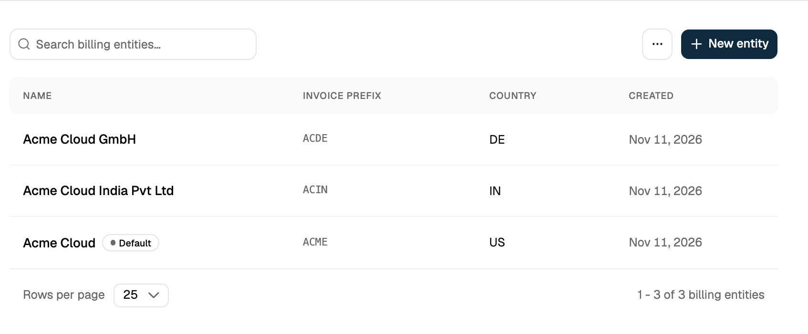
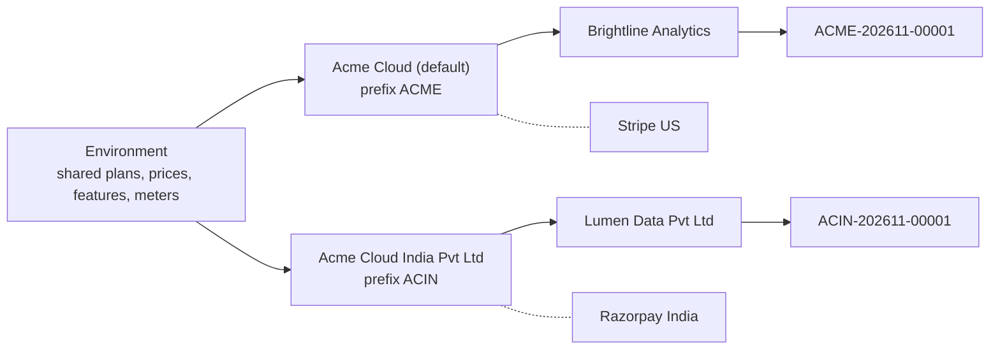
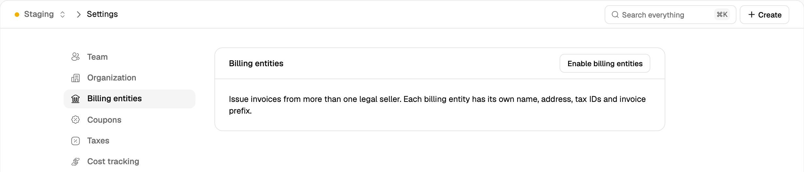
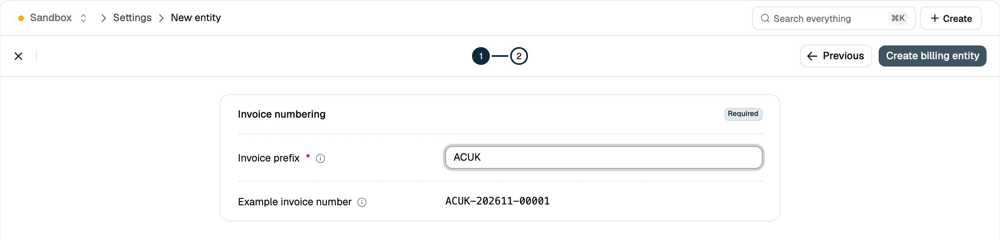
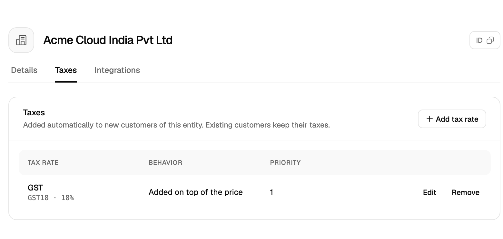
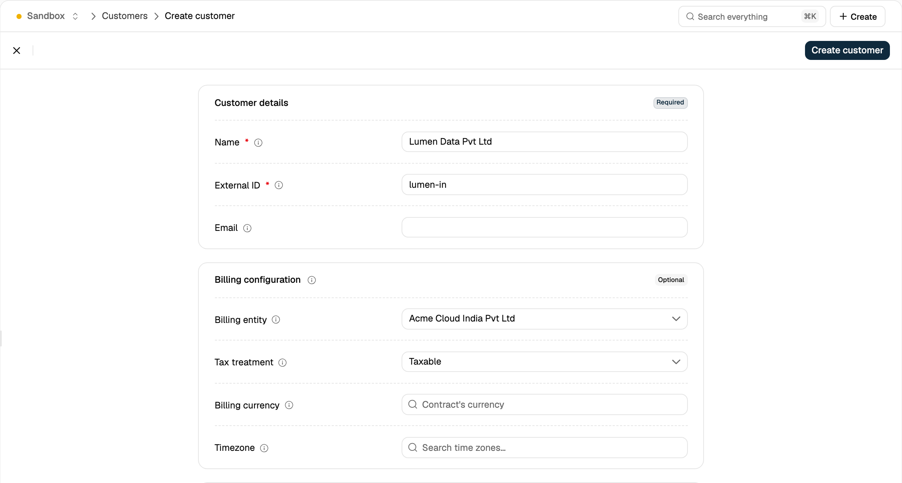
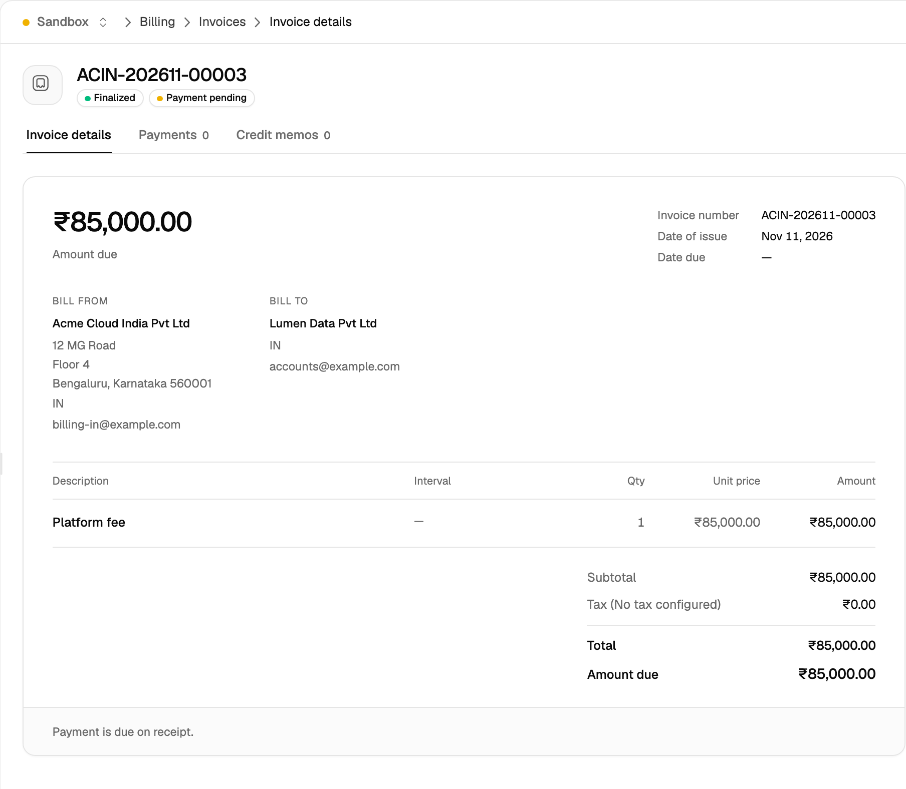

A billing entity is the legal company that issues an invoice. Billing entities let one Flexprice environment invoice from several companies, for example a US parent and an Indian subsidiary, each with its own seller details, invoice number series, default tax rates and payment connections. Every customer is assigned to exactly one billing entity, and all of that customer's invoices are issued by it.

<Frame></Frame>

## How It Works



- **Shared catalog:** plans, prices, features and meters are environment-wide and shared by every entity. Only the seller on the invoice differs.
- **Customer assignment:** a customer's `billing_entity_id` is set when the customer is created and can't be changed afterwards.
- **Seller details:** the invoice, its PDF and the hosted invoice page show the entity's `name` and `billing_details` as the seller.
- **Invoice numbering:** each entity has its own `invoice_number_prefix`, and each prefix keeps its own sequence, for example `ACME-202611-00003` and `ACIN-202611-00001` in the same month.
- **Default tax rates:** tax rates associated with an entity are applied to every new customer of that entity.
- **Connections:** each entity owns its own payment and accounting connections. Payments and syncs for a customer use only the connections of the customer's entity. See [Integrations for Billing Entities](/integrations/billing-entities).
- **Environment scope:** billing entities are enabled per environment, so you can try them in a sandbox before production.

## Turning On Billing Entities

Billing entities are off in every new environment. Turning them on is an irreversible operation.

Enabling provisions a **default billing entity** for the environment, seeded from your existing configuration. Any customer created without an explicit `billing_entity_id` is assigned to it.

| Default entity field | Source |
| --- | --- |
| `name` | Account (tenant) name |
| `invoice_number_prefix` | The environment's current invoice prefix (`invoice_config.prefix`) |
| `billing_details` | Account billing email, help email, phone and address |
| `tax_associations` | Account-level tax associations (`entity_type: tenant`), copied with `entity_type: billing_entity` |

Flexprice then runs a background backfill that assigns every existing customer, invoice and connection to the default entity. The environment reports `enabling` until the backfill completes, then `enabled`. Issued invoices keep their numbers, amounts and PDFs, and billing continues uninterrupted while the backfill runs.

### In the dashboard

Only users with the **Super Admin** role can turn on billing entities.

1. Go to **Settings** → **Billing entities**.
2. Click **Enable billing entities** and confirm.

<Frame></Frame>

Once the backfill completes, the section shows the list of billing entities, including the default entity.

### From the API

Call `POST /v1/billing-entities/enable` with an API key that has Super Admin access. The request returns `202` and the backfill runs in the background:

```bash
curl -X POST https://us.api.flexprice.io/v1/billing-entities/enable \
  -H "x-api-key: <API_KEY>"
```

```json
{
  "mode": "enabling"
}
```

Poll `GET /v1/billing-entities/status` until `mode` is `enabled`:

```bash
curl https://us.api.flexprice.io/v1/billing-entities/status \
  -H "x-api-key: <API_KEY>"
```

```json
{
  "mode": "enabled"
}
```

| `mode` | Meaning |
| --- | --- |
| `off` | Billing entities are not enabled. Entity fields and filters are rejected. |
| `enabling` | The default entity exists and the backfill is running. New customers and invoices are assigned to the default entity, but entity fields and filters are still rejected. |
| `enabled` | All billing entity endpoints, fields and filters are available. |

The enable endpoint is idempotent. Calling it while the mode is `enabling` resumes the same backfill, and calling it once the mode is `enabled` returns `200` without changing anything.

### What changes once billing entities are on

- **Invoice prefix:** the prefix is set per entity. `invoice_config.prefix` becomes read-only, and the prefix in **Settings** → **Invoicing** can't be edited. The other numbering settings (format, separator, number of digits, timezone) still apply to every entity.
- **Default tax rates:** account-level tax associations can't be created or changed. Associate tax rates with a billing entity instead.
- **External tax engines:** Stripe Tax and other external tax engines can't be enabled.
- **Cloning:** the environment can't be cloned, and can't be the target of a clone.

## Creating a Billing Entity

| Field | Required | Notes |
| --- | --- | --- |
| `name` | Yes | Up to 255 characters. Shown as the seller on invoices. |
| `invoice_number_prefix` | Yes | Up to 20 characters. Must be unique among the entities in the environment. |
| `billing_details` | No | `email`, `help_email`, `phone` and `address`, printed on invoices as the seller. |
| `metadata` | No | Key-value pairs for your own use. |

### In the dashboard

1. Go to **Settings** → **Billing entities** and click **New entity**.
2. On the **Entity** step, enter the **Name** and the **Billing details** printed on invoices. Click **Next**.
3. On the **Invoicing** step, enter the **Invoice prefix**. **Example invoice number** previews the numbers this entity will issue.
4. Click **Create billing entity**.

<Frame></Frame>

To edit an entity, open it from the list and update the fields on the **Details** tab.

### From the API

```bash
curl -X POST https://us.api.flexprice.io/v1/billing-entities \
  -H "x-api-key: <API_KEY>" \
  -H "Content-Type: application/json" \
  -d '{
    "name": "Acme Cloud India Pvt Ltd",
    "invoice_number_prefix": "ACIN",
    "billing_details": {
      "email": "billing-in@example.com",
      "help_email": "support-in@example.com",
      "phone": "+91 80 4000 1234",
      "address": {
        "address_line1": "12 MG Road",
        "address_line2": "Floor 4",
        "address_city": "Bengaluru",
        "address_state": "Karnataka",
        "address_postal_code": "560001",
        "address_country": "IN"
      }
    }
  }'
```

```json
{
  "id": "be_01M75QYPFKPRQKKAW2SV8BQRB9",
  "name": "Acme Cloud India Pvt Ltd",
  "is_default": false,
  "invoice_number_prefix": "ACIN",
  "billing_details": {
    "email": "billing-in@example.com",
    "help_email": "support-in@example.com",
    "phone": "+91 80 4000 1234",
    "address": {
      "address_line1": "12 MG Road",
      "address_line2": "Floor 4",
      "address_city": "Bengaluru",
      "address_state": "Karnataka",
      "address_postal_code": "560001",
      "address_country": "IN"
    }
  },
  "environment_id": "env_01M75QPTNVY9ZYM4TAYJ4ESHRD",
  "status": "published",
  "created_at": "2026-11-11T16:44:43.379474Z",
  "updated_at": "2026-11-11T16:44:43.379474Z"
}
```

A prefix already used by another entity returns `409`:

```json
{
  "code": "already_exists",
  "message": "Invoice prefix ACIN is already used by another billing entity",
  "http_status_code": 409
}
```

| Endpoint | Description |
| --- | --- |
| `GET /v1/billing-entities` | Lists billing entities. Filter with `is_default` or `billing_entity_ids`. |
| `GET /v1/billing-entities/{id}` | Retrieves a billing entity. |
| `PUT /v1/billing-entities/{id}` | Partial update: only the fields you send change. `billing_details`, when sent, replaces the whole object. |

While the mode is not `enabled`, these endpoints return `400` with "Billing entities are not enabled in this environment".

Updates to an entity apply to drafts and to invoices finalized afterwards. Finalized invoices keep the seller details saved at finalization (see [Invoices](#invoices)).

## Default Tax Rates

Tax associations with `entity_type: billing_entity` and `auto_apply: true` are copied to each new customer of that entity when the customer is created. Existing customers keep their current tax associations.

In the dashboard, open the entity and add rates on the **Taxes** tab.

<Frame></Frame>

From the API, create the association with `POST /v1/taxes/associations`:

```bash
curl -X POST https://us.api.flexprice.io/v1/taxes/associations \
  -H "x-api-key: <API_KEY>" \
  -H "Content-Type: application/json" \
  -d '{
    "tax_rate_code": "GST18",
    "entity_type": "billing_entity",
    "entity_id": "be_01M75QYPFKPRQKKAW2SV8BQRB9",
    "priority": 1,
    "auto_apply": true
  }'
```

## Assigning Customers

Set `billing_entity_id` when you create the customer. If it's omitted, the customer is assigned to the default entity. The field can't be changed after creation.

In the dashboard, select the entity in the **Billing entity** field of the new customer form. The default entity is preselected.

<Frame></Frame>

```bash
curl -X POST https://us.api.flexprice.io/v1/customers \
  -H "x-api-key: <API_KEY>" \
  -H "Content-Type: application/json" \
  -d '{
    "external_id": "lumen",
    "name": "Lumen Data Pvt Ltd",
    "email": "accounts@example.com",
    "billing_entity_id": "be_01M75QYPFKPRQKKAW2SV8BQRB9"
  }'
```

Sending `billing_entity_id` on a customer update returns `400`:

```json
{
  "message": "A customer's billing entity is set at creation and cannot be changed",
  "http_status_code": 400
}
```

<Note>
  To invoice the same buyer from two entities, create one customer per entity with different `external_id` values.
</Note>

## Invoices

An invoice's `billing_entity_id` is taken from its customer when the invoice is created and doesn't change.

- **Invoice number:** assigned at finalization from the entity's prefix and sequence.
- **Seller details:** at finalization, Flexprice saves the entity's `name` and `billing_details` on the invoice as `billing_entity`. The PDF and hosted invoice page render this saved copy, so later edits to the entity don't change issued invoices.

The seller shown depends on the invoice's state:

| Invoice | `billing_entity` | Seller shown |
| --- | --- | --- |
| Finalized after billing entities were turned on | Saved at finalization | The saved seller details |
| Draft | Not set yet | The entity's current details |
| Finalized while billing entities were off, or before they were turned on | `null` | Your account's current billing details |

<Frame></Frame>

```json
{
  "id": "inv_01M75R4KQRJVAV1RTGYSE1Q9CB",
  "invoice_number": "ACIN-202611-00003",
  "invoice_status": "FINALIZED",
  "billing_entity_id": "be_01M75QYPFKPRQKKAW2SV8BQRB9",
  "billing_entity": {
    "billing_entity_id": "be_01M75QYPFKPRQKKAW2SV8BQRB9",
    "name": "Acme Cloud India Pvt Ltd",
    "billing_details": {
      "email": "billing-in@example.com",
      "help_email": "support-in@example.com",
      "phone": "+91 80 4000 1234",
      "address": {
        "address_line1": "12 MG Road",
        "address_line2": "Floor 4",
        "address_city": "Bengaluru",
        "address_state": "Karnataka",
        "address_postal_code": "560001",
        "address_country": "IN"
      }
    }
  }
}
```

### Delegated and grouped invoicing

[Delegated invoicing](/docs/subscriptions/billing-workflows/delegated-invoicing) and [grouped invoicing](/docs/subscriptions/billing-workflows/grouped-invoicing) combine customers on one invoice, so every customer involved must belong to the same billing entity. Mixing entities returns `400` with "Customers of different billing entities cannot be invoiced together".

## Filtering by Billing Entity

The customer and invoice lists in the dashboard have a **Billing entity** column and a **Billing entity** filter. From the API, pass `billing_entity_id` to the customer and invoice list endpoints:

```bash
curl "https://us.api.flexprice.io/v1/invoices?billing_entity_id=be_01M75QYPFKPRQKKAW2SV8BQRB9" \
  -H "x-api-key: <API_KEY>"
```

## Limitations

<Warning>
  - Turning on billing entities is irreversible.
  - Billing entities can't be deleted, and the default entity can't be changed.
  - A customer's `billing_entity_id` can't be changed after creation.
  - Billing entities work only with Flexprice's built-in tax calculation, which uses the tax rates you set up in Flexprice. Stripe Tax and other external tax engines are not supported yet. If the environment uses one, turn it off before you turn on billing entities.
</Warning>

## Related Articles

<CardGroup cols={2}>
  <Card icon="plug" href="/integrations/billing-entities" title="Integrations for Billing Entities">
    Connect payment and accounting providers per billing entity.
  </Card>
  <Card icon="file-invoice" href="/docs/invoices/managing" title="Managing Invoices">
    Finalize, void and track invoices.
  </Card>
  <Card icon="percent" href="/docs/product-catalogue/taxes/configure" title="Configuring Taxes">
    Create the tax rates you associate with each billing entity.
  </Card>
  <Card icon="gear" href="/docs/settings/settings" title="Settings">
    Invoice numbering settings shared by all billing entities.
  </Card>
</CardGroup>
