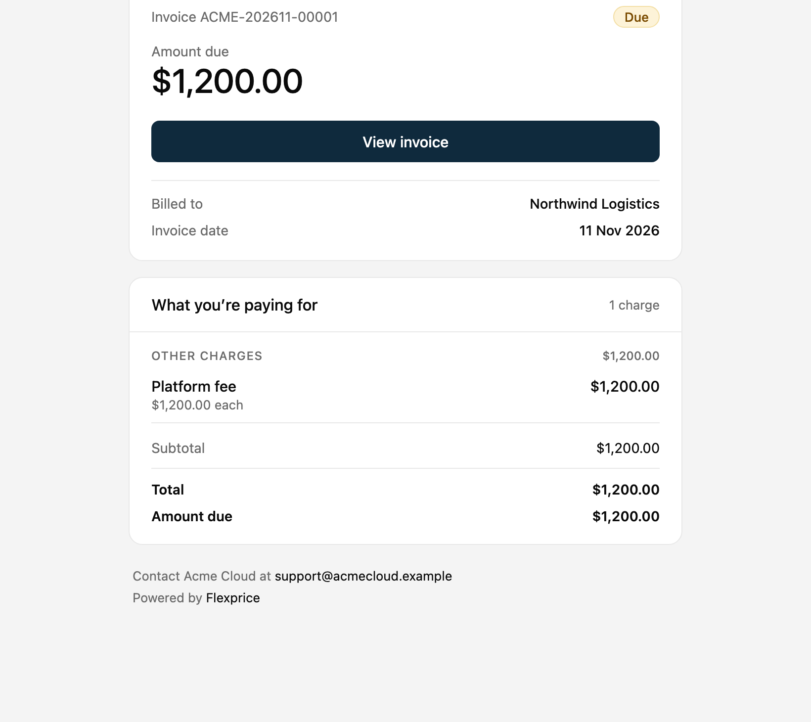
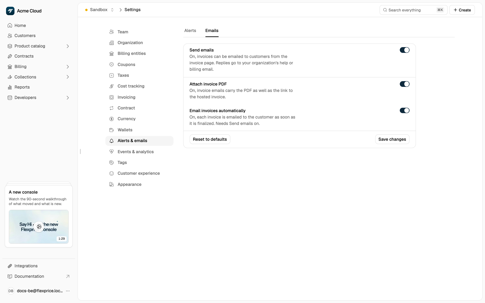
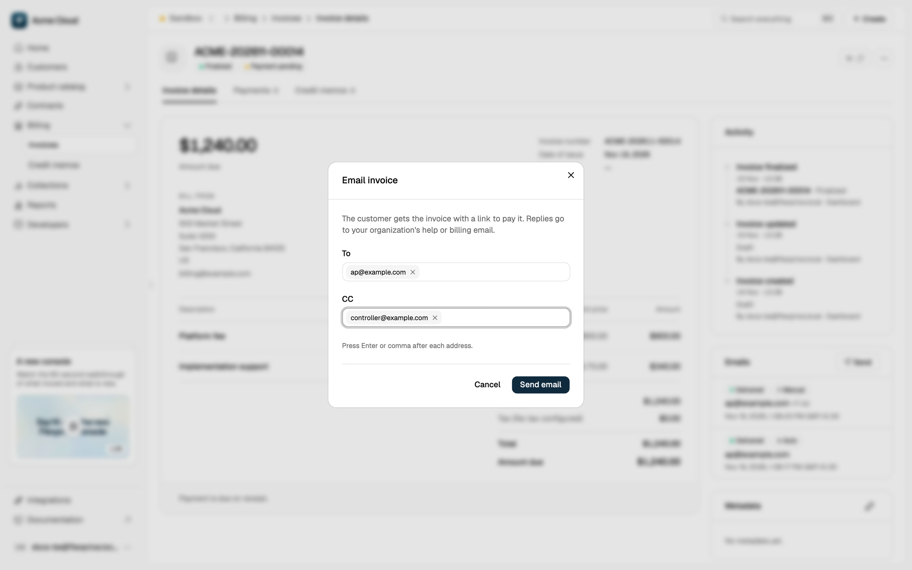
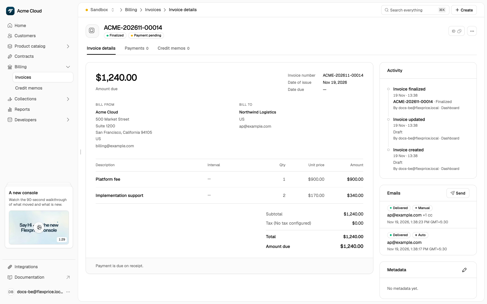

Invoice emails send a finalized invoice straight to your customer, with the invoice PDF attached and a **View invoice** button when a hosted invoice link is available. The button opens the hosted page, where customers can see the invoice and pay online when payment is available for it. Send one by hand from the invoice page, or let Flexprice email every invoice as soon as it is finalized. The invoice page shows every email sent and whether it reached the customer.

<Frame></Frame>

## What your customer receives

- **From your business:** the email comes from your business name, with the subject "Invoice _invoice number_ from _your business name_".
* **View invoice:** when a hosted invoice link is available, it opens the [hosted invoice](/docs/invoices/hosted-invoices), where the customer can see the full invoice, download the PDF and pay the remaining balance when online payment is available for that invoice.
- **A summary of the invoice:** the amount due, who it is billed to, the invoice date and the charges with the totals. Long invoices list the first 10 charges, and the rest are on the hosted invoice.
- **The PDF:** attached to the email when **Attach invoice PDF** is on.
- **Replies come to you:** when the customer replies, the email goes to your organization's help email, or to its billing email if there is no help email.
- **Billing entities, if turned on:** when [billing entities](/docs/invoices/billing-entities) are turned on for the environment, each invoice is emailed under the name of the entity that issued it, and replies go to that entity's help or billing email, or to your organization's if the entity has neither. With billing entities off, every email uses your organization's name and emails.

## Before you start

Add a help or billing email under **Settings → Organization**, so customers have somewhere to reply. Invoices are not emailed without one. If billing entities are turned on, a help or billing email on the invoice's entity also works.

## Turning on emails

Go to **Settings → Alerts & Emails → Emails**, turn on the options you want, and select **Save changes**. The settings apply to the environment selected in the environment switcher, so turn them on separately for Sandbox and Production.

<Frame></Frame>

| Option | Default | What it does |
| ------ | ------- | ------------ |
| **Send emails** | Off | Lets you email invoices to customers. Turning it off also turns off automatic emails. |
| **Attach invoice PDF** | On | Attaches the invoice PDF to each email, as well as the View invoice button. |
| **Email invoices automatically** | Off | Emails each invoice to the customer as soon as it is finalized. Needs **Send emails** on. |

## Sending an invoice

Open a finalized invoice under **Billing → Invoices**. Select **Send** in the **Emails** card, or **Email invoice** in the **⋯** menu.

<Frame></Frame>

**To** is filled in with the customer's email. Change it or add more addresses, add anyone to copy in **CC** (press Enter or a comma after each address), then select **Send email**. The email appears in the **Emails** card straight away.

Draft invoices can't be emailed until they are finalized, and voided invoices can't be emailed at all.

## Sending invoices automatically

With **Email invoices automatically** on, Flexprice emails each invoice to the customer's email address the moment it is finalized, so you don't have to send it yourself. These emails are marked **Auto** in the **Emails** card.

An invoice is not emailed automatically when the customer has no email address or the invoice total is zero. The **Emails** card shows these as **Skipped**, with the reason.

## Checking delivery

The **Emails** card on the invoice page lists every email sent for the invoice, newest first. Each one shows:

- its status, such as **Delivered** or **Bounced**
- **Manual** if someone sent it, or **Auto** if it was sent on finalize
- who it was sent to, and how many people were copied
- when it was sent

When an email didn't reach the customer, the card also shows why. The status updates on its own, so there is no need to refresh the page.

<Frame></Frame>

| Status | Meaning |
| ------ | ------- |
| **Queued** | About to be sent |
| **Sent** | Sent, waiting for the customer's mail server to accept it |
| **Delivery delayed** | Delivery is taking longer than usual |
| **Delivered** | Reached the customer's inbox provider |
| **Bounced** | The customer's mail server rejected it, often because the address is wrong |
| **Failed** | Could not be sent |
| **Suppressed** | Not sent, because this address bounced or complained before |
| **Complained** | The customer marked the email as spam |
| **Skipped** | Not sent on purpose, with the reason shown |

If you turn off **Send emails** while an email is still **Queued**, it is not sent and shows as **Skipped**.

## Using the API

You can do the same from the API:

- Turn emails on with the `email_notification_config` setting, which has the same three options: `enabled`, `attach_invoice_pdf` and `auto_send`.
- Send an invoice with [Email invoice to customer](/api-reference/invoices/email-invoice-to-customer), optionally with your own `to` and `cc` addresses.
- See an invoice's emails with [List invoice emails](/api-reference/invoices/list-invoice-emails), or search across invoices with [Search emails](/api-reference/invoices/search-emails).

<CardGroup cols={2}>
  <Card icon="link" href="/docs/invoices/hosted-invoices" title="Hosted Invoices">
    The page your customer opens from the email to view and pay the invoice.
  </Card>
  <Card icon="file-invoice" href="/docs/invoices/managing" title="Managing Invoices">
    Find, finalize, void and download invoices in the dashboard.
  </Card>
</CardGroup>
