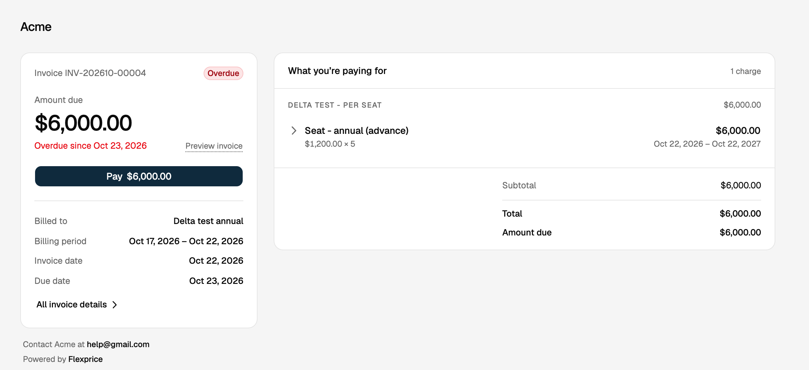
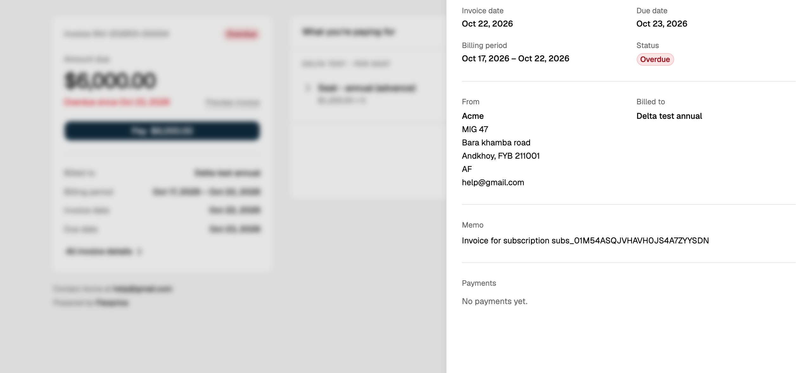
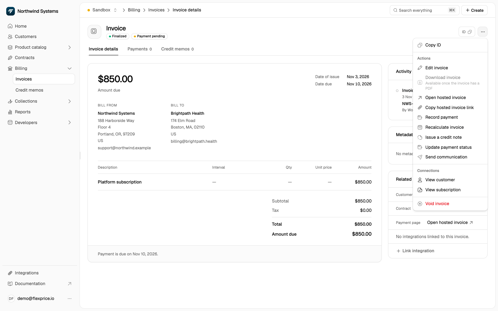

Emailing a PDF leaves your customer with a static document and no way to pay it. Every finalized invoice in Flexprice gets its own hosted invoice page: a link you can send to your customer, who can open it without an account to see what they owe, download the PDF and pay online.

<Frame></Frame>

## How It Works

- **One link per invoice:** Flexprice creates the link when the invoice is finalized. Draft invoices have no link.
- **No sign-in:** anyone with the link can open the page. Each link opens only its own invoice.
- **Always current:** the page shows the invoice as it is right now, so a payment, a status change or a new due date shows up the next time the page loads.
- **Pay online:** when a payment gateway is connected, the page shows a **Pay** button for the amount remaining. It opens the gateway's checkout in a new tab, and the page updates once the payment is recorded.
- **Preview and download:** **Preview invoice** opens the invoice PDF.
- **Full details:** **All invoice details** opens a panel with the invoice dates, your billing address, the customer's details, the memo and the payment history.

<Frame></Frame>

The page shows your business name and the billing email from your account settings, so your customer knows who to contact about the invoice.

## Getting the Link

### From the dashboard

Open an invoice under **Billing > Invoices**. The **Payment page** row on the right links to the hosted invoice, and the **...** menu has **Open hosted invoice** and **Copy hosted invoice link**. The row menu on the invoice list also has **Open hosted invoice**.

<Frame></Frame>

### From the API

Finalized invoices carry the link in `hosted_invoice_url`:

```bash
curl https://us.api.flexprice.io/v1/invoices/<INVOICE_ID> \
  -H "x-api-key: <API_KEY>"
```

```json
{
  "id": "inv_01M5HDDEHMDACTNYCGAGYZQH3E",
  "invoice_number": "INV-202610-00004",
  "invoice_status": "FINALIZED",
  "payment_status": "PENDING",
  "amount_due": "6000",
  "hosted_invoice_url": "https://invoice.flexprice.io/us/hit_01M5HSDZMHV378FW0W5ZEDHP2J.xxxxxxxxxxxx"
}
```

`hosted_invoice_url` is returned by:

| Where | Details |
| ----- | ------- |
| [Get invoice](/api-reference/invoices/get-invoice) | On the invoice |
| [Query invoices](/api-reference/invoices/query-invoices) | On each invoice in the list |
| [Customer Portal](/docs/customers/customer-portal) | Invoices in the portal carry the same link |
| [Webhooks](/docs/webhook/webhooks) | On the invoice in `invoice.update`, `invoice.update.finalized`, `invoice.update.payment`, `invoice.update.voided`, `invoice.payment.overdue`, `invoice.communication.triggered`, `invoice.sync.success` and `invoice.sync.failed` |

Use the field to put a **View invoice** or **Pay now** link in your own emails, in-app billing pages or reminders.

<Tip>
Read the link from the invoice each time you need it rather than storing it. The value can change, for example when the invoice syncs to Stripe.
</Tip>

## Invoices Synced to Stripe

If [Stripe invoice sync](/integrations/stripe/invoice-sync) is on, Stripe already hosts a page for the invoice. In that case `hosted_invoice_url` is Stripe's hosted invoice URL, and the Flexprice page link for that invoice stops working. Your customer gets one page per invoice, never two.

## Link Expiry

A link works until 30 days after the invoice's due date. If the invoice has no due date, the 30 days count from finalization. Every link lasts at least 30 days and at most 120 days after the invoice is finalized.

When the due date changes, the expiry moves with it. After a link expires, the page tells your customer it is no longer valid and to contact you.

## What the Page Shows by Invoice State

| Invoice state | What your customer sees |
| ------------- | ----------------------- |
| Unpaid | A **Due** badge, the amount due and the **Pay** button (when a gateway is connected) |
| Past due date | An **Overdue** badge and the date it became overdue |
| Payment in progress | A **Processing** badge, no Pay button |
| Paid | A **Paid** badge, the payment date and the payment in the payment history |
| Voided | A **Void** badge and the date it was voided, no Pay button |

## Limitations

- **Finalized invoices only.** Draft invoices have no link, and invoices finalized before hosted invoice pages were available have none either.
- **Pay needs a payment gateway.** Without one, the page still shows the invoice and PDF, but no Pay button. See [Portal payments](/docs/customers/customer-portal/payments) for which gateways support paying an invoice.
- **No custom domain or branding yet.** The page is served from `invoice.flexprice.io` and shows your business name.

<Warning>
Anyone with the link can view the invoice, including your customer's name and billing address. Share it only with the people who should see the invoice.
</Warning>

## Related Articles

<CardGroup cols={2}>
  <Card icon="file-invoice" href="/docs/invoices/managing" title="Managing Invoices">
    View, update and download invoices in the dashboard.
  </Card>
  <Card icon="user" href="/docs/customers/customer-portal" title="Customer Portal">
    A self-service portal for all of a customer's invoices, usage and credits.
  </Card>
  <Card icon="credit-card" href="/docs/customers/customer-portal/payments" title="Portal Payments">
    Payment gateways and how invoice payments are collected.
  </Card>
  <Card icon="stripe" href="/integrations/stripe/invoice-sync" title="Stripe Invoice Sync">
    Sync invoices to Stripe and use Stripe's hosted page.
  </Card>
</CardGroup>

**API References**
- [Get invoice](/api-reference/invoices/get-invoice)
- [Query invoices](/api-reference/invoices/query-invoices)
