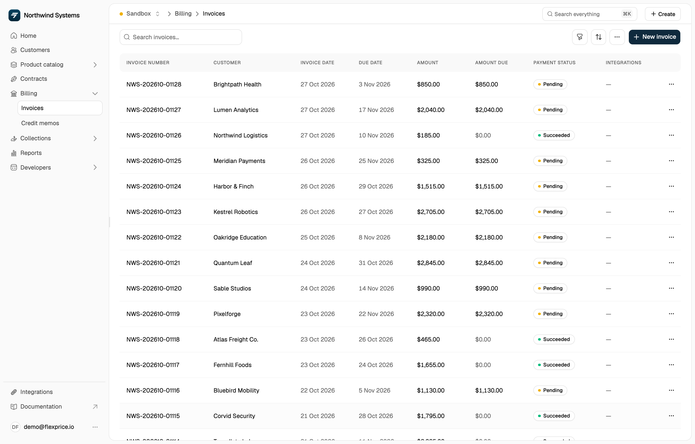
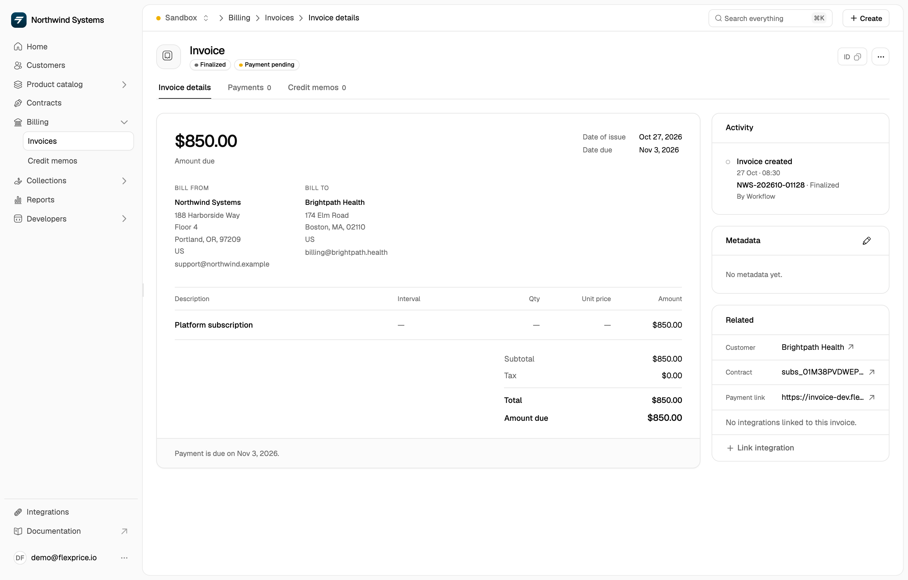
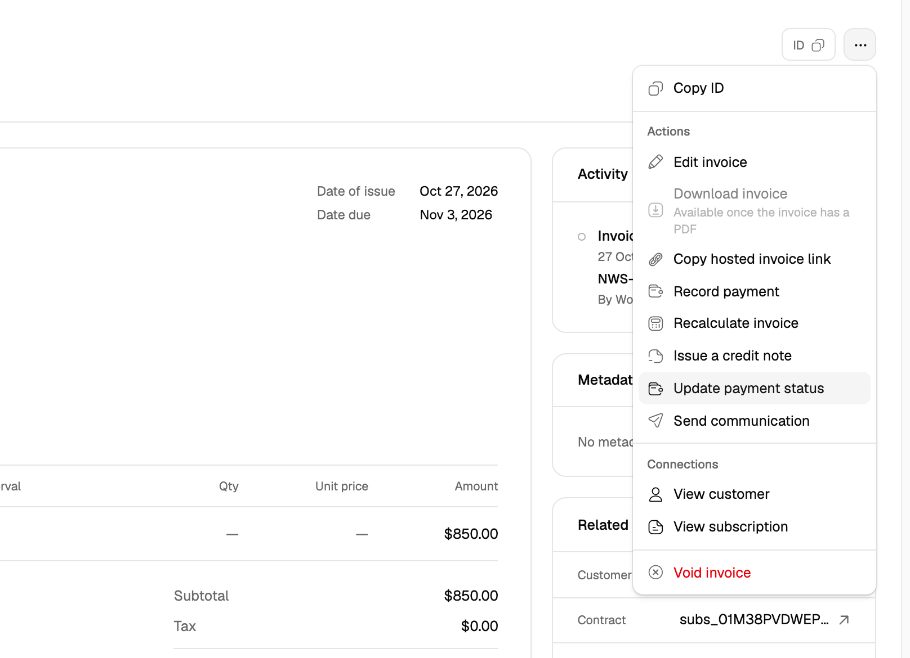
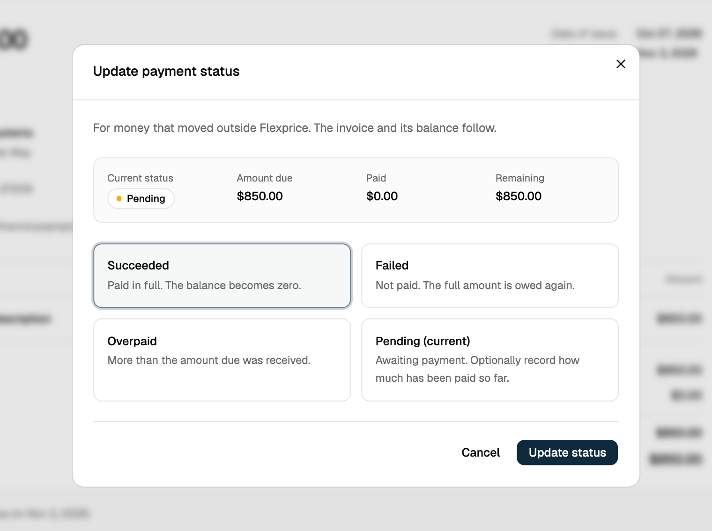

## Viewing invoices

Go to **Billing** → **Invoices** in the left navigation. The list shows each invoice's number, customer, invoice date, due date, amount, amount due and payment status. Click an invoice to open it.

To see one customer's invoices, open the customer and go to their **Invoices** tab.

<Frame>
  
</Frame>

## Invoice details

The invoice page shows:

- **Status badges**: the invoice status (for example **Finalized**) and the payment status.
- **Amount due**, **Date of issue** and **Date due**.
- **Bill from** and **Bill to** addresses.
- **Line items** with description, interval, quantity, unit price and amount.
- **Subtotal**, tax, any discounts and credits applied, **Total** and **Amount due**.
- The **Payments** and **Credit memos** tabs, listing the payments recorded against the invoice and the credit memos issued for it.

<Frame>
  
</Frame>

## Invoice actions

Every action below is in the **⋯** menu at the top right of the invoice page. The **⋯** menu on the invoice's row in the **Invoices** list offers all of them except **Update payment status**.

<Frame>
  
</Frame>

### Finalizing and voiding

- A **Draft** invoice can still change. Select **Finalize invoice** to lock it for payment.
- Select **Void invoice** to cancel an invoice and prevent further changes.

### Updating payment status

Use this for money that moved outside Flexprice.

1. Open the invoice and click the **⋯** menu.
2. Select **Update payment status**.
3. Choose **Succeeded** (paid in full), **Failed** (not paid, so the full amount is owed again), **Overpaid**, or **Pending** (awaiting payment, optionally with the amount paid so far).
4. Click **Update status**.

<Frame>
  
</Frame>

To record a single payment against the invoice instead, select **Record payment**.

### Downloading invoices

Open the invoice, click the **⋯** menu, and select **Download invoice**. It's available once the invoice has a PDF.
