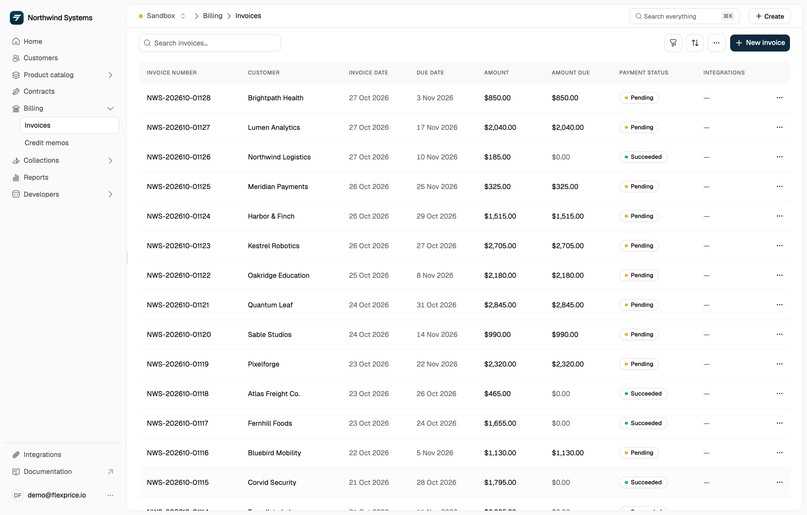
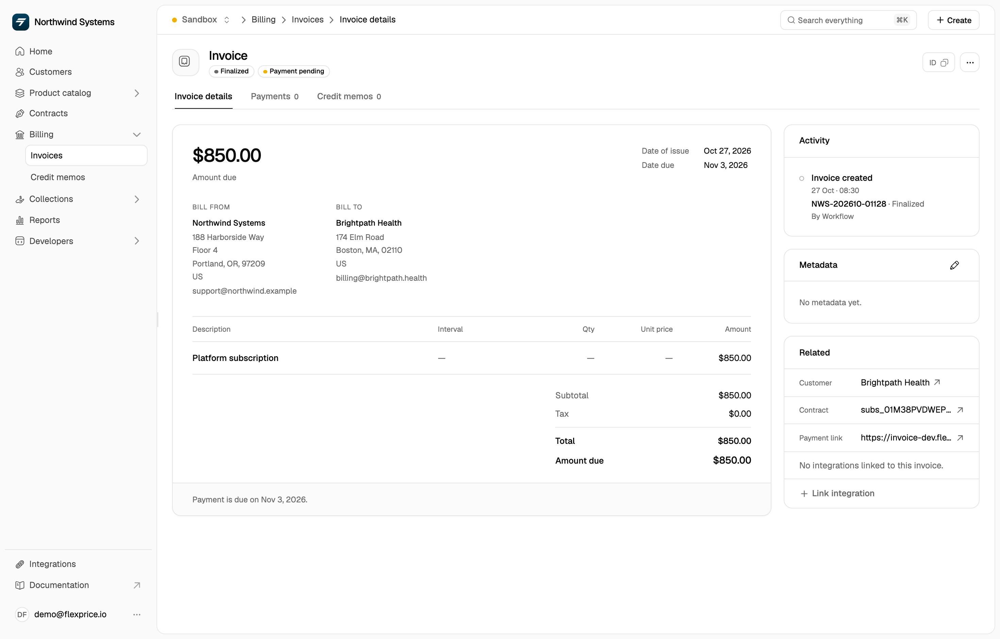
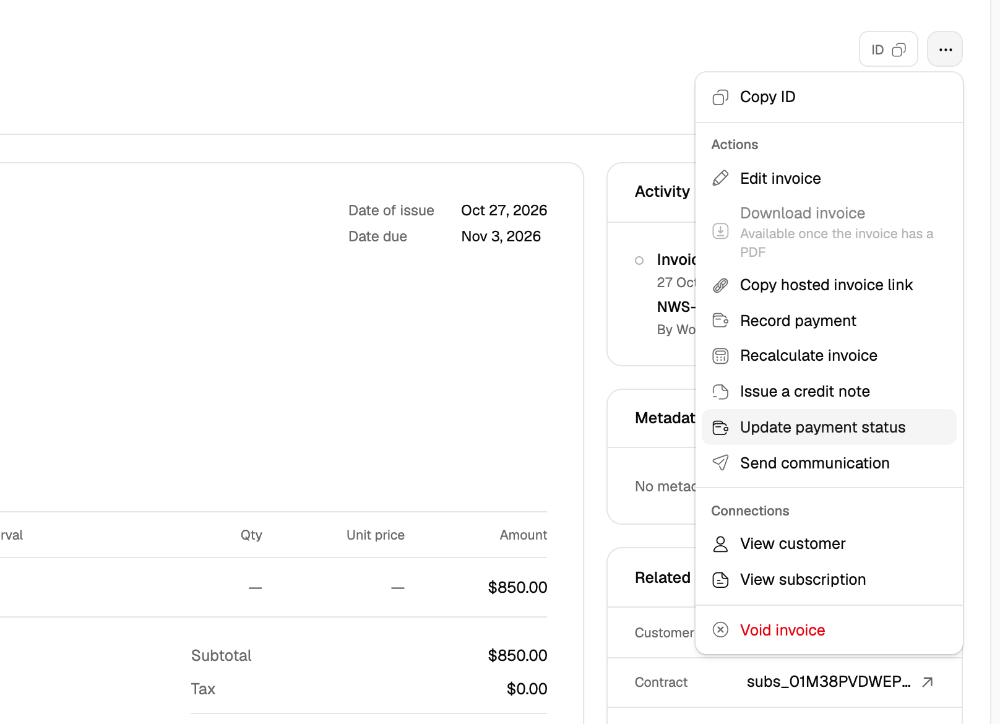
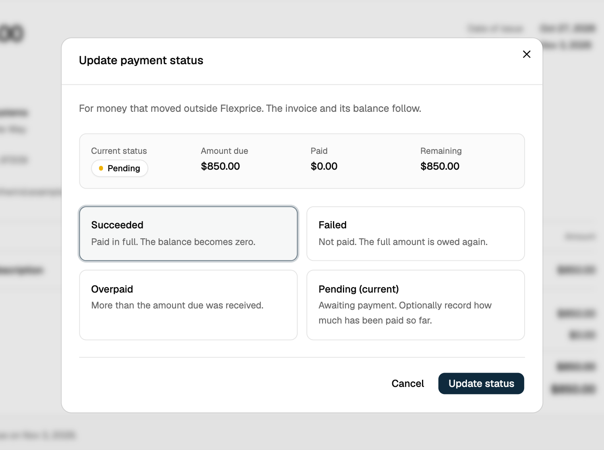

## Viewing invoices

Go to **Billing** → **Invoices** in the left navigation. Dashboard invoice lists exclude **Skipped** invoices by default. Clear the **Invoice status** exclusion to include them. The list shows each invoice's number, customer, invoice date, due date, amount, amount due and payment status. Click an invoice to open it.

To see one customer's invoices, open the customer and go to their **Invoices** tab.

<Frame>
  
</Frame>

## Invoice details

The invoice page shows:

- **Status badges**: the invoice status (for example **Finalized**) and the payment status.
- **Amount due**, **Date of issue** and **Date due**.
- **Bill from** and **Bill to** addresses.
- **Line items** with description, interval, quantity, unit price and amount.
- **Subtotal**, tax, any discounts and credits applied, **Total** and **Amount due**.
- The **Payments** and **Credit memos** tabs, listing the payments recorded against the invoice and the credit memos issued for it.
- The **Emails** card, listing the emails sent to the customer for the invoice with their delivery status. Select **Send** to email the invoice. See [Emailing invoices](/docs/invoices/email-notifications).

* If the invoice has linked wallet credits in the pending state, its header shows **Releases X credits**. The credits become available once the invoice is paid.

<Frame>
  
</Frame>

## Invoice actions

Every action below is in the **⋯** menu at the top right of the invoice page. The **⋯** menu on the invoice's row in the **Invoices** list offers all of them except **Update payment status**.

<Frame>
  
</Frame>

### Finalizing and voiding

- A **Draft** invoice can still change. Select **Finalize invoice** to lock it for payment.
- Select **Void invoice** to cancel an invoice and prevent further changes. Flexprice then tries to close the invoice's unpaid Stripe and Razorpay payment links, except links a checkout session created. See [Invoices](/docs/core-concepts/invoices#correcting-a-finalized-invoice).

### Updating payment status

Use this for money that moved outside Flexprice.

1. Open the invoice and click the **⋯** menu.
2. Select **Update payment status**.
3. Choose **Succeeded** (paid in full), **Failed** (not paid, so the full amount is owed again), **Overpaid**, or **Pending** (awaiting payment, optionally with the amount paid so far).
4. Click **Update status**.

<Frame>
  
</Frame>

### Recording a payment

On an open or overdue invoice with a balance due, select **Record payment** from the **⋯** menu. You can record an offline or credit payment, create a payment link, or submit a charge against a saved method.

1. Choose **Charge saved method** under **Method** and check the amount.
2. Select the **Provider** and **Saved method**. Stripe supports saved cards. For INR invoices, Razorpay supports active card, UPI, and eNACH mandates.
3. Click **Create payment** to submit the charge.

The saved method must be unexpired and enabled for automatic charging. For Razorpay, the customer's phone number must match their Razorpay record, and the amount must be within the selected mandate's per-debit limit.

Razorpay sends a pre-debit notice. Card and UPI debits can take about 36 hours to settle. The invoice shows **Processing** while the debit is pending.

If there is no usable saved method, choose **Payment link** under **Method** when a payment-link provider is connected.

Before creating a payment link, Flexprice checks again for a saved-method charge in progress. If the check fails, no link is created and you are asked to try again. If a charge is in progress, a confirmation lets you create the link anyway or wait. Paying on the link too could charge the customer twice.

### Downloading invoices

Open the invoice, click the **⋯** menu, and select **Download invoice**. It's available once the invoice has a PDF.
