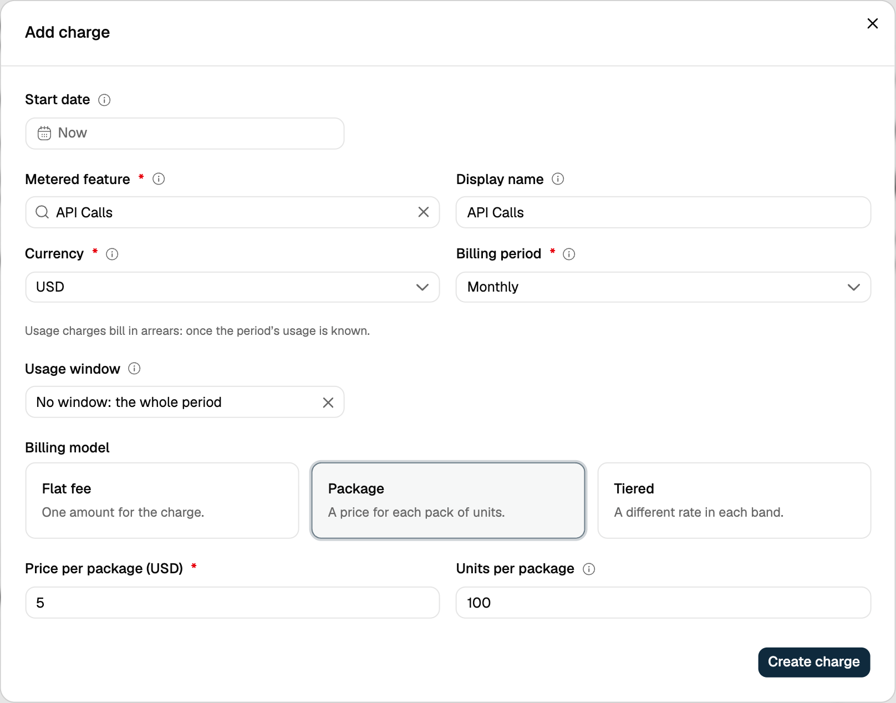

The **Package** model charges a fixed price for each **pack of units** instead of for each unit. A started pack counts as a full pack.

**Example:**

An API service charges **$5 per 100 API calls**. If a customer makes **450 API calls** in a billing period, that is 4.5 packs, which round up to 5:

`5 packs × $5 = $25`

In the dashboard, set the **Price per package** and the **Units per package** on the charge.

It is best for businesses that sell usage in fixed blocks, such as messages, credits or API calls, rather than per unit.

<Tip>
  To charge per pack in only some ranges of usage, use a [package size in a tier](/docs/product-catalogue/plans/billing-models/tiered#package-size-in-a-tier).
</Tip>

<Frame>
  
</Frame>