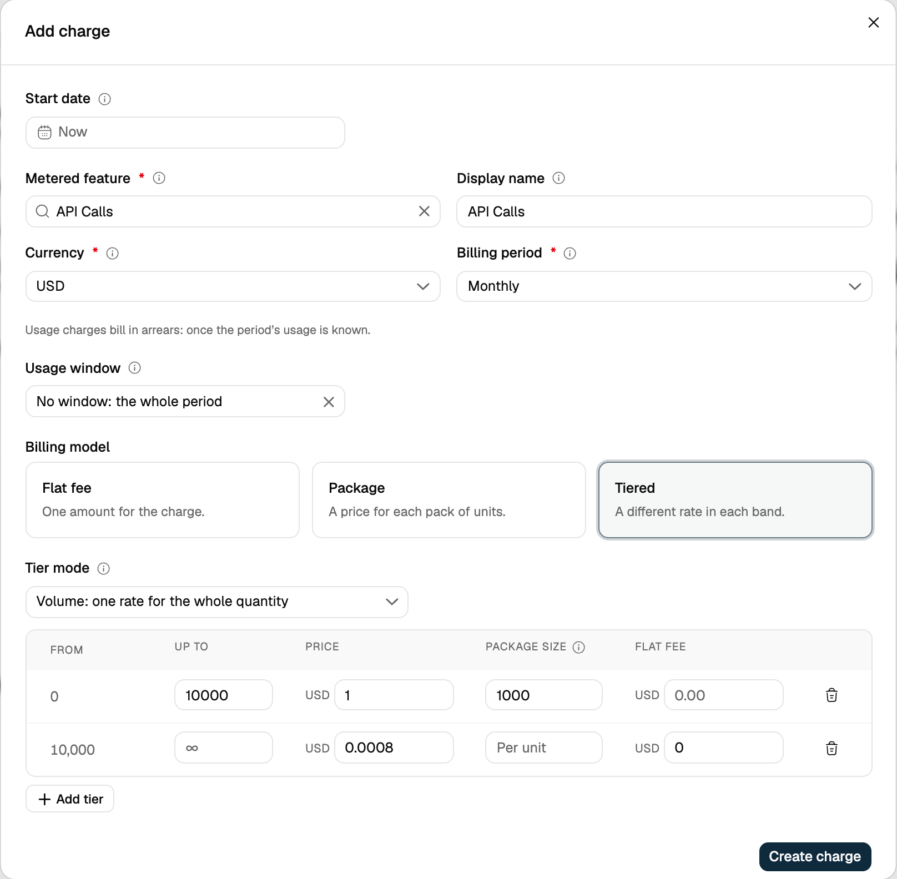
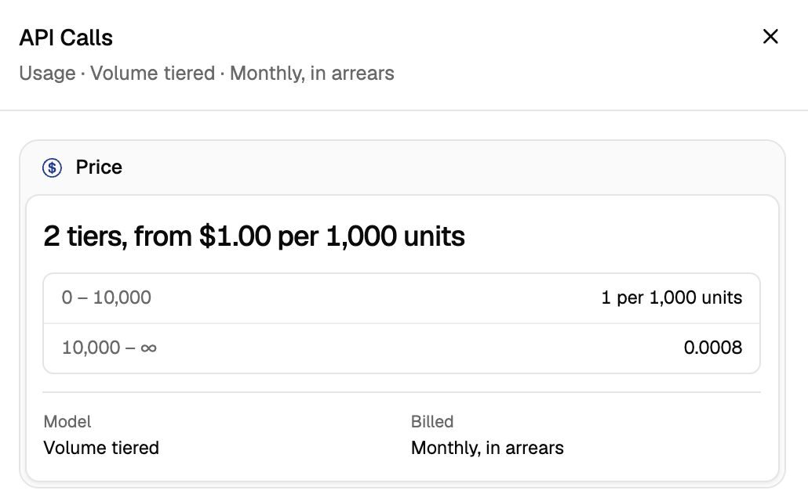

The **Tiered** model splits usage into bands, called tiers, and gives each tier its own price. Use it when the rate should change as usage grows, for example a lower price per API call for customers who make more calls.

Each tier has:

| Field | What it does |
| --- | --- |
| **Up to** | The last unit in the tier. Leave the last tier open (∞) to cover all usage above it. |
| **Price** | What the tier charges per unit, or per package when a package size is set. |
| **Package size** | Optional. Charges the price once per package of this many units instead of per unit. |
| **Flat fee** | Optional. A fixed amount added when usage reaches the tier. |

## Tier modes

A tiered price uses one of two modes. They differ in how the tiers apply to the customer's usage.

| Mode | How usage is priced |
| --- | --- |
| **Volume** | The tier the customer's total usage reaches sets one rate for **all** units. |
| **Slab** | Usage fills the tiers in order, and the units in each tier are charged at **that tier's** rate. |

**Example:**

Consider the following tiers for an API service:

| Tier       | Usage Range (API Calls) | Unit Price ($) |
| ---------- | ----------------------- | -------------- |
| **Tier 1** | 0 – 10,000              | 0.0010         |
| **Tier 2** | 10,001 – 50,000         | 0.0008         |
| **Tier 3** | 50,001 – 100,000        | 0.0006         |
| **Tier 4** | 100,001 and above       | 0.0004         |

A customer makes **65,000 API calls** in a billing period.

### Volume

The total usage falls within **Tier 3**, so all 65,000 calls are charged at $0.0006:

`65,000 API calls × $0.0006 = $39`

The rate for every unit drops as the customer's total grows, so heavy users get a lower price on all their usage.

### Slab

The usage fills the tiers in order, and each part is charged at its tier's rate:

| Tier       | Calls in tier | Unit Price ($) | Charge ($) |
| ---------- | ------------- | -------------- | ---------- |
| **Tier 1** | 10,000        | 0.0010         | 10         |
| **Tier 2** | 40,000        | 0.0008         | 32         |
| **Tier 3** | 15,000        | 0.0006         | 9          |
| **Total**  | 65,000        |                | **51**     |

Earlier units keep their higher rate, and only the units above each boundary get the lower one.

## Package size in a tier

By default, a tier charges its price per unit. Give a tier a **package size** to charge the price once per package of that many units instead. A started package counts as a full package, and a tier without a package size keeps charging per unit, so one price can mix both.

| Tier       | Usage Range (API Calls) | Price ($) | Package size |
| ---------- | ----------------------- | --------- | ------------ |
| **Tier 1** | 0 – 10,000              | 1.00      | 1,000 calls  |
| **Tier 2** | 10,001 and above        | 0.0008    | Per unit     |

With volume mode, a customer who makes **4,500 API calls** falls within **Tier 1**. 4,500 calls make 4.5 packages, which round up to 5:

`5 packages × $1.00 = $5`

In volume mode, packages are counted on the customer's total usage. In slab mode, they are counted on the units that fall inside each tier.

## Setting up in the dashboard

1. Open the plan and click **Add charge**, then choose **Usage**.
2. Pick the metered feature and select the **Tiered** billing model.
3. Choose the **Tier mode**: Volume or Slab.
4. For each tier, enter **Up to** and **Price**. Enter a **Package size** to charge per package, or leave it empty to charge per unit. Add a **Flat fee** if the tier needs one.
5. Click **Add tier** for more tiers, then **Create charge**.

<Frame>
  
</Frame>

The charge shows each tier's price, per unit or per package:

<Frame>
  
</Frame>

## Setting up with the API

Set `billing_model` to `TIERED`, `tier_mode` to `VOLUME` or `SLAB`, and list the tiers. Use `"up_to": null` for the last tier. For a package size, add `transform_quantity` to the tier: `divide_by` is the package size, a whole number of at least 1, and `round` is `up` (the default) or `down`.

```bash
curl -X POST https://us.api.flexprice.io/v1/prices \
  -H "x-api-key: <API_KEY>" \
  -H "Content-Type: application/json" \
  -d '{
    "entity_type": "PLAN",
    "entity_id": "<PLAN_ID>",
    "type": "USAGE",
    "meter_id": "<METER_ID>",
    "currency": "usd",
    "billing_model": "TIERED",
    "tier_mode": "VOLUME",
    "billing_period": "MONTHLY",
    "billing_period_count": 1,
    "billing_cadence": "RECURRING",
    "invoice_cadence": "ARREAR",
    "tiers": [
      { "up_to": 10000, "unit_amount": "1", "transform_quantity": { "divide_by": 1000 } },
      { "up_to": null, "unit_amount": "0.0008" }
    ]
  }'
```

<Note>
  The dashboard always rounds partial packages up. Use the API to round down.
</Note>

**API References**
- [Create a Price](/api-reference/prices/create-price)
- [Update a Price](/api-reference/prices/update-price)
