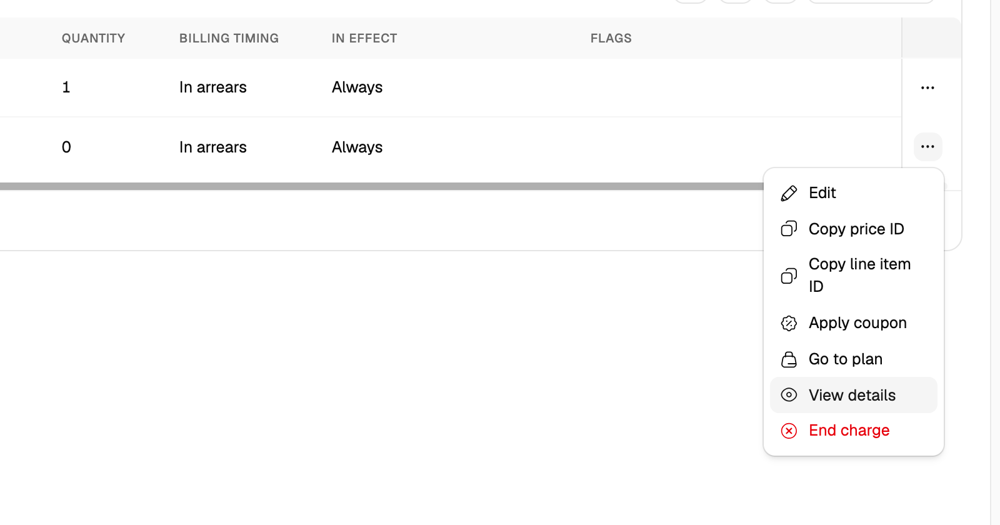
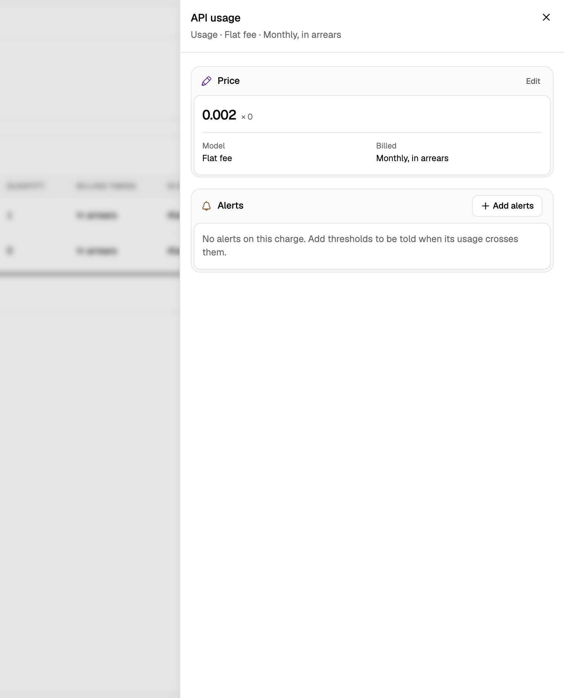
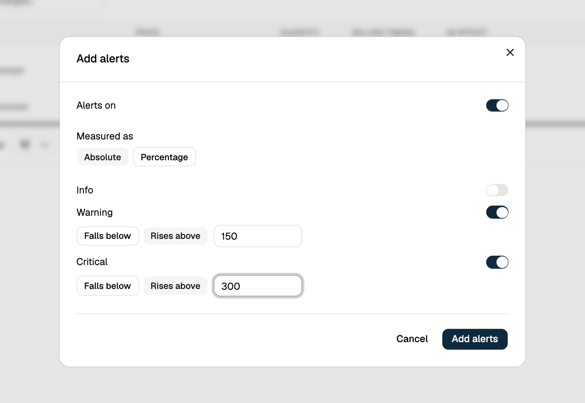

Line item spend alerts monitor the **usage-based spend of a single line item** on a subscription, independently of the subscription's total. Use this when one specific charge (for example, a particular metered API) needs its own budget, separate from the rest of the subscription.

## Configuring via the Dashboard

<Steps>
  <Step title="Open the contract's charges">
    In the dashboard, subscriptions are called **contracts** and their line items are **charges**. Open the contract and go to the **Charges** tab.
  </Step>

  <Step title="Open the charge's details">
    Find the usage charge to monitor, click its **⋯** menu, and select **View details**.
    <Frame>
      
    </Frame>
  </Step>

  <Step title="Add alerts">
    In the **Alerts** section of the charge's details, click **Add alerts**. The section appears on usage charges.
    <Frame>
      
    </Frame>
  </Step>

  <Step title="Configure thresholds">
    Keep **Alerts on** turned on and choose whether thresholds are measured as **Absolute** amounts or a **Percentage**. Turn on each level you want (**Info**, **Warning**, **Critical**), keep **Rises above** selected, and enter the threshold, then click **Add alerts**. Spend alerts support only **Rises above**, so a level set to **Falls below** is rejected when you save. At least one level must be set while alerts are on, and a percentage can't exceed 100.
    <Frame>
      
    </Frame>
  </Step>
</Steps>

## Configuring via API

```json
{
  "entity_type": "subscription_line_item",
  "entity_id": "subs_line_01K7YQ0000LINEITEM00001",
  "parent_entity_type": "subscription",
  "parent_entity_id": "subs_01K7YQ8ZR4M3V2N1XA9C6D0EFG",
  "config": {
    "alert_enabled": true,
    "warning":  { "threshold": "150", "condition": "above" },
    "critical": { "threshold": "300", "condition": "above" }
  }
}
```

<CodeGroup>
```bash cURL
curl -X POST 'https://api.cloud.flexprice.io/v1/alerts/setting' \
  -H 'x-api-key: <api_key>' \
  -H 'Content-Type: application/json' \
  -d '{
    "entity_type": "subscription_line_item",
    "entity_id": "subs_line_01K7YQ0000LINEITEM00001",
    "parent_entity_type": "subscription",
    "parent_entity_id": "subs_01K7YQ8ZR4M3V2N1XA9C6D0EFG",
    "config": {
      "alert_enabled": true,
      "warning":  { "threshold": "150", "condition": "above" },
      "critical": { "threshold": "300", "condition": "above" }
    }
  }'
```
</CodeGroup>

<Warning>
`entity_id` must be a line item that belongs to the subscription identified by `parent_entity_id`. The API rejects a line item ID from a different subscription.
</Warning>

## Alert Behavior

Flexprice recalculates this line item's usage-based spend on every usage event affecting the subscription and sends a webhook only when the alert state changes.

<Info>
Usage on a different line item in the same subscription does not affect this alert. It only tracks the one line item it's configured on.
</Info>

## Managing Alert Settings

### Viewing current configuration

<Steps>
  <Step title="Open the charge's details">
    Open the contract, go to the **Charges** tab, click the charge's **⋯** menu, and select **View details**.
  </Step>

  <Step title="Read the Alerts section">
    The **Alerts** section lists each level with its condition and threshold. While the charge's alerts are switched off, the section lists none and shows **Add alerts**.
  </Step>
</Steps>

### Changing thresholds

<Steps>
  <Step title="Edit the alerts">
    In the charge's details, click **Edit** in the **Alerts** section.
  </Step>

  <Step title="Adjust values">
    Change **Measured as** or any level's threshold, keeping **Rises above** selected. This form shows only the levels already set; to add or drop one, see [Removing a threshold](#removing-a-threshold).
  </Step>

  <Step title="Save">
    Click **Save alerts**.
  </Step>
</Steps>

### Removing a threshold

The **Edit** form has no switch per level, so you remove a level by turning the alerts off and adding them again.

<Steps>
  <Step title="Turn the alerts off">
    Click **Edit** in the charge's **Alerts** section, turn off **Alerts on**, and click **Save alerts**.
  </Step>

  <Step title="Add the alerts again">
    Click **Add alerts** in the same section. The form reopens on the stored thresholds, with a switch per level.
  </Step>

  <Step title="Turn off the level">
    Turn off the switch next to the level you want to drop, and click **Add alerts**. The level is cleared from the setting. The same steps add a level: turn its switch on instead.
  </Step>
</Steps>

Through the API, send the remaining `config` to `PUT /v1/alerts/setting/:id`. An update replaces the whole `config`, so a threshold left out is cleared.

### Disabling alerts

<Steps>
  <Step title="Edit the alerts">
    In the charge's details, click **Edit** in the **Alerts** section.
  </Step>

  <Step title="Turn off Alerts on">
    Turn off **Alerts on** (or set `alert_enabled` to `false` through the API).
  </Step>

  <Step title="Save">
    Click **Save alerts**. The section then lists no alerts, but the thresholds are kept: **Add alerts** reopens them.
  </Step>
</Steps>

## Webhooks

| Event | Fires when |
|-------|------------|
| `subscription.line_item_spend.threshold_reached` | Spend crosses a threshold |
| `subscription.line_item_spend.threshold_recovered` | Spend recovers to `ok` |

## Use Cases

- **Per-charge budgets**: Alert on a specific metered charge (e.g. a particular API or compute meter) without noise from the rest of the subscription
- **High-cost line items**: Set tighter thresholds on line items with the highest per-unit cost or the most usage variance
- **Customer-specific overrides**: Combine with per-subscription price overrides to alert on a customer's negotiated rate independently

## Related

- [What Are Spend Alerts?](/docs/subscriptions/how-to-configure-spend-alerts/what-are-spend-alerts): all three alert scopes, shared validation, and the full API reference
- [Subscription spend alerts](/docs/subscriptions/how-to-configure-spend-alerts/how-to-configure-subscription-spend-alerts): monitor the whole subscription instead of one line item
- [Group spend alerts](/docs/subscriptions/how-to-configure-spend-alerts/how-to-configure-group-spend-alerts): monitor spend across a feature group
- [Webhooks](/docs/webhook/webhooks): endpoint setup, payload signatures, and retry behavior
