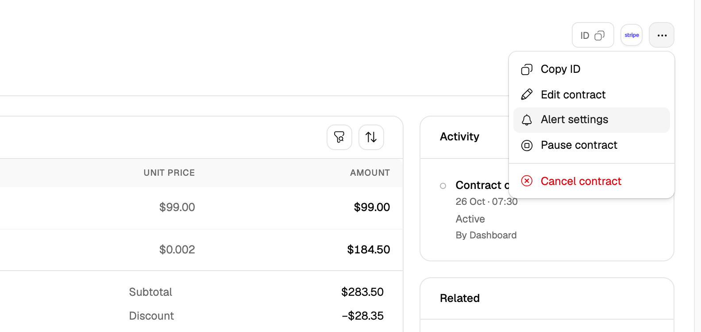
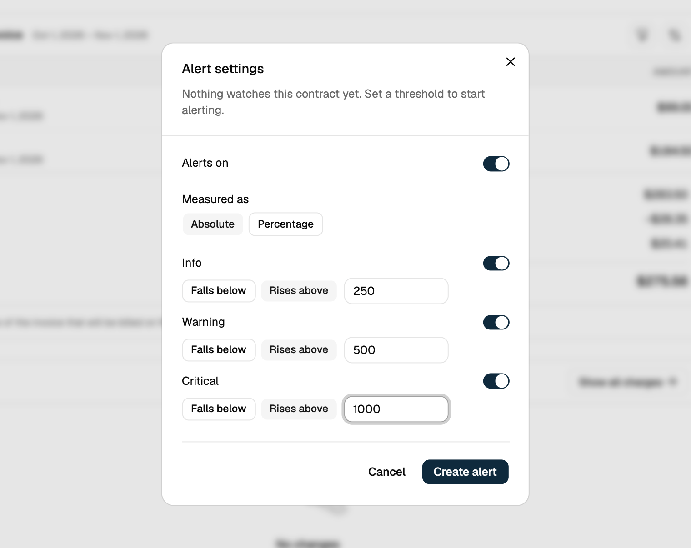

Subscription spend alerts monitor the **total usage-based spend across an entire subscription** for the current billing period. This is the broadest of the three spend alert scopes: it catches overall budget overruns regardless of which line item drove the spend.

## Configuring via the Dashboard

<Steps>
  <Step title="Open the contract">
    In the dashboard, subscriptions are called **contracts**. Go to **Contracts** and open the contract, or open it from the **Contracts** card on the customer's page.
  </Step>

  <Step title="Open Alert settings">
    Click the **⋯** menu at the top right of the contract and select **Alert settings**.
    <Frame>
      
    </Frame>
  </Step>

  <Step title="Configure thresholds">
    Keep **Alerts on** turned on and, under **Measured as**, select **Absolute**. A new alert starts on **Percentage**, but Flexprice compares spend with each threshold as an amount in the contract's currency, so a percentage threshold of 80 fires once spend reaches 80. Turn on each level you want (**Info**, **Warning**, **Critical**), keep **Rises above** selected, and enter the threshold amount, then click **Create alert**. Spend alerts support only **Rises above**, so a level set to **Falls below** is rejected when you save. At least one level must be set while alerts are on.
    <Frame>
      
    </Frame>
  </Step>
</Steps>

## Configuring via API

```json
{
  "entity_type": "subscription",
  "entity_id": "subs_01K7YQ8ZR4M3V2N1XA9C6D0EFG",
  "config": {
    "alert_enabled": true,
    "info":     { "threshold": "250",  "condition": "above" },
    "warning":  { "threshold": "500",  "condition": "above" },
    "critical": { "threshold": "1000", "condition": "above" }
  }
}
```

<CodeGroup>
```bash cURL
curl -X POST 'https://api.cloud.flexprice.io/v1/alerts/setting' \
  -H 'x-api-key: <api_key>' \
  -H 'Content-Type: application/json' \
  -d '{
    "entity_type": "subscription",
    "entity_id": "subs_01K7YQ8ZR4M3V2N1XA9C6D0EFG",
    "config": {
      "alert_enabled": true,
      "info":     { "threshold": "250",  "condition": "above" },
      "warning":  { "threshold": "500",  "condition": "above" },
      "critical": { "threshold": "1000", "condition": "above" }
    }
  }'
```
</CodeGroup>

<Note>
No `parent_entity_type` or `parent_entity_id` is sent for subscription-level alerts. `entity_id` is the subscription itself.
</Note>

## Alert Behavior

Once configured and enabled, Flexprice:

- **Recalculates spend**: On every usage event for the subscription, recomputes total usage-based spend using the same invoicing-grade calculation (commitment- and overage-aware) used to generate invoices
- **Compares against thresholds**: Evaluates the recalculated total against Critical, Warning, and Info
- **Updates state**: Reflects the current state (`ok`, `info`, `warning`, `in_alarm`) in alert history
- **Notifies**: Sends a webhook only when the state changes, not on every event


## Managing Alert Settings

### Viewing current configuration

<Steps>
  <Step title="Open the contract">
    Go to **Contracts** and open the contract.
  </Step>

  <Step title="Open Alert settings">
    Click the **⋯** menu at the top right and select **Alert settings**. The dialog shows whether **Alerts on** is on, how thresholds are **Measured as**, and the threshold of each level whose switch is on.
  </Step>
</Steps>

### Changing thresholds

<Steps>
  <Step title="Open Alert settings">
    On the contract, click the **⋯** menu and select **Alert settings**.
  </Step>

  <Step title="Adjust values">
    Change any level's threshold, keeping **Absolute** and **Rises above** selected. To add a level, turn on its switch.
  </Step>

  <Step title="Save">
    Click **Save alerts**.
  </Step>
</Steps>

### Removing a threshold

<Steps>
  <Step title="Open Alert settings">
    On the contract, click the **⋯** menu and select **Alert settings**.
  </Step>

  <Step title="Turn off the level">
    Turn off the switch next to the level you want to drop.
  </Step>

  <Step title="Save">
    Click **Save alerts**. The level is cleared from the setting, not just hidden. Through the API, an update replaces the whole `config`, so send every threshold you want to keep.
  </Step>
</Steps>

### Disabling alerts

<Steps>
  <Step title="Open Alert settings">
    On the contract, click the **⋯** menu and select **Alert settings**.
  </Step>

  <Step title="Turn off Alerts on">
    Turn off **Alerts on** (or set `alert_enabled` to `false` through the API).
  </Step>

  <Step title="Save">
    Click **Save alerts**. The thresholds are kept, so turning **Alerts on** back on restores them.
  </Step>
</Steps>

## Webhooks

| Event | Fires when |
|-------|------------|
| `subscription.spend.threshold_reached` | Spend crosses a threshold |
| `subscription.spend.threshold_recovered` | Spend recovers to `ok` |

## Use Cases

- **Overall budget cap**: Alert when a customer's total subscription spend approaches or exceeds a contracted limit
- **Early warning for usage spikes**: Set Info well below Critical to catch unexpected spend trends before they become a problem
- **Account health monitoring**: Route alerts to a support or account-management queue

## Related

- [What Are Spend Alerts?](/docs/subscriptions/how-to-configure-spend-alerts/what-are-spend-alerts): all three alert scopes, shared validation, and the full API reference
- [Line item spend alerts](/docs/subscriptions/how-to-configure-spend-alerts/how-to-configure-subscription-line-item-spend-alerts): monitor one line item instead of the whole subscription
- [Group spend alerts](/docs/subscriptions/how-to-configure-spend-alerts/how-to-configure-group-spend-alerts): monitor spend across a feature group
- [Webhooks](/docs/webhook/webhooks): endpoint setup, payload signatures, and retry behavior
