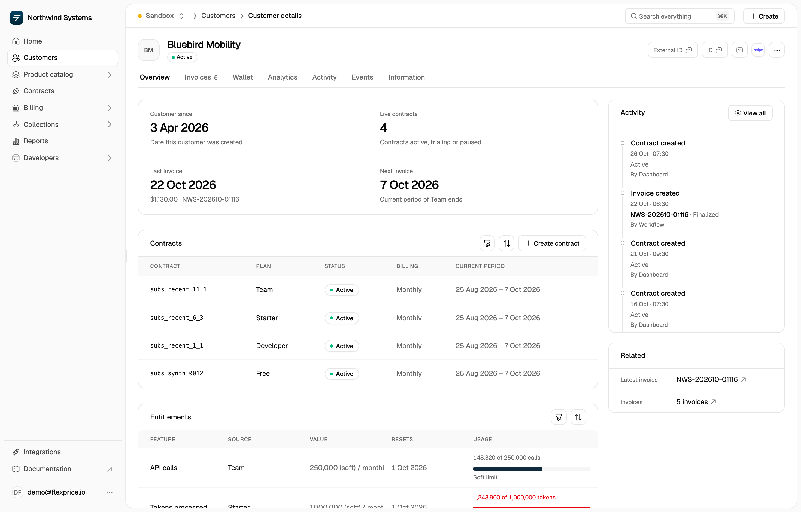
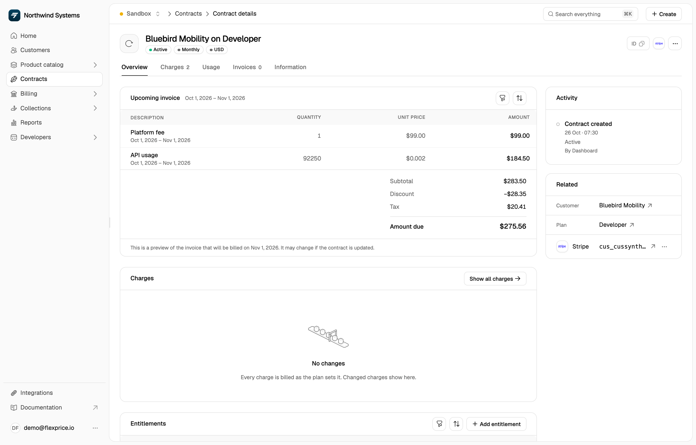

Once a customer has a subscription, you can see its plan, status, and upcoming invoice from the customer's page. In the dashboard, subscriptions are called **contracts**.

<Steps>
  <Step title="Open the customer">
    Go to **Customers** and click the customer. The **Contracts** card lists each contract with its plan, status, billing period, and current period.

    <Frame>
      
    </Frame>
  </Step>

  <Step title="Open the contract">
    Click a contract to open its page. The header shows the customer and plan, with badges for the status, billing period, and currency. The **Charges**, **Usage**, and **Invoices** tabs hold the contract's details, and **Information** shows its start date, current period, payment terms, and collection method.

    <Frame>
      
    </Frame>
  </Step>
</Steps>

To see contracts across all customers, open **Contracts** in the sidebar.

## Manage contracts from the customer page

Open the **⋯** menu beside a contract in the customer's **Contracts** card to act without opening its detail page. The menu offers the same actions as the contract detail header, based on the contract's state.

| Action | Availability and behavior |
| ------ | ------------------------- |
| **Copy ID** | Copies the contract ID |
| **Activate** | Shown for draft and incomplete contracts. Opens a confirmation where you can choose the **Start date** |
| **Alert settings** | Opens the contract's [spend alert settings](/docs/subscriptions/how-to-configure-spend-alerts/how-to-configure-subscription-spend-alerts) |
| **Pause contract** | Shown for active contracts with no cancellation scheduled, except inherited and grouped-invoicing contracts. Opens the [pause dialog](/docs/subscriptions/workflows/pause-and-resume#pausing-a-subscription) |
| **Resume contract** | Shown for paused contracts. Opens the [resume dialog](/docs/subscriptions/workflows/pause-and-resume#resuming-a-subscription) |
| **Cancel contract** | Shown when the contract is not already canceled or scheduled to cancel. A paused contract always shows it, though its pause schedules a cancellation. Opens a cancellation confirmation |

Actions other than **Copy ID** require write access to subscriptions. Without it, those menu items are disabled, including **Alert settings**.

To cancel, choose **At the end of the current period** (the default), **Immediately**, or **On a date**. For **On a date**, choose **Cancel on**. A paused contract can only be canceled **Immediately**, so the dialog offers only that, without the proration and final invoice switches. You can also turn on **Prorate the current period** and enter a **Reason (optional)**. **Raise a final invoice now** is available only when canceling immediately. Click **Cancel contract** to confirm.

## Upcoming invoice

The **Overview** tab opens with the **Upcoming invoice**: a preview of the invoice the contract raises at the end of the current period. It lists each charge with its quantity and amount, then the subtotal, discount, tax, and amount due.

- Usage-based lines reflect usage up to when the page loads. Reload the page to see new usage.
- Lines that come to zero are left out.
- The preview shows only for active and paused contracts.
