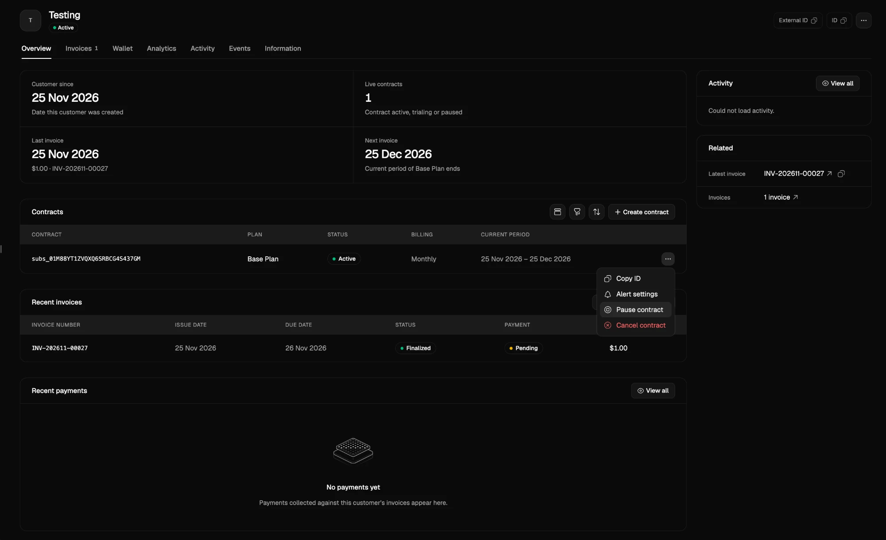
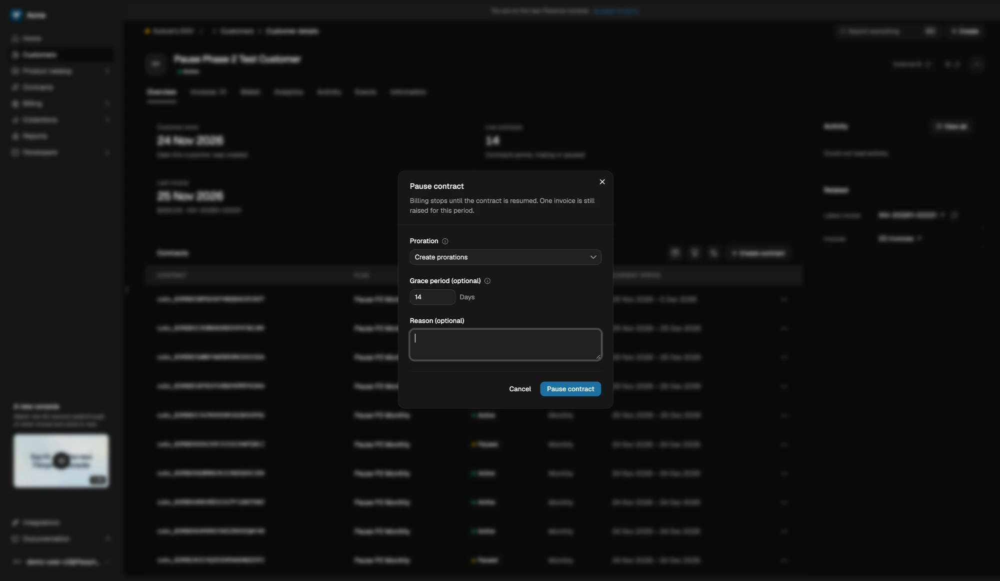
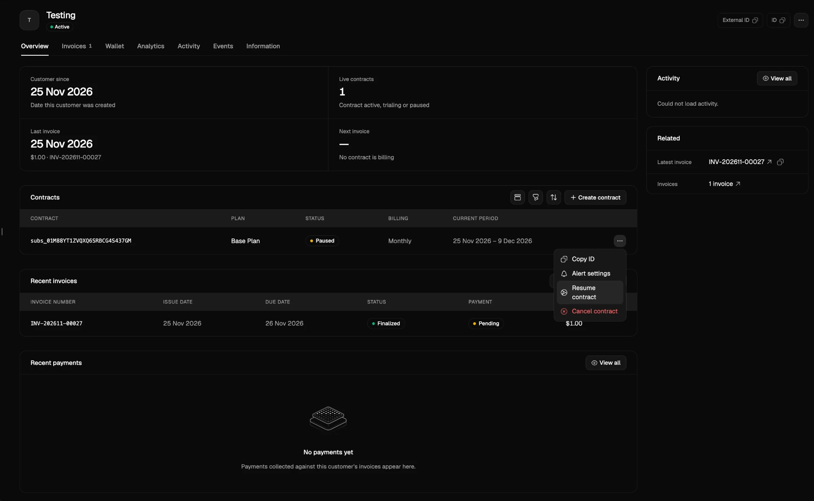
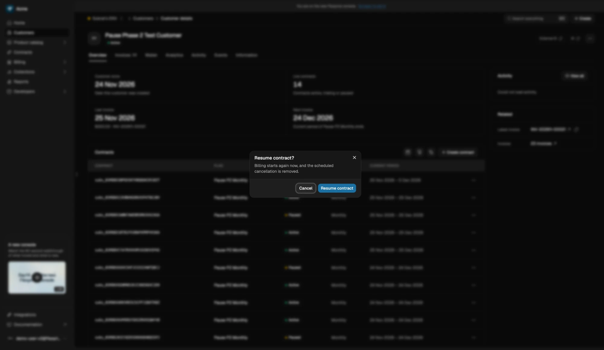

Pausing a subscription stops billing without ending it. The billing period carries on, and its invoice is raised at the period end as usual, over the time the subscription was active. A paused subscription that is not resumed within its grace period is cancelled.

<Info>
  Pause and resume take effect at the moment of the request. Pause with [Pause subscription](/api-reference/subscriptions/pause-subscription) and resume with [Resume subscription](/api-reference/subscriptions/resume-subscription). For how prorated amounts are calculated, see [Understanding Proration](/docs/subscriptions/understanding-proration).
</Info>

## Pausing a subscription

Only an `active` subscription can be paused.

In the dashboard, subscriptions are called **contracts**. Actions that change a contract require write access to subscriptions.

<Tabs>
  <Tab title="Dashboard">
    <Steps>
      <Step title="Open the subscription">
        Go to **Customers**, select the customer, and find the active contract in the **Contracts** card.
      </Step>

      <Step title="Choose Pause contract">
        Open the **⋯** menu beside the contract and select **Pause contract**. You can also open the contract and use its header menu.
      </Step>

      <Step title="Fill in the pause">
        All fields are optional:

        - **Proration**: **None** (the default) or **Create prorations**. See [How a paused period is billed](#how-a-paused-period-is-billed).
        - **Grace period (optional)**: the number of days the contract may stay paused before it is cancelled. Leave it empty to use the default.
        - **Reason (optional)**: why the contract is paused.
      </Step>

      <Step title="Confirm">
        Click **Pause contract**. The contract status changes to **Paused**, and its banner shows the date it is cancelled if it is not resumed.
      </Step>
    </Steps>

    <Frame>
      
    </Frame>

    <Frame>
      
    </Frame>
  </Tab>
  <Tab title="API">
    ```bash
    curl -X POST "https://us.api.flexprice.io/v1/subscriptions/$SUBSCRIPTION_ID/pause" \
      -H "x-api-key: $FLEXPRICE_API_KEY" \
      -H "Content-Type: application/json" \
      -d '{
        "proration_behavior": "create_prorations",
        "pause_grace_period_days": 15,
        "reason": "customer_request"
      }'
    ```

    | Field | Description |
    | ----- | ----------- |
    | `proration_behavior` | `none` (default) or `create_prorations`. Decides whether this pause's days are taken off the fixed charges |
    | `pause_grace_period_days` | Days the subscription may stay paused before it is cancelled. Minimum 1, and it must end by the current period end |
    | `reason` | Why the subscription is paused. Up to 255 characters |
    | `metadata` | Key-value pairs stored with the pause |
  </Tab>
</Tabs>

## Automatic cancellation

Every pause schedules a cancellation. If the subscription is still paused when the grace period ends, it is cancelled and its invoice for the period is raised. The grace period is taken from the first of these that is set:

1. `pause_grace_period_days` on the pause request.
2. `pause_grace_period_days` in the [subscription settings](/docs/settings/settings#subscription-configuration), capped at the current period end.
3. The end of the current billing period.

<Warning>
  A grace period sent on the pause request must end by the current period end. A longer one is refused with HTTP 400.
</Warning>

<Note>
  To set the default, go to **Settings → Contract** and enter the **Pause grace period**. Leave it empty to cancel paused contracts at the end of their period.
</Note>

## How a paused period is billed

The period's `SUBSCRIPTION_CYCLE` invoice is raised at the period end, as for any other period.

- **Usage** is billed only for the time the subscription was active.
- **Fixed charges** depend on each pause's `proration_behavior`:

| Charge | `none` | `create_prorations` |
| ------ | ------ | ------------------- |
| `ARREAR` fixed charges | The full period | The period minus the paused days |
| `ADVANCE` fixed charges | No credit | The paused share is credited to the customer's prepaid wallet |

The `ADVANCE` credit is given once per billing period, when that period's invoice is finalized, and covers every `create_prorations` pause in the period together. Days paused with `none` are billed as usual. The subscription's own `proration_behavior` does not change.

## Resuming a subscription

Resuming starts billing again and removes the pause's scheduled cancellation. The billing period and its end date stay as they were.

<Tabs>
  <Tab title="Dashboard">
    Open the **⋯** menu beside the paused contract, select **Resume contract**, and confirm. The contract status changes to **Active**.

    <Frame>
      
    </Frame>

    <Frame>
      
    </Frame>
  </Tab>
  <Tab title="API">
    ```bash
    curl -X POST "https://us.api.flexprice.io/v1/subscriptions/$SUBSCRIPTION_ID/resume" \
      -H "x-api-key: $FLEXPRICE_API_KEY" \
      -H "Content-Type: application/json" \
      -d '{}'
    ```

    | Field | Description |
    | ----- | ----------- |
    | `metadata` | Key-value pairs merged into the pause |
  </Tab>
</Tabs>

A subscription can be paused again after it is resumed. Each pause has its own proration behavior and grace period.

## Cancelling a paused subscription

A paused subscription can be cancelled only with `cancellation_type: immediate`. Its invoice for the period is raised up to the cancellation, over the time it was active. If the pause used `create_prorations`, the paused share of the `ADVANCE` fixed charges is credited up to the original period end. To keep the subscription instead, resume it, which removes the scheduled cancellation.

## Use case: a ten-day pause in January

| Subscription | Setup |
| ------------ | ----- |
| Billing period | Monthly, billed on the 1st |
| Platform fee | \$310, `ADVANCE` |
| Support fee | \$62, `ARREAR` |
| API usage | `ARREAR` |
| Paused | January 11, after 10 of 31 days |
| Resumed | January 21, after 10 paused days |

| Invoice | Raised on | `create_prorations` | `none` |
| ------- | --------- | ------------------- | ------ |
| `SUBSCRIPTION_CYCLE` | February 1 | \$42 support fee, API usage outside January 11 to 21, \$310 platform fee for February. \$100 of January's platform fee is credited to the wallet | \$62 support fee, API usage outside January 11 to 21, \$310 platform fee for February. No credit |

Had the subscription not been resumed, it would have been cancelled when its grace period ended, and its January invoice raised then.

## Webhooks

| Event | Fires when |
| ----- | ---------- |
| [`subscription.paused`](/api-reference/webhook-events/subscriptionpaused) | A subscription is paused |
| [`subscription.resumed`](/api-reference/webhook-events/subscriptionresumed) | A paused subscription is resumed |
| [`subscription.updated`](/api-reference/webhook-events/subscriptionupdated) | A subscription is paused or resumed, sent alongside the two events above |

<CardGroup cols={3}>
  <Card title="Subscription settings" icon="gear" href="/docs/settings/settings#subscription-configuration">
    Set the default pause grace period.
  </Card>
  <Card title="Pause subscription" icon="pause" href="/api-reference/subscriptions/pause-subscription">
    API reference for pausing a subscription.
  </Card>
  <Card title="Resume subscription" icon="play" href="/api-reference/subscriptions/resume-subscription">
    API reference for resuming a paused subscription.
  </Card>
</CardGroup>
