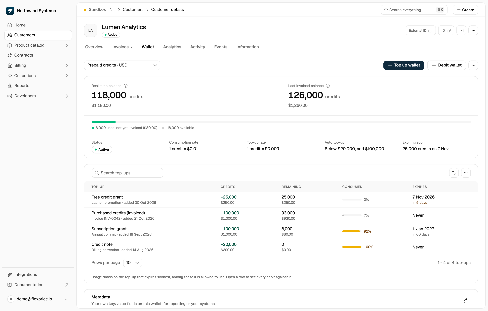
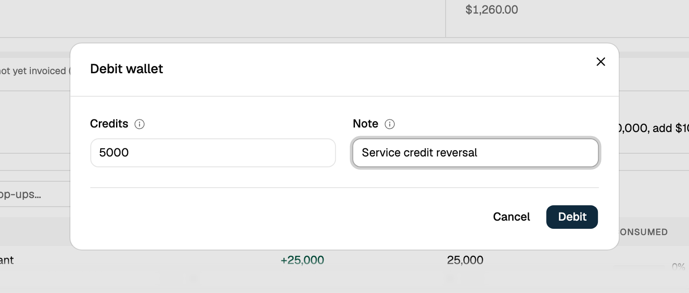

The Manual Wallet Debit feature allows you to manually deduct credits from a customer's wallet. This is essential for handling refunds, billing corrections, chargebacks, and other administrative adjustments.

**Common Use Cases:**

- **Refunds**: Process customer refunds for overcharges or billing errors
- **Billing Adjustments**: Correct incorrect credit allocations
- **Chargebacks**: Handle payment disputes and chargebacks
- **Administrative Corrections**: Fix manual entry errors or system issues

To close a wallet, terminate it instead (**Terminate wallet** in the wallet's **⋯** menu, or `POST /wallets/{id}/terminate`). Termination debits the remaining balance for you.

## How Manual Debit Works

When you debit a wallet, Flexprice automatically:

1. **Validates the Request**: Checks that the credits are positive and the wallet is active
2. **Consumes Credits**: Deducts credits using a priority-based algorithm (see below)
3. **Updates Balance**: Reduces the wallet balance by the debited amount, even below zero (see [Debits Larger Than the Balance](#debits-larger-than-the-balance))
4. **Creates Transaction Record**: Maintains a complete audit trail
5. **Triggers Alerts**: Checks the wallet's low balance alert and auto top-up against the new balance

## Credit Consumption Algorithm

Flexprice uses a smart **Priority-Based FIFO** algorithm to determine which credits to consume when processing a debit:

### Consumption Order

Credits are consumed in the following order:

1. **Priority** (Lower number = Higher priority)
   - Credits with priority 1 are consumed before priority 2
   - Credits without priority are consumed last

2. **Expiry Date** (Earlier expiry first)
   - Credits expiring sooner are consumed first to prevent waste
   - Credits without expiry dates are consumed last

3. **Credit Amount** (Larger amounts first)
   - Among credits with the same priority and expiry, larger amounts are consumed first
   - This optimizes the number of transaction updates required

### Example Scenario

Suppose a wallet has the following credits:

| Credits | Priority | Expiry Date | Status |
|---------|----------|-------------|--------|
| 50      | 1        | 2024-03-01  | Available |
| 30      | 1        | 2024-03-01  | Available |
| 100     | 1        | 2024-03-15  | Available |
| 75      | 2        | 2024-02-20  | Available |
| 200     | None     | None        | Available |

**If you debit 150 credits**, they will be consumed in this order:

1. **50 credits** from priority 1, expiring 2024-03-01
2. **30 credits** from priority 1, expiring 2024-03-01
3. **70 credits** from priority 1, expiring 2024-03-15 (partial)

The wallet will have 30 credits remaining from the third transaction, plus the untouched 75 and 200 credits.

## Making a Manual Debit via Dashboard

You can debit credits from a customer's wallet through the Flexprice dashboard:

<Steps>
  <Step title="Navigate to the wallet">
    Go to **Customers**, open the customer whose wallet you want to debit, and select the **Wallet** tab.
  </Step>

  <Step title="Open Debit wallet">
    Click **Debit wallet** next to **Top up wallet**.
    <Frame>
      
    </Frame>
  </Step>

  <Step title="Enter the debit details">
    - **Credits**: the number of credits to remove from the wallet
    - **Note** (optional): why the credits are being removed

    Click **Debit** to process the debit.
    <Frame>
      
    </Frame>
  </Step>

  <Step title="Verify the transaction">
    The wallet balance drops by the debited credits. The debit doesn't get a row of its own in the wallet's table of top-ups: expand a top-up it drew credits from to see it as a negative line, labelled with your note (or **Manual debit** when the note is empty or looks like an ID).
  </Step>
</Steps>

The dialog has no reference field: the dashboard generates an idempotency key each time you open **Debit wallet**, so clicking **Debit** again after an error doesn't debit the wallet twice. That key belongs to the dialog alone, so if a retry shows "A wallet transaction with this idempotency key already exists", the earlier attempt went through. To debit from your own systems, use the API and send your own `idempotency_key`, such as the ID of the refund or ticket the debit is for.

## Making a Manual Debit via API

### Endpoint

```http
POST https://api.cloud.flexprice.io/v1/wallets/{wallet_id}/debit
```

### Request Parameters

| Parameter | Type | Required | Description |
|-----------|------|----------|-------------|
| `credits` | string | Yes | Amount of credits to debit (decimal format, e.g., "100.50") |
| `transaction_reason` | string | Yes | Reason code for the debit (see Transaction Reasons below) |
| `idempotency_key` | string | Yes | Unique key to prevent duplicate debits |
| `description` | string | No | Human-readable description of the debit |
| `metadata` | object | No | Custom key-value pairs for additional context |

### Transaction Reasons

Use appropriate transaction reason codes to categorize debits:

| Reason Code | Use Case |
|-------------|----------|
| `MANUAL_BALANCE_DEBIT` | Administrative corrections and manual adjustments |

### Example Request

```bash
curl --request POST \
  --url https://api.cloud.flexprice.io/v1/wallets/{id}/debit \
  --header 'Content-Type: application/json' \
  --header 'x-api-key: <api-key>' \
  --data '{
  "credits": 123,
  "description": "<string>",
  "idempotency_key": "<string>",
  "metadata": {},
  "transaction_reason": "MANUAL_BALANCE_DEBIT"
}'
```

### Success Response

```json
{
    "id": "wallet_0123",
    "customer_id": "cust_0123",
    "name": "Prepaid Wallet",
    "currency": "usd",
    "balance": "1587",
    "credit_balance": "1587",
    "wallet_status": "active",
    "wallet_type": "PRE_PAID",
    "config": {
        "allowed_price_types": [
            "ALL"
        ]
    },
    "conversion_rate": "1",
    "topup_conversion_rate": "1",
    "description": "",
    "metadata": {},
    "alert_state": "ok",
    "environment_id": "env_0123",
    "tenant_id": "tenant_0123",
    "status": "published",
    "created_at": "2025-11-05T13:41:59.256406Z",
    "updated_at": "2025-11-14T15:55:38.19095Z",
    "created_by": "user_0123",
    "updated_by": "user_0123"
}
```

The response is the updated wallet. It also includes `auto_topup` and `alert_settings` when the wallet has them configured.

### Error Responses

| HTTP Status | `code` | `message` | Cause |
|-------------|--------|-----------|-------|
| 400 | `validation_error` | Invalid request format | The body can't be parsed, or `idempotency_key` or `transaction_reason` is missing |
| 400 | `validation_error` | Credits to debit must be a positive value | `credits` is missing, zero, or negative |
| 400 | `validation_error` | Invalid transaction reason | `transaction_reason` isn't `MANUAL_BALANCE_DEBIT` |
| 400 | `invalid_operation` | Wallet is not active | The wallet was terminated |
| 404 | `not_found` | Wallet not found | No wallet has this ID |
| 409 | `already_exists` | A wallet transaction with this idempotency key already exists | The `idempotency_key` was already used |

A debit larger than the wallet's balance is not an error. See [Debits Larger Than the Balance](#debits-larger-than-the-balance).

### Example Error Response

```json
{
  "code": "already_exists",
  "message": "A wallet transaction with this idempotency key already exists",
  "http_status_code": 409,
  "details": {
    "amount": "10",
    "idempotency_key": "refund_inv_123",
    "type": "debit",
    "wallet_id": "wallet_0123"
  }
}
```

The `details` repeat the debit you sent, not the transaction that already holds the key.

## Idempotency

The `idempotency_key` parameter is **required** and ensures that duplicate API requests (e.g., due to network timeouts) don't result in multiple debits.

If a key has already been used, Flexprice rejects the request with 409 `already_exists` and debits nothing. Keys are unique across all wallet transactions in the environment, not per wallet, so the key may belong to an earlier attempt of this debit, or to a top-up or a transaction on another wallet. A 409 alone doesn't tell you which.

To find the transaction that holds the key, search wallet transactions by `idempotency_key`:

```bash
curl --request POST \
  --url https://api.cloud.flexprice.io/v1/wallets/transactions/search \
  --header 'Content-Type: application/json' \
  --header 'x-api-key: <api-key>' \
  --data '{
  "filters": [
    {
      "field": "idempotency_key",
      "operator": "eq",
      "data_type": "string",
      "value": { "string": "refund_inv_123" }
    }
  ]
}'
```

Treat the debit as done only if the match is a `debit` on the same `wallet_id` for the same `credit_amount`. Otherwise the key belongs to another transaction: send the debit again with a new key.

### Best Practices for Idempotency Keys

- Use a **unique identifier** for each logical debit operation
- Include context in the key, e.g., `refund_invoice_123_20240115`
- **Never reuse** idempotency keys across different operations

## Use Case Examples

### Example: Administrative Correction

```bash
curl --location 'https://api.cloud.flexprice.io/v1/wallets/{id}/debit' \
--header 'Content-Type: application/json' \
--header 'Accept: application/json' \
--header 'x-api-key: sk_xxxxxxxxxxxx' \
--data '{
  "idempotency_key": "Manual-adjustment-123",
  "transaction_reason": "MANUAL_BALANCE_DEBIT",
  "credits": 1
}'
```

## Important Considerations

### Debits Larger Than the Balance

A manual debit isn't limited to the wallet's balance:

- Flexprice consumes every available, unexpired credit, in the order described above
- The part of the debit that no credit covers still counts, so the wallet's credit balance goes below zero
- The API returns success, not an error
- The next top-up covers the negative amount first, so only the rest of its credits become available

Check the balance before a large debit if the wallet shouldn't go negative.

### Transaction Atomicity

All debit operations are **atomic**:

- Credits are consumed and wallet balance is updated in a single database transaction
- If any step fails, all changes are rolled back
- This ensures data consistency and prevents partial debits

### Audit Trail

Every manual debit creates a complete audit trail:

- Transaction record with type `debit`
- Before and after balances
- Description and metadata
- Transaction reason
- Idempotency key for tracking
- Timestamp and user information

### Alert Integration

After a debit, Flexprice automatically:

- Checks the wallet's [low balance alert](/docs/wallet/low-balance-alert) against the new balance
- Sends a webhook if the alert state changes
- Tops up the wallet if [auto top-up](/docs/wallet/auto-top-up) is on and the balance is at or below its threshold

## Best Practices

💡 **Always Use Idempotency Keys**: Protect against duplicate debits by using unique idempotency keys for each operation

💡 **Provide Clear Descriptions**: Include descriptive text and metadata to make audit trails meaningful

💡 **Choose Appropriate Reasons**: Use the correct transaction reason code to categorize debits properly

💡 **Check the Balance First**: A manual debit larger than the balance still goes through and leaves the wallet below zero

💡 **Handle Errors Gracefully**: Don't treat a 409 `already_exists` as proof that the debit went through. Find the transaction that holds the key first (see [Idempotency](#idempotency))

💡 **Monitor Alert Notifications**: Watch for low balance alerts after processing debits

## Troubleshooting

### Negative Balance After a Debit

**Problem**: The wallet balance is below zero after a manual debit

**Solution**:
- Manual debits aren't limited to the balance: the debit used every available credit and recorded the rest as a negative balance
- Check the wallet's balance before debiting
- Top up the wallet to bring the balance back up

### Duplicate Idempotency Key Error

**Problem**: API returns 409 `already_exists` with "A wallet transaction with this idempotency key already exists"

**Solution**:
- Find the transaction that holds the key by searching wallet transactions by `idempotency_key` (see [Idempotency](#idempotency))
- If it's a `debit` on the same wallet for the same credits, your earlier request went through, so don't send it again
- If it's a top-up or a transaction on another wallet, the key is already taken: send the debit again with a new key
- Generate a new idempotency key for each distinct debit

### Wallet Not Active Error

**Problem**: API returns 400 `invalid_operation` with "Wallet is not active"

**Solution**:
- The wallet was terminated, so its `wallet_status` is `closed`
- Termination already debited the remaining balance, and a closed wallet can't be reopened

## Related Features

- [Creating a Wallet](/docs/wallet/create) - Learn how to create wallets for customers
- [Top-up Wallet](/docs/wallet/top-up) - Add credits to customer wallets
- [Low Balance Alert](/docs/wallet/low-balance-alert) - Configure balance threshold alerts
- [Prepaid and Promotional Credits](/docs/wallet/prepaid-and-promotional) - Understand credit types
- [Wallet Transactions](/docs/wallet/transactions) - Track and monitor all wallet transactions

