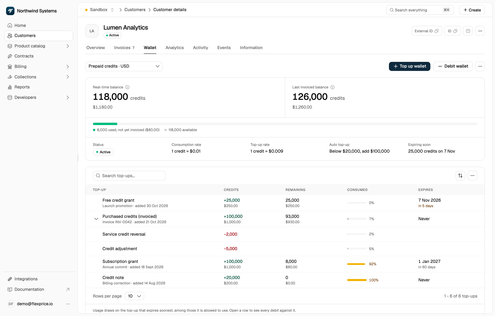

## Overview

Every action that affects a wallet balance is recorded as a transaction. In the dashboard, the customer's **Wallet** tab lists the wallet's top-ups, the transactions that added credits, with how much of each is left, how much has been consumed, and when it expires. Debits don't get rows of their own: open a top-up to see the debits that drew credits from it.

<Frame>
  
</Frame>

To list every transaction as its own record, debits included, use the API: `GET /wallets/{id}/transactions` for one wallet, or `POST /wallets/transactions/search` to search across wallets.

## Transaction Types

Every transaction has a `type`, either `credit` or `debit`, and a `transaction_reason`. The dashboard shows the reason as the transaction's name.

### Credits Added

Credits added to the wallet appear as top-ups:

- **Free credit grant** (`FREE_CREDIT_GRANT`): free or promotional credits, such as a welcome bonus, service compensation, or trial credits. They're available immediately, with no payment or invoice.
- **Purchased credits (invoiced)** (`PURCHASED_CREDIT_INVOICED`): credits bought through an invoice. They wait for the invoice to be paid (see [Purchased Credits (Invoiced)](#purchased-credits-invoiced)).
- **Purchased credits** (`PURCHASED_CREDIT_DIRECT`): credits bought without an invoice, available immediately.
- **Bonus credits** (`PURCHASED_CREDIT_BONUS`): bonus credits earned on a purchase. They become available together with the purchase.
- **Subscription grant** (`SUBSCRIPTION_CREDIT_GRANT`): credits from a credit grant on a subscription.
- **Credit note** (`CREDIT_NOTE`): a credit note refunded to the wallet.
- **Invoice void refund** (`INVOICE_VOID_REFUND`): what a voided invoice had been paid, returned to the wallet as credits.

### Purchased Credits (Invoiced)

Credits purchased through an invoice are added only after the invoice is paid:

<Steps>
  <Step title="Purchase Initiated">
    The purchase creates a transaction in the `pending` state
  </Step>

  <Step title="Invoice Generated">
    An invoice is created for the purchased amount
  </Step>

  <Step title="Payment Pending">
    The transaction stays pending while the invoice is unpaid. Its credits aren't in the wallet balance and can't be used
  </Step>

  <Step title="Payment Received">
    When the invoice is paid, the transaction becomes `completed`
  </Step>

  <Step title="Credits Available">
    The credits are added to the wallet balance and can be used
  </Step>
</Steps>

If the invoice is voided, or the purchase's checkout doesn't complete, the transaction becomes `failed` and its credits never become available.

**Example**: A customer buys 500 credits through an invoice. The transaction shows as "Purchased credits (invoiced)" and stays pending. Once the customer pays the invoice, the transaction completes and the credits are added to their wallet balance.

<Note>
  The **Wallet** tab doesn't show a purchase's status. A pending purchase appears as a top-up with all its credits remaining, but they aren't in the balance until the invoice is paid. Check the purchase's invoice, or `transaction_status` in the API.
</Note>

#### Auto-Complete Purchased Credit Transactions

To skip the pending state, turn on **Settle automatically** in **Settings** > **Invoicing** > **Invoices** (the `auto_complete_purchased_credit_transaction` field of the `invoice_config` setting). When it's on:

- Purchased credit transactions are created directly as **completed** instead of pending
- Credits are added to the wallet **immediately**
- The invoice is still generated, and it's marked as paid
- Useful for automated payment systems where payment is guaranteed

Purchases paid through a checkout, and purchases a customer makes themselves (for example, from the customer portal), still wait for payment. While the setting is on, a top-up that uses a coupon is rejected.

**When to Enable:**
- Integration with pre-authorized payment methods
- Automated billing systems with payment confirmation
- Trust-based credit purchases for verified enterprise customers

**Note**: This setting bypasses the pending state entirely. Only enable if you have a reliable payment confirmation mechanism in place.

### Credits Removed

Debits appear under the top-ups they drew from:

- **Credit adjustment** (`CREDIT_ADJUSTMENT`): prepaid credits applied to an invoice's usage charges when the invoice is finalized
- **Invoice payment** (`INVOICE_PAYMENT`): the wallet pays an invoice
- **Manual debit** (`MANUAL_BALANCE_DEBIT`): credits you remove with a [manual debit](/docs/wallet/manual-debit)
- **Credits expired** (`CREDIT_EXPIRED`): unused credits removed when they pass their expiry date
- **Wallet terminated** (`WALLET_TERMINATION`): the remaining balance, removed when the wallet is terminated

Usage isn't debited as it happens. Until it's invoiced, the **Real-time balance** already subtracts it, and the bar under the balances shows it as used, not yet invoiced. The wallet is debited once that usage is invoiced.

A completed debit isn't edited or reversed. If the invoice it paid is voided, the credits come back as a new **Invoice void refund**.

## Transaction Details

Each top-up in the **Wallet** tab includes:

| Column | Description |
|--------|-------------|
| **Top-up** | The transaction's name, with its description or reference and the date it was added |
| **Credits** | Credits added, with their value in the wallet currency |
| **Remaining** | Credits from this top-up that haven't been used, with their value |
| **Consumed** | Share of the top-up's credits already used |
| **Expires** | When the credits expire, or **Never** |

Top-ups that debits have drawn from have an arrow next to their name. Open one to list those debits: each shows the credits it took from this top-up and its share of the top-up. A debit is named after its note, or after its type (such as **Credit adjustment**) when there's no readable note.

Older debits recorded without a breakdown of the top-ups they drew from, and any part of a debit that no top-up covered (such as a [manual debit](/docs/wallet/manual-debit) larger than the balance), don't appear in the table. The API lists them.

### Understanding Transaction Amounts

The **Credits** column shows each top-up in two formats:

- **Credit Amount**: Credit units (e.g., +25,000)
- **Currency Amount**: Their value in the wallet currency

**Positive amounts** (+) are credits **added** to the wallet. **Negative amounts** (−) are credits a debit **removed** from the top-up it's listed under.

## Accessing Transaction History

View the transaction history for any customer wallet:

<Steps>
  <Step title="Navigate to Customer Wallet">
    Go to **Customers**, open the customer, and select the **Wallet** tab. If the customer has more than one wallet, pick it from the wallet selector at the top left
  </Step>

  <Step title="Review the Top-Ups">
    The table below the balances lists each top-up. Search by name, description, or reference, and use the sort button to reorder the table
  </Step>

  <Step title="Open a Top-Up">
    Click the arrow next to a top-up to see the debits that drew from it
  </Step>
</Steps>

## Transaction States

Each transaction has a `transaction_status`, which tracks payment flows and credit availability:

### Completed Transactions

- Credits are available for use, or have been removed
- Balance has been updated
- Transaction is finalized and cannot be changed
- Applies to: Free credits, purchases without an invoice, grants, credit notes, refunds, paid invoiced purchases, and all debits

### Pending Transactions

- Credits are not yet available
- Balance has not been updated
- Waiting for invoice payment
- Applies to: Purchased credits (invoiced) and their bonus credits

### Failed Transactions

- The purchase won't complete: its invoice was voided, or its checkout didn't complete
- Credits never become available
- Applies to: Purchased credits (invoiced) and their bonus credits

<Tip>
  **Monitoring Pending Transactions**: Keep an eye on pending purchases to ensure their invoices are paid promptly. The **Wallet** tab doesn't mark them, so check the purchase invoices or `transaction_status` in the API.
</Tip>

## Use Cases

### For Finance Teams

💡 **Audit Trail**: Complete transaction history for accounting and compliance

💡 **Reconciliation**: Match wallet transactions with invoices and payments

💡 **Revenue Tracking**: Monitor purchased credit transactions and payment flow

### For Customer Support

💡 **Quick Reference**: Review transaction history when resolving customer inquiries

💡 **Balance Investigation**: Open a top-up to see which debits drew it down

💡 **Payment Status**: Check whether purchased credits are pending or completed (`transaction_status` in the API)

### For Analytics

💡 **Usage Patterns**: Analyze customer spending and credit consumption trends

💡 **Credit Utilization**: Track how customers use free vs. purchased credits

💡 **Payment Behavior**: Monitor invoice payment timelines for purchased credits

## Related Documentation

- [Top-Up Wallet](/docs/wallet/top-up) - Learn about manual wallet top-ups
- [Auto Top-Up](/docs/wallet/auto-top-up) - Configure automatic wallet recharging
- [Manual Debit](/docs/wallet/manual-debit) - Remove credits from a wallet
- [Low Balance Alert](/docs/wallet/low-balance-alert) - Set up balance alerts
