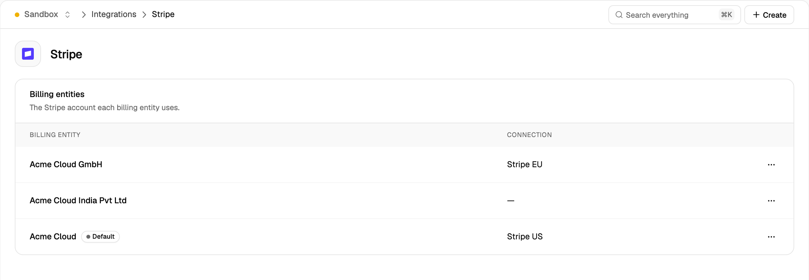
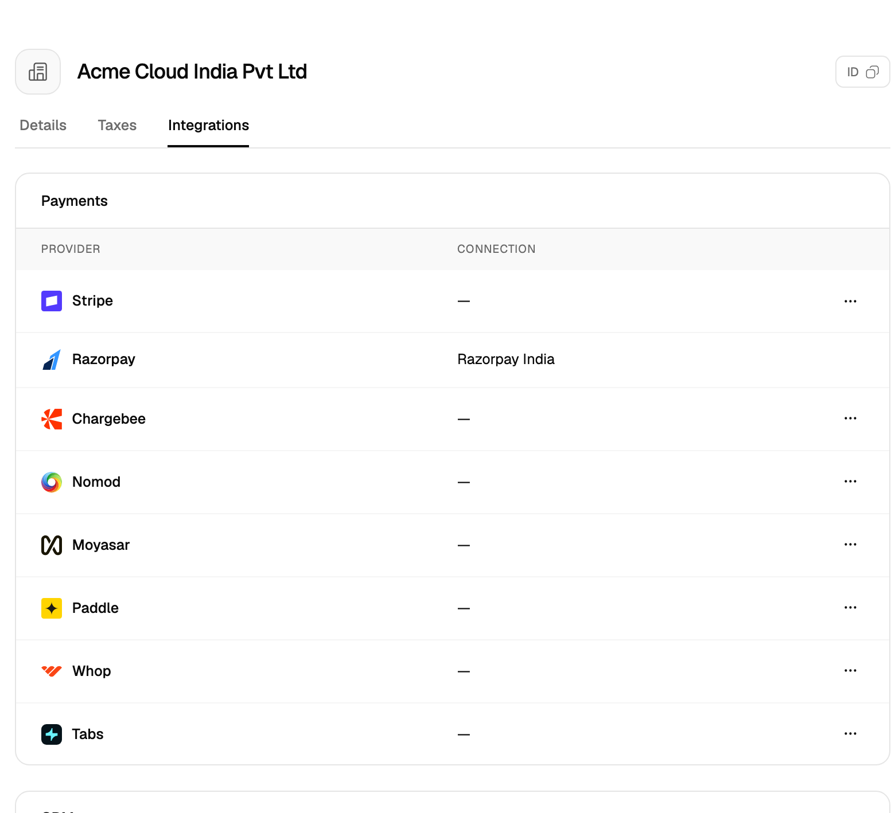
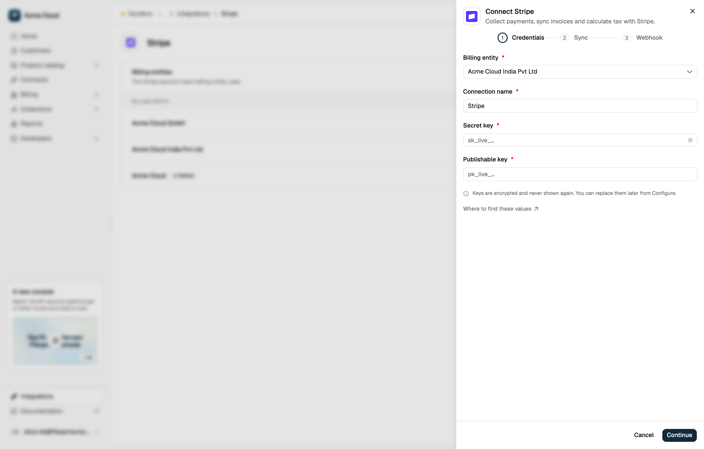

With [billing entities](/docs/invoices/billing-entities) turned on, every connection (a linked Stripe, Razorpay, QuickBooks or other provider account) is owned by one billing entity. Flexprice picks the connection for each operation from the customer's billing entity. Card charges, payment links, saved payment methods and customer, invoice and subscription syncs use only connections owned by that entity, and never fall back to another entity's connection.

<Frame></Frame>

## How It Works

Each billing entity can own one connection per provider: one Stripe connection, one Razorpay connection, one QuickBooks connection and so on. Two entities can't share a connection, and a connection's owner can't change after it's created. When billing entities are turned on, existing connections are assigned to the default entity.

Which connection Flexprice uses depends on the operation:

| Operation | Connection used |
| --- | --- |
| Card charges, payment links, checkout | The customer's entity's connection for that provider |
| Saved payment methods (list, charge, delete, set default) | The customer's entity's connection |
| Customer, invoice and subscription sync | The customer's entity's connection. Skipped if the entity has no connection for the provider. |
| Plan, price and add-on sync | Every connection of the provider, because the catalog is shared by all entities |
| Refunds | The connection that took the original payment, recorded on the payment as `connection_id` |
| Incoming webhooks | The connection named in the webhook URL's `?connection=` parameter |
| Data exports (S3 and other storage) | Shared by the whole environment, not owned by an entity |

## Connecting a Provider for an Entity

### In the dashboard

You can start from the provider's page or from the entity's page. Both open the same connect panel with the entity preselected.

<Tabs>
  <Tab title="From the provider page">
    1. Go to **Integrations** and click the provider, for example **Stripe**. The **Billing entities** section lists each entity and its connection.
    2. Open the menu (**⋯**) on the entity's row and click **Connect**.
  </Tab>
  <Tab title="From the entity page">
    1. Go to **Settings** → **Billing entities** and open the entity.
    2. On the **Integrations** tab, open the menu (**⋯**) next to the provider and click **Connect**.

    <Frame></Frame>
  </Tab>
</Tabs>

In the connect panel:

1. Check the **Billing entity** field, then enter the provider's API keys and choose what to sync.
2. On the **Webhook** step, copy the **Webhook URL**. It ends in `?connection=<connection_id>`. Register it as a webhook endpoint in the provider's dashboard.
3. Paste the signing secret from the provider into **Webhook signing secret** and finish connecting.

<Frame></Frame>

### From the API

Create the connection with `POST /v1/connections` and set `billing_entity_id`. If `billing_entity_id` is omitted, the connection belongs to the default entity.

For any entity other than the default, the request must also include a client-generated `id`: `conn_` followed by a [ULID](https://github.com/ulid/spec). Generating the ID yourself means you know the webhook URL before the connection exists, so you can register it with the provider first.

```bash
curl -X POST https://us.api.flexprice.io/v1/connections \
  -H "x-api-key: <API_KEY>" \
  -H "Content-Type: application/json" \
  -d '{
    "id": "conn_01M7JNERZMM2D27MP4BW5F23BW",
    "name": "Stripe EU",
    "provider_type": "stripe",
    "billing_entity_id": "be_01M75QYPH7E0ZHBF4ZBT5KE640",
    "encrypted_secret_data": {
      "secret_key": "<STRIPE_SECRET_KEY>",
      "publishable_key": "<STRIPE_PUBLISHABLE_KEY>",
      "webhook_secret": "<STRIPE_WEBHOOK_SIGNING_SECRET>"
    },
    "sync_config": {
      "customer": { "inbound": false, "outbound": true },
      "invoice": { "inbound": false, "outbound": true }
    }
  }'
```

| Error | Response |
| --- | --- |
| `id` missing for a non-default entity | `400` "Send the connection id (conn_ followed by a ULID) used in its webhook URL; a connection without one belongs to the default billing entity" |
| Entity already has a connection for the provider | `409` "A published connection for provider 'stripe' already exists for this billing entity" |
| `id` already in use | `409` "A connection with this id already exists" |

List an entity's connections with `GET /v1/connections?billing_entity_id=<ID>`.

QuickBooks and Zoho Books connect through OAuth. Send `billing_entity_id`, and `id` for a non-default entity, in the `POST /v1/oauth/init` request.

## Webhook URLs

Each connection has its own webhook URL:

```
https://api.cloud.flexprice.io/v1/webhooks/{provider}/{tenant_id}/{environment_id}?connection={connection_id}
```

`{tenant_id}` is your Flexprice account ID. The dashboard shows the complete URL on the **Webhook** step. Stripe, Razorpay, Paddle, Nomod, Moyasar, Whop, Chargebee, HubSpot, QuickBooks and Zoho Books use per-connection URLs.

Events sent to a per-connection URL are verified with that connection's signing secret and applied to its entity. Events for an unknown connection return `404`.

The URL without `?connection=` keeps routing to the default entity's connection, so webhook endpoints registered before billing entities were turned on keep working.

<Warning>
  Register the URL with `?connection=` for every non-default entity. Events from a non-default entity's provider account sent to the URL without it are verified against the default entity's signing secret and rejected.
</Warning>

## Payments Use the Customer's Entity

A payment can only go through a provider that the customer's billing entity has connected. Requesting any other provider returns `400`:

```bash
curl -X POST https://us.api.flexprice.io/v1/payments \
  -H "x-api-key: <API_KEY>" \
  -H "Content-Type: application/json" \
  -d '{
    "destination_type": "INVOICE",
    "destination_id": "inv_01M75R4KQRJVAV1RTGYSE1Q9CB",
    "payment_method_type": "PAYMENT_LINK",
    "payment_gateway": "stripe",
    "amount": "85000",
    "currency": "inr",
    "success_url": "https://example.com/ok"
  }'
```

```json
{
  "message": "stripe is not connected for this customer's billing entity",
  "http_status_code": 400
}
```

If an entity has no payment connection, automatic charges are skipped for its customers and their invoices stay pending. You can still record payments manually.

Saved payment methods exist only in the provider account where they were created, so a customer's saved cards are always read and charged through their entity's connection.

## Changing an Entity's Provider Account

A connection's owner can't change. To move an entity to a different account of the same provider:

1. Disconnect the entity's current connection.
2. Connect the new account for the entity.
3. Re-sync the entity's customers to the new account.

<Warning>
  Customers, saved payment methods and other records in the old account aren't copied to the new one. A refund of a payment taken through the removed connection can't go back to the original payment method, so Flexprice credits it to the customer's wallet instead.
</Warning>

## Related Articles

<CardGroup cols={2}>
  <Card icon="building" href="/docs/invoices/billing-entities" title="Billing Entities">
    Enable billing entities and configure seller details, invoice numbering and default tax rates.
  </Card>
  <Card icon="credit-card" href="/integrations/stripe/connection-setup" title="Stripe Connection Setup">
    API keys, webhook events and sync options for a Stripe connection.
  </Card>
  <Card icon="indian-rupee-sign" href="/integrations/razorpay/connection-setup" title="Razorpay Connection Setup">
    API keys and webhook setup for a Razorpay connection.
  </Card>
  <Card icon="plug" href="/integrations/introduction" title="Integrations">
    All providers Flexprice connects to.
  </Card>
</CardGroup>
