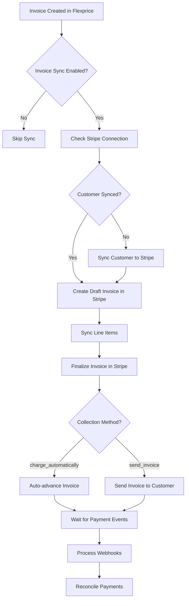
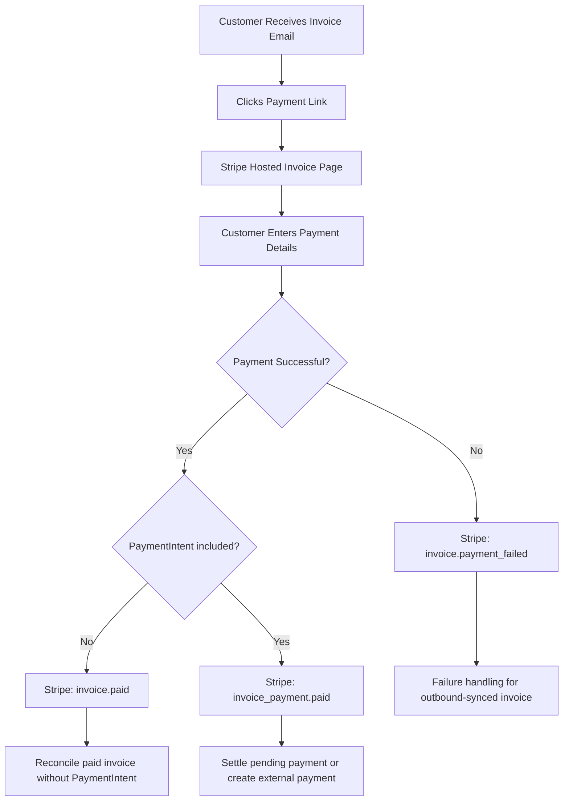
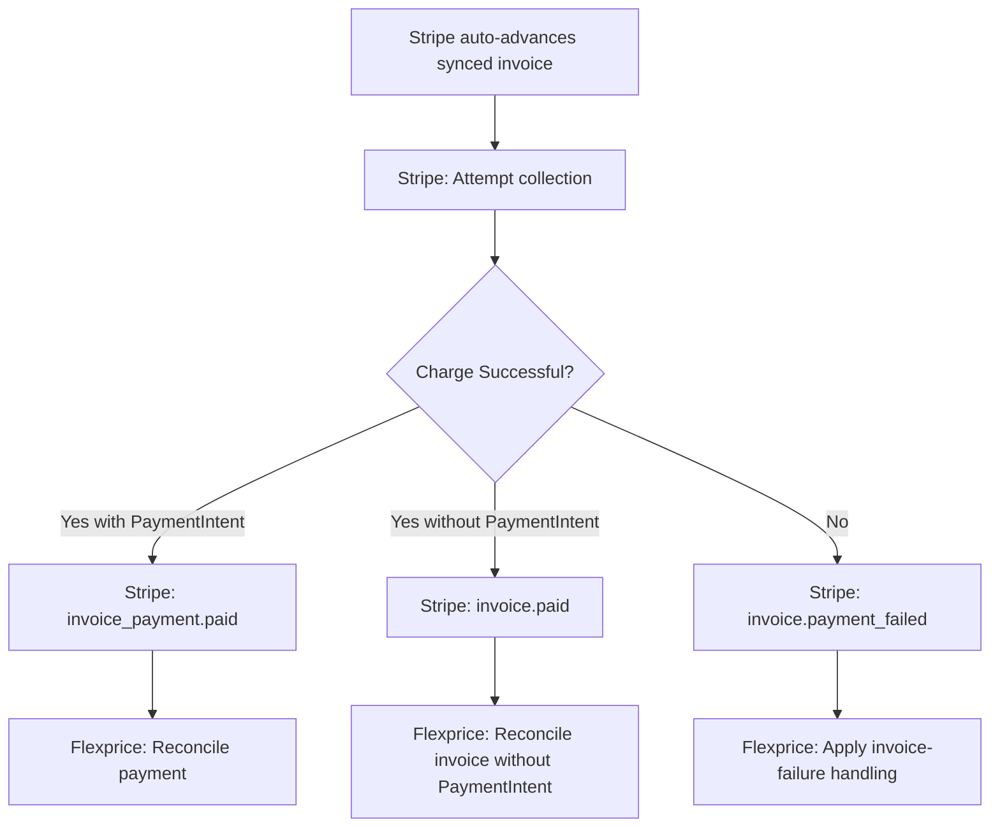
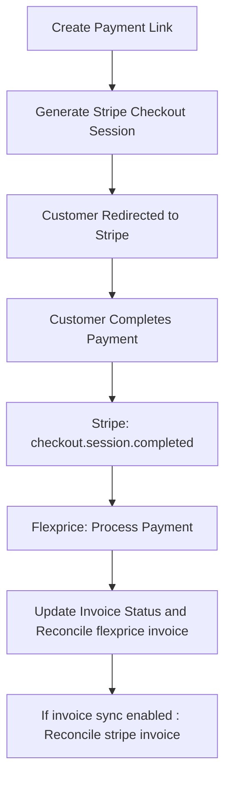
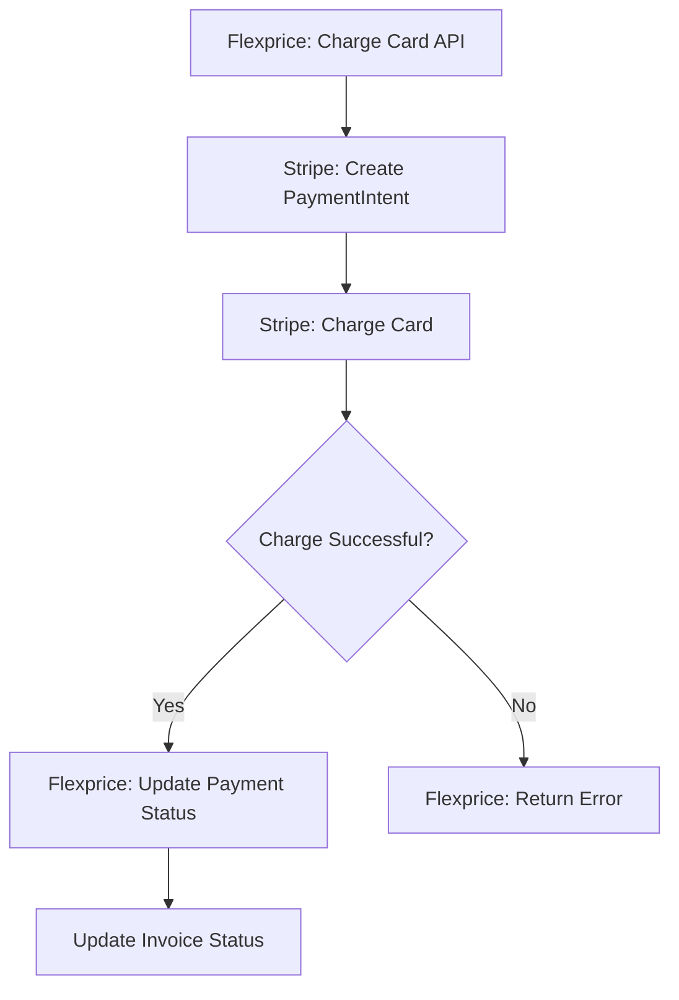

## Overview

The Stripe Invoice Sync Flow enables Flexprice to synchronize invoices with Stripe, allowing for seamless payment processing and reconciliation across both platforms. This system handles different collection methods, webhook processing, and ensures accurate payment tracking.

### Key Features

- **Invoice Synchronization**: Automatic sync of Flexprice invoices to Stripe
- **Collection Methods**: Support for `charge_automatically` and `send_invoice` methods
- **Payment Reconciliation**: Real-time payment tracking across platforms
- **Webhook Processing**: Comprehensive webhook handling for all payment events
- **Credit/Offline Restrictions**: Disabled when invoice sync is enabled
- **Metadata Tracking**: Uses `flexprice_payment_id` and `flexprice_invoice_id` for reconciliation

## Invoice Sync Lifecycle



## Collection Methods

### Charge Automatically

When `collection_method` is set to `charge_automatically`:

1. **Invoice Creation**: Creates a draft invoice in Stripe with `charge_automatically` collection method
2. **Auto-advance**: When enabled, Stripe advances the invoice and attempts to charge the customer's default payment method. Flexprice still finalizes the Stripe invoice during sync when this setting is disabled.
3. **Payment Processing**: Stripe attempts collection when auto-advance is enabled and collection can proceed
4. **Webhook Events**: Listen for `invoice_payment.paid`, `invoice.paid`, `invoice.payment_failed` and `payment_intent.succeeded`

**Behavior:**

* `auto_advance` defaults to `true`, except for `charge_automatically` when the customer has no default payment method; then it defaults to `false`. Setting it to `false` disables Stripe's automatic advancement and collection, but Flexprice still finalizes the invoice during sync.
- Uses customer's default payment method
- Automatic retry on failure (based on Stripe settings)
- Subscription status depends of payment behavior until payment succeeds

### Send Invoice

When `collection_method` is set to `send_invoice`:

1. **Invoice Creation**: Creates a invoice in Stripe with `send_invoice` collection method
2. **Due Date**: Sets the invoice due date from Flexprice invoice
3. **Send Invoice**: Sends Stripe's invoice email by default; set `send_invoice_email` to `false` to suppress it
4. **Customer Action**: Customer must manually pay using Stripe's hosted invoice page
5. **Webhook Events**: Listen for `invoice_payment.paid`, `invoice.paid`, `invoice.payment_failed` and `payment_intent.succeeded`

**Behavior:**

* `send_invoice_email` defaults to `true` for `send_invoice`; set it to `false` to prevent Stripe's invoice email
- Manual payment required by customer
- Subscription status depends on payment behavior setting
- More control over payment timing

### Outbound invoice settings

Set these optional fields in `sync_config.invoice_sync_settings`:

```json
{
  "sync_config": {
    "invoice_sync_settings": {
      "auto_advance": false,
      "send_invoice_email": false
    }
  }
}
```

When unset, `auto_advance` follows the collection method and saved default payment method; a failed lookup keeps it enabled. `send_invoice_email` defaults to sending Stripe's email for `send_invoice` invoices. An invoice already paid or overpaid in Flexprice is synced as paid, without another Stripe collection attempt or invoice email. Sync also adds Stripe invoice-item adjustments for Flexprice discounts, prepaid credits, and exclusive tax.

## Payment Flows

### Stripe Payment Methods

#### 1. Invoice Link (Stripe Hosted)

**Flow:**



**Webhook Events:** `invoice.paid` when there is no PaymentIntent; `invoice_payment.paid` when the payment includes a PaymentIntent

- **Trigger**: Customer pays via Stripe invoice link
- **Action**: `invoice.paid` reconciles the invoice without a PaymentIntent. `invoice_payment.paid` settles the matching pending hosted-invoice payment, or creates an external payment record if none exists.
- **Reconciliation**: Uses `flexprice_invoice_id` from invoice metadata
* **Failure**: `invoice.payment_failed` is handled for outbound-synced invoices; see [Failed Payments](#3-failed-payments)

#### 2. Stripe Invoice Auto-collection

**Flow:**



**Webhook Events:** `invoice_payment.paid` includes a PaymentIntent; `invoice.paid` is reconciled without one.

* **Trigger**: Stripe attempts automatic collection for a `charge_automatically` invoice
* **Action**: Reconciles a payment when the event includes a PaymentIntent, or reconciles the paid invoice without one
* **Failure**: `invoice.payment_failed` is handled separately from `payment_intent.payment_failed`; see [Failed Payments](#3-failed-payments)

### Flexprice Payment Methods

#### 1. Checkout Link (Flexprice Hosted)

**Flow:**



**Webhook Handler:** `checkout.session.completed`

- **Trigger**: Customer completes payment via Stripe Checkout
- **Action**: Updates payment status to `SUCCEEDED`
- **Reconciliation**: Uses `flexprice_payment_id` from PaymentIntent metadata
* **Failure**: A `payment_intent.payment_failed` event with matching `flexprice_payment_id` metadata records a failed attempt and leaves the Checkout payment open for retry on the same live link.

#### 2. Charge Card (Flexprice Direct)

**Flow:**



The direct card API handles successful charges synchronously. `payment_intent.succeeded` does not drive this success update; `payment_intent.payment_failed` can update the payment to `FAILED`. Neither event itself reconciles invoice payment status.

## Webhook Processing

### Webhook Event Types

| Event Type                      | Trigger                    | Action                       | Reconciliation Method                              |
| ------------------------------- | -------------------------- | ---------------------------- | -------------------------------------------------- |
| `checkout.session.completed`    | Payment link completed     | Update payment status        | `flexprice_payment_id` from session metadata       |
| `payment_intent.succeeded`      | PaymentIntent succeeds | Completes a matching Flexprice Checkout Session, including off-session charges, or refunds a late capture if the session has ended. It can also reconcile a payment on a mapped Stripe invoice when outbound invoice sync is enabled. Standalone Flexprice card charges are handled synchronously by the API. | `flexprice_payment_id` from PaymentIntent metadata, or the Stripe invoice ID for external invoice payments. |
| `payment_intent.payment_failed` | PaymentIntent fails | Non-link payment becomes `FAILED`; a Checkout `PAYMENT_LINK` with matching metadata records an attempt and stays open | `flexprice_payment_id` from PaymentIntent metadata |
| `invoice.paid`                  | Stripe invoice is paid without a PaymentIntent | Reconcile the mapped Flexprice invoice without a payment intent | Stripe invoice mapping |
| `invoice_payment.paid`          | Stripe invoice payment includes a PaymentIntent | Settle a matching pending hosted-invoice payment or create an external payment record | Stripe invoice mapping and PaymentIntent ID |
| `invoice.payment_failed`        | Outbound-synced Stripe invoice payment fails | May mark an eligible subscription incomplete; records a failed payment only when an open PaymentIntent is found. Does not directly change Flexprice invoice `payment_status`. | Stripe invoice mapping |

### Metadata Requirements

**Critical:** Never delete `flexprice_payment_id` or `flexprice_invoice_id` from Stripe metadata. These are essential for payment reconciliation.

**Required Metadata Fields:**

- `flexprice_payment_id`: Links Stripe payment to Flexprice payment record
- `flexprice_invoice_id`: Links Stripe invoice to Flexprice invoice record
- `flexprice_customer_id`: Links Stripe customer to Flexprice customer record

## Payment Reconciliation

### Reconciliation Process

1. **Webhook Received**: Stripe sends webhook with payment event
2. **Metadata Extraction**: Extract `flexprice_payment_id` or `flexprice_invoice_id`
3. **Record Lookup**: Find corresponding Flexprice record
4. **Status Update**: Update payment/invoice status
5. **Amount Verification**: Ensure payment amounts match
6. **Event Triggering**: Send internal events for downstream processing

## Restrictions and Edge Cases

### When Invoice Sync is Enabled

**Disabled Payment Methods:**

- ❌ **Credit Payments**: Cannot use wallet credits for payment
- ❌ **Offline Payments**: Cannot mark payments as offline
- ❌ **Manual Payment Recording**: Must use Stripe payment methods

**Reasoning:**

- Invoice sync requires payment reconciliation with Stripe
- Credit and offline payments bypass Stripe's payment tracking
- This ensures accurate financial reporting and reconciliation

### Edge Cases

#### 1. Partial Payments

- **Stripe**: Handles partial payments automatically
- **Flexprice**: Syncs partial payment amounts; the hosted-invoice payment-link path below requires the full remaining balance
- **Reconciliation**: Tracks cumulative payment amounts

#### 2. Refunds

- **Stripe**: Process refunds through Stripe dashboard
- **Flexprice**: Manual reconciliation required

#### 3. Failed Payments

* **Non-link PaymentIntent failure**: Updates that Flexprice payment to `FAILED`; this update does not itself reconcile the invoice.
* **Checkout payment-link decline**: When `payment_intent.payment_failed` has matching `flexprice_payment_id` metadata, it records `payment.attempt.failed` only. The parent payment remains open and the customer can retry the same live Checkout link.
* **`invoice.payment_failed`**: Handled only when invoice outbound sync is enabled, a Flexprice mapping exists, and the mapped invoice is not already paid. It can mark a subscription incomplete when the invoice is finalized, has a positive balance, is a subscription-cycle invoice, and belongs to an active subscription with incomplete-payment behavior and either automatic collection or an overdue invoice. If an open PaymentIntent is found, Flexprice records a separate failed payment; without one, it creates no payment record. The handler does not directly set the invoice's `payment_status` to `FAILED`.

### Synced invoice payment links

For an outbound-synced, finalized invoice, a `/payments` link uses the Stripe-hosted invoice page only after the hosted URL is available, no amount has already been paid, and the requested amount equals the full `amount_remaining`. This hosted-page PaymentIntent does not carry `flexprice_payment_id`. On failure, `invoice.payment_failed` can create a separate `FAILED` card payment when an open PaymentIntent is found; the original pending payment-link record stays open. Without an open PaymentIntent, no failed payment record is created. When payment succeeds through `invoice_payment.paid` with a PaymentIntent, Flexprice settles the existing pending hosted-invoice payment; if none exists, it creates an external payment record. `invoice.paid` without a PaymentIntent reconciles the mapped invoice. Partial payments are not supported on this hosted-page path. Voiding the Flexprice invoice attempts to void its synced Stripe invoice after the local commit; this is best-effort, and an already-paid Stripe invoice is left alone.

## Configuration

### Enabling Invoice Sync

1. **Stripe Connection**: Configure Stripe integration
2. **Enable Sync**: Set `"invoice": {"inbound": false, "outbound": true}`
3. **Customer Sync**: Ensure customers are synced to Stripe
4. **Webhook Setup**: Configure webhook endpoints

### Webhook Endpoints

```
POST /v1/webhooks/stripe/{tenant_id}/{environment_id}
```

**Required Events:**

- `checkout.session.completed`
- `payment_intent.succeeded`
- `payment_intent.payment_failed`
- `invoice_payment.paid`

For invoice outbound sync, also subscribe to `invoice.paid` and `invoice.payment_failed`.

## Error Handling

### Common Errors

| Error                          | Cause                             | Resolution                                |
| ------------------------------ | --------------------------------- | ----------------------------------------- |
| "Invoice not synced to Stripe" | Invoice sync disabled             | Enable invoice sync or use manual payment |
| "Customer not found in Stripe" | Customer not synced               | Sync customer to Stripe first             |
| "Payment already exists"       | Duplicate webhook                 | Skip processing (idempotent)              |
| "Metadata missing"             | Webhook without required metadata | Log warning and skip                      |

### Error Recovery

1. **Webhook Failures**: Stripe retries failed webhooks
2. **Sync Failures**: Manual retry via admin interface

## Testing

### Test Scenarios

1. **Invoice Sync**: Create invoice and verify Stripe sync
2. **Payment Link**: Generate link and complete payment
3. **Direct Charge**: Charge customer directly
4. **Webhook Processing**: Simulate webhook events
5. **Reconciliation**: Verify payment amounts match

### Test Data

**Test Cards:**

- `4242424242424242`: Successful payment
- `4000000000000002`: Card declined
- `4000000000009995`: Insufficient funds

**Test Webhooks:**
Use Stripe CLI to forward webhooks to local development environment.

For additional support, refer to the [API Reference](/api-reference) or contact [support@flexprice.io](mailto:support@flexprice.io).
