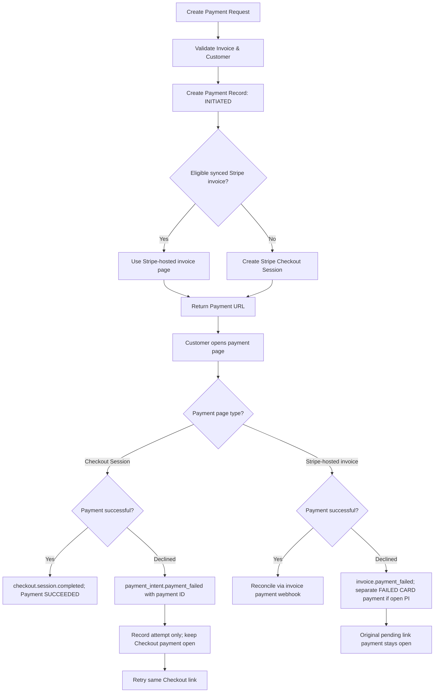
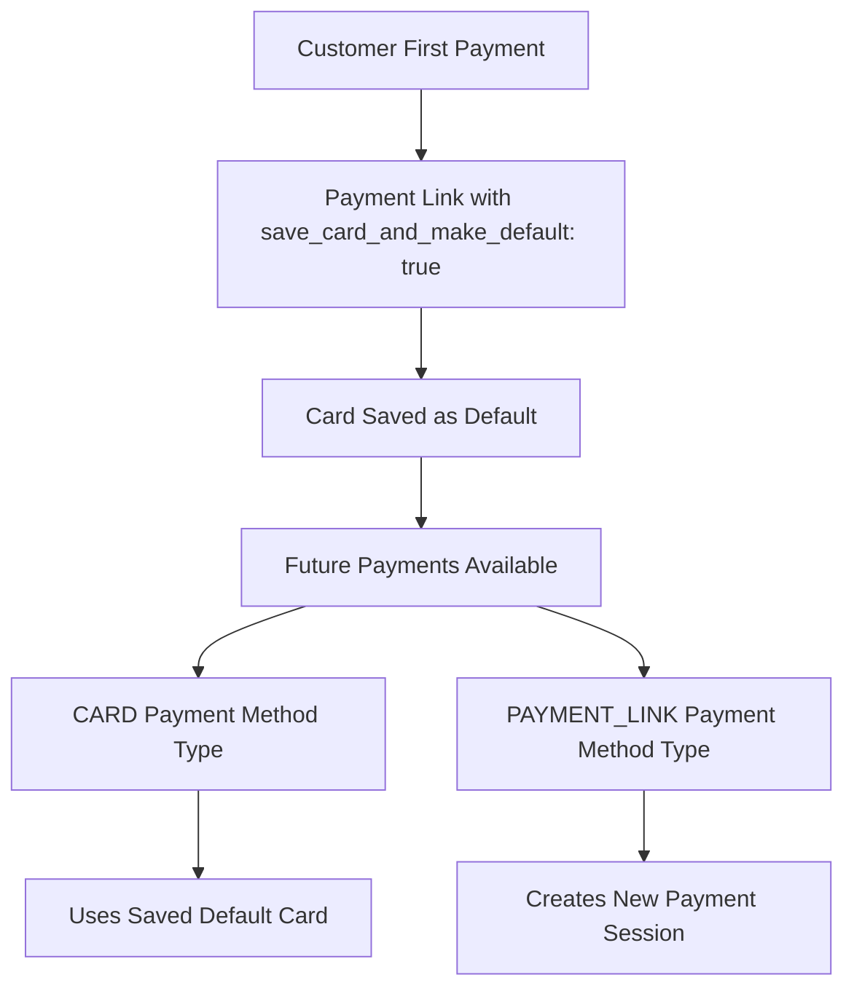

## Overview

Payment links in Flexprice provide a hosted Stripe payment page. Most use a Stripe Checkout Session. An eligible payment request for an invoice already synced to Stripe uses that invoice's Stripe-hosted page instead.

### Key Features

- **Secure Checkout**: Hosted by Stripe with PCI compliance
- **Multiple Payment Methods**: Cards, bank transfers, digital wallets
- **Mobile Optimized**: Responsive checkout experience
- **Real-time Updates**: Webhook-driven status updates
- **Invoice Integration**: Automatic invoice reconciliation
- **Card Saving**: Optional card storage for future payments

## Payment Link Lifecycle



## Payment Status Flow

### Status Transitions

```
INITIATED → PENDING → SUCCEEDED
                           ↓
                       REFUNDED

PENDING → VOIDED  (invoice voided while the link is unpaid)
```

### Status Definitions

| Status | Description | Triggers |
|--------|-------------|----------|
| `INITIATED` | Payment record created, payment page not yet ready | Initial payment creation |
| `PENDING` | Payment page created: Stripe Checkout Session or eligible synced invoice page | Successful Stripe API call |
| `PROCESSING` | Payment is being processed | Temporary status during updates |
| `SUCCEEDED` | Payment completed through Checkout or a synced Stripe invoice page | `checkout.session.completed`, or invoice payment reconciliation |
| `REFUNDED` | Payment was refunded | Manual refund processing |
| `VOIDED` | Unpaid link closed because its invoice was voided; the Stripe checkout session is expired | Voiding the invoice |

## Creating Payment Links

### Prerequisites

1. **Stripe Connection**: Active Stripe connection configured
2. **Customer Sync**: Customer must have Stripe customer ID
3. **Invoice Status**: Invoice must be finalized and unpaid
4. **Amount**: For invoice payments, omit `amount` or set it to zero to use the remaining balance. Otherwise, request the amount to collect.

### Creating Payment Links via Dashboard

1. Open an invoice with a balance due and select **Record payment** from the **⋯** menu.
2. Choose **Payment link** under **Method** and select **Stripe** as the **Provider**.
3. Check the amount and click **Create payment**.
4. Copy the URL from **Payment link ready** and send it to the customer.

The invoice menu's **Copy hosted invoice link** action copies the Flexprice-hosted invoice page. To debit a saved method from the dashboard, see [Recording a payment](/docs/invoices/managing#recording-a-payment).

### API Request

**Endpoint:** `POST /api/v1/payments`

**Headers:**
```http
Content-Type: application/json
x-api-key: your_api_key
X-Environment-ID: your_environment_id
```

**Request Body (Save Card for Future Use):**
```json
{
    "amount": 10,
    "currency": "usd",
    "destination_id": "inv_01K34HYZN03V6X8Q6V3T8X6G4F",
    "destination_type": "INVOICE",
    "payment_method_type": "PAYMENT_LINK",
    "process_payment": true,
    "payment_gateway": "stripe",
    "success_url": "https://admin-dev.flexprice.io/customer-management/invoices/inv_01K34HYZN03V6X8Q6V3T8X6G4F?page=1",
    "cancel_url": "https://admin-dev.flexprice.io/customer-management/invoices/inv_01K34HYZN03V6X8Q6V3T8X6G4F?page=1",
    "save_card_and_make_default": true
}
```

**Request Body (One-time Payment Only):**
```json
{
    "amount": 10,
    "currency": "usd",
    "destination_id": "inv_01K34HYZN03V6X8Q6V3T8X6G4F",
    "destination_type": "INVOICE",
    "payment_method_type": "PAYMENT_LINK",
    "process_payment": true,
    "payment_gateway": "stripe",
    "success_url": "https://admin-dev.flexprice.io/customer-management/invoices/inv_01K34HYZN03V6X8Q6V3T8X6G4F?page=1",
    "cancel_url": "https://admin-dev.flexprice.io/customer-management/invoices/inv_01K34HYZN03V6X8Q6V3T8X6G4F?page=1"
}
```

### Response

```json
{
  "id": "pay_1234567890abcdef",
  "payment_status": "pending",
  "payment_url": "https://checkout.stripe.com/c/pay/cs_test_...",
  "amount": "150.00",
  "currency": "usd",
  "gateway_tracking_id": "cs_test_1234567890abcdef",
  "created_at": "2024-01-20T10:30:00Z",
  "metadata": {
    "stripe_session_id": "cs_test_1234567890abcdef"
  }
}
```

## Payment Link Configuration

### Required Fields

| Field | Type | Required | Description |
|-------|------|----------|-------------|
| `destination_type` | string | ✅ | Must be `"invoice"` |
| `destination_id` | string | ✅ | Valid invoice ID |
| `payment_method_type` | string | ✅ | Must be `"payment_link"` |
| `payment_gateway` | string | ✅ | Must be `"stripe"` |
| `amount` | string | No | For invoice payments, zero or omitted defaults to the invoice's remaining balance. |
| `currency` | string | ✅ | Valid currency code |
| `process_payment` | boolean | ✅ | Set to `true` to create Stripe session |
| `save_card_and_make_default` | boolean | ❌ | Save card for future payments (default: false) |
| `gateway_options.stripe.allow_promotion_codes` | boolean | No | On direct `POST /payments` requests, show a promotion-code field in a Stripe Checkout Session. Defaults to `true`; set to `false` to disable. This does not configure a Stripe-hosted invoice page. |


## Stripe Checkout Configuration

### Default Checkout Settings

When creating payment links, Flexprice automatically configures Stripe Checkout with:

- **Payment Methods**: Cards, bank transfers, digital wallets
- **Currency**: Matches the payment currency
- **Amount**: Exact payment amount
- **Customer**: Pre-filled with customer data
- **Invoice Details**: Line items from the invoice

### Card Saving Configuration

When `save_card_and_make_default` is set to `true`:

- **Setup Future Usage**: Stripe session configured with `setup_future_usage: "off_session"`
- **Card Storage**: Payment method automatically saved to customer
- **Default Assignment**: Saved card becomes the customer's default payment method
- **Future Payments**: Enables subsequent card payments without re-entering details

**Important Notes:**
- Card saving requires customer consent and should comply with local regulations
- Saved cards can be used for future `CARD` payment method type payments
- Only one default payment method per customer is supported


## Webhook Processing

### Payment Completion Webhook

When a payment is completed, Stripe sends a `checkout.session.completed` webhook:

```json
{
  "id": "evt_1234567890abcdef",
  "type": "checkout.session.completed",
  "data": {
    "object": {
      "id": "cs_test_1234567890abcdef",
      "payment_status": "paid",
      "amount_total": 15000,
      "currency": "usd",
      "customer": "cus_stripe123abc",
      "metadata": {
        "flexprice_payment_id": "pay_1234567890abcdef"
      }
    }
  }
}
```

### Webhook Processing Flow

1. **Receive Webhook**: Flexprice receives the webhook from Stripe
2. **Verify Signature**: Validate webhook signature for security
3. **Find Payment**: Locate payment record using session ID
4. **Check Card Saving**: Read `save_card_and_make_default` from payment metadata
5. **Set Default Card**: If flag is true, set payment method as default in Stripe
6. **Update Status**: Change payment status to `SUCCEEDED`
7. **Reconcile Invoice**: Update invoice payment status and amounts
8. **Trigger Events**: Send payment completion events

## Error Handling

### Common Payment Errors

| Error | Cause | Resolution |
|-------|-------|------------|
| "Customer not found in Stripe" | Customer not synced | Sync customer to Stripe first |
| "Invalid invoice amount" | Amount mismatch | Ensure amount matches invoice |
| "Invoice already paid" | Invoice status issue | Check invoice payment status |
| "Stripe session creation failed" | API error | Check Stripe connection |

### Payment Failure Handling

A declined Stripe Checkout PaymentIntent with matching `flexprice_payment_id` metadata records `payment.attempt.failed`; it does not fail the parent payment. The payment stays pending and the customer can retry the same live Checkout link. The synced Stripe-hosted invoice page has different failure handling: `invoice.payment_failed` can create a separate failed card payment while leaving the original pending link payment open. See [Synced invoice payment links](/integrations/stripe/invoice-sync#synced-invoice-payment-links).

When Stripe outbound invoice sync is enabled, a finalized invoice uses its Stripe-hosted invoice page only after the hosted URL is available. The invoice must have no amount already paid, and the request must cover the full `amount_remaining`. An omitted or zero `amount` defaults to that remaining balance. A finalized invoice still syncing returns the hint "This invoice is being synced to Stripe. Please try again in some time." A prior payment or partial amount returns "This invoice can only be paid in full." These limits apply to the synced invoice page, not to Checkout Session settings such as `gateway_options.stripe.allow_promotion_codes`.

## Testing Payment Links

### Test Environment Setup

1. **Use Test Keys**: Configure Stripe test mode
2. **Test Cards**: Use Stripe's test card numbers
3. **Test Webhooks**: Use ngrok for local webhook testing

### Test Card Numbers

| Card Number | Description |
|-------------|-------------|
| `4242424242424242` | Successful payment |
| `4000000000000002` | Card declined |
| `4000000000009995` | Insufficient funds |
| `4000000000009987` | Expired card |

### Testing Flow

1. **Create Test Payment**: Use test invoice and customer
2. **Generate Payment Link**: Create payment with test data
3. **Complete Payment**: Use test card in Stripe checkout
4. **Verify Webhook**: Check webhook processing
5. **Confirm Status**: Verify payment and invoice updates

## Relationship with Card Payments

### Enabling Future Card Payments

Payment links with `save_card_and_make_default: true` enable future card payments:

1. **First Payment**: Customer uses payment link to pay and save card
2. **Card Storage**: Payment method saved and set as default in Stripe
3. **Future Payments**: Customer can use `CARD` payment method type
4. **Seamless Experience**: No redirect required for subsequent payments

### Payment Method Hierarchy



### Integration Strategy

**Recommended Flow:**
1. **New Customers**: Always use payment links for first payment
2. **Set Save Flag**: Include `save_card_and_make_default: true` for returning customers
3. **Future Payments**: Use card payment method for faster checkout
4. **Fallback**: Provide payment link option if card payment fails

For detailed information about card payments, see [Card Payment Documentation](/integrations/stripe/card-payment).

## Security Considerations

### Payment Link Security

- **HTTPS Required**: All payment links use HTTPS
- **Session Expiry**: Links expire after 24 hours
- **One-time Use**: Each link can only be used once
- **Signature Verification**: All webhooks verified

### Data Protection

- **PCI Compliance**: Stripe handles sensitive payment data
- **No Card Storage**: Card details never stored in Flexprice
- **Encrypted Storage**: All payment data encrypted at rest
- **Access Controls**: Role-based access to payment data


### Webhook Endpoints

- `POST /api/v1/webhooks/stripe/{tenant_id}/{environment_id}` - Stripe webhook handler

For complete API documentation, see the [API Reference](/api-reference/payments/create-payment).
