If your finance team keeps its books in Zoho Books, every Flexprice invoice otherwise has to be re-keyed by hand, and every payment collected in Zoho has to be marked paid twice. A Zoho Books connection removes both steps: finalized Flexprice invoices land in Zoho Books on their own, payments flow in both directions, and new Zoho customers can appear in Flexprice.

## What the Connection Does

| Capability | Direction | Details |
|---|---|---|
| Invoice sync | Flexprice → Zoho | Finalized invoices are created in Zoho Books, with contacts and items created as needed. See [Invoice Sync](/integrations/zohobooks/invoice-sync). |
| Payment sync | Flexprice → Zoho | When a Flexprice invoice is fully paid, the payment is recorded against the Zoho invoice. |
| Payment gateways | Flexprice → Zoho | Synced invoices can carry Zoho online payment options such as Razorpay, Stripe or PayPal. |
| Paid and voided invoices | Zoho → Flexprice | A Zoho invoice marked paid or voided updates the linked Flexprice invoice. See [Webhooks and Customer Sync](/integrations/zohobooks/webhooks-and-customer-sync). |
| Customer import | Zoho → Flexprice | A customer created in Zoho Books creates a Flexprice customer. |

## Prerequisites

- **Zoho Books admin access** to the organization you want to connect.
- **A Zoho API Console client** of type **Server-based Applications**. You need its **Client ID** and **Client Secret**.
- **Your Zoho Books Organization ID.** In Zoho Books, open **Settings** > **Organization** > **Profile**. The ID is shown next to the page title.

  <Frame>
    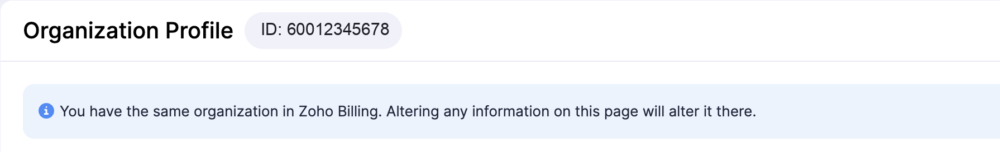
  </Frame>

- **Your Zoho data center.** Zoho runs separate data centers (`.in`, `.com`, `.eu`, `.com.au`, `.jp` and others). Use the one your Zoho Books account signs in on.

## Step 1: Create the Zoho API Console Client

1. Open the Zoho API Console for your data center, for example [api-console.zoho.in](https://api-console.zoho.in/) or [api-console.zoho.com](https://api-console.zoho.com/).
2. Click **Add Client** and choose **Server-based Applications**.

   <Frame>
     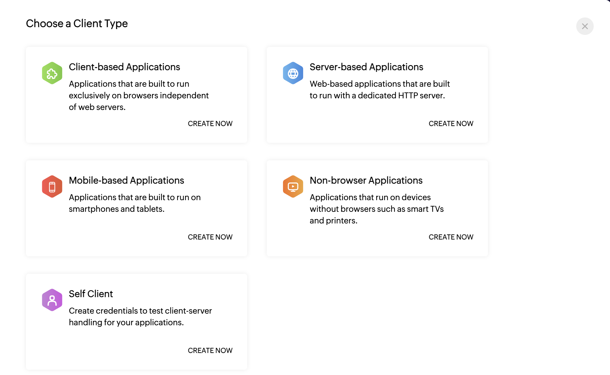
   </Frame>

3. Enter a client name and homepage URL.
4. Under **Authorized Redirect URIs**, add the **Redirect URI** that Flexprice shows on the first step of the **Connect Zoho** sheet (Step 3 below). For the Flexprice cloud console it is `https://app.flexprice.io/tools/integrations/oauth/callback`. Copy it from the sheet rather than typing it: the URI must match character for character.

   <Frame>
     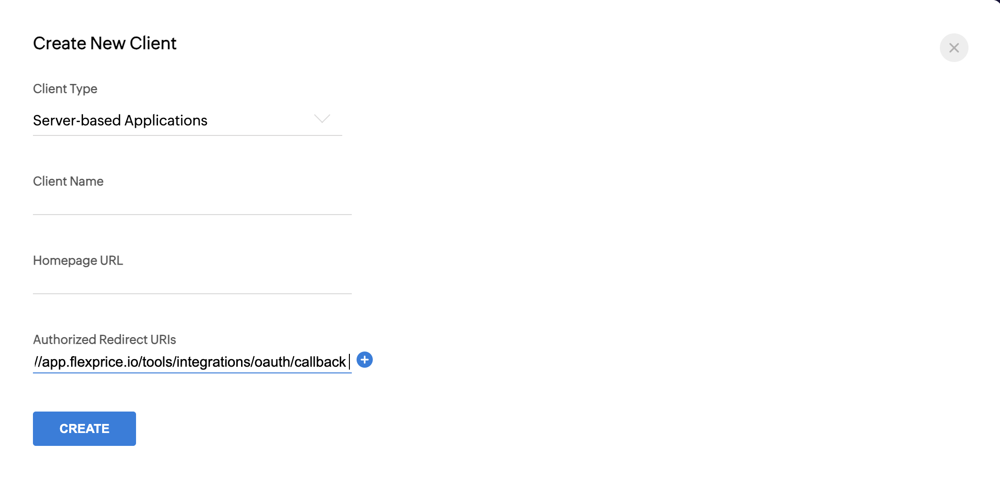
   </Frame>

5. Click **Create** and copy the **Client ID** and **Client Secret**.

## Step 2: Choose a Webhook Secret

Zoho Books does not generate a webhook signing secret. You make one up, for example a long random string, and enter the **same** value in two places: the Flexprice connection (Step 3) and each Zoho webhook (Step 4). Flexprice rejects any webhook whose `X-Zoho-Webhook-Signature` header does not match it.

```bash
openssl rand -hex 32
```

<Warning>
  There is nothing to copy from Zoho. If the secret in Zoho and the secret in Flexprice differ by even one character, every webhook is rejected.
</Warning>

## Step 3: Connect Zoho in Flexprice

<Steps>
  <Step title="Open the Zoho card">
    In the Flexprice console, open **Integrations** from the sidebar and click **Connect** on the **Zoho** card.
  </Step>
  <Step title="Enter credentials">
    Copy the **Redirect URI** into your Zoho API Console client if you have not already. Then fill in:

    | Field | Value |
    |---|---|
    | **Connection name** | Any label, for example `Zoho Books (India)` |
    | **Client ID** / **Client secret** | From the Zoho API Console |
    | **Organization ID** | From **Settings** > **Organization Profile** in Zoho Books |
    | **Accounts server** | Your data center: India (.in), United States (.com), Europe (.eu), Australia (.com.au) or Japan (.jp) |

    Click **Continue**.

    <Frame>
      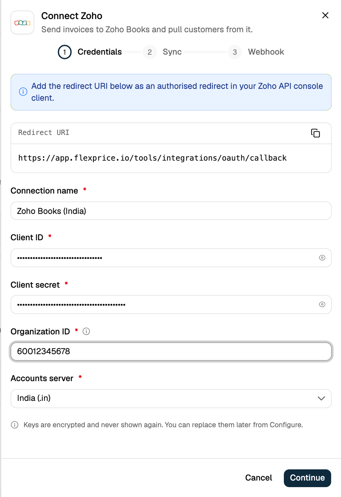
    </Frame>
  </Step>
  <Step title="Choose what syncs">
    **Push invoices** sends finalized Flexprice invoices to Zoho Books. **Pull customers** creates Flexprice customers from new Zoho customers. Both are on by default; switch off any you do not want.

    <Frame>
      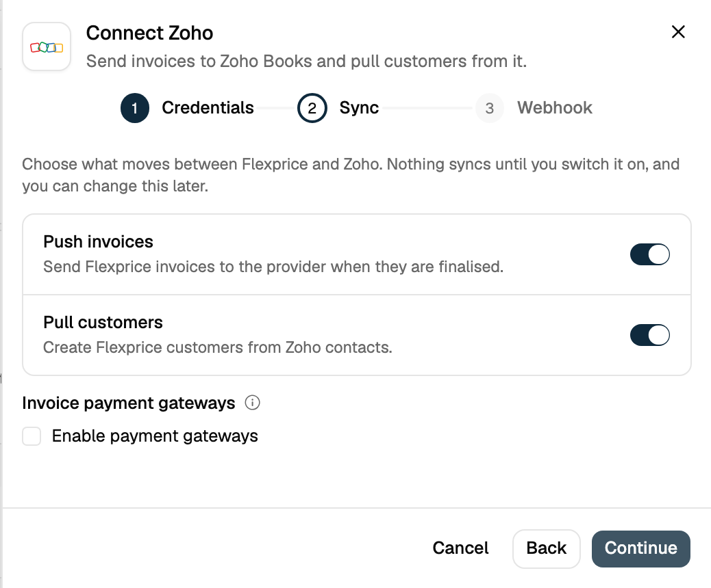
    </Frame>

    To let customers pay from the Zoho invoice, tick **Enable payment gateways** and select the gateways. If you pick **PayPal**, also choose the **PayPal payment method** (**Standard** or **Adaptive**). Each gateway must already be set up in Zoho Books under **Settings** > **Module Settings** > **Online Payments** > **Customer Payments**, or Zoho rejects the invoice. Click **Continue**.

    <Frame>
      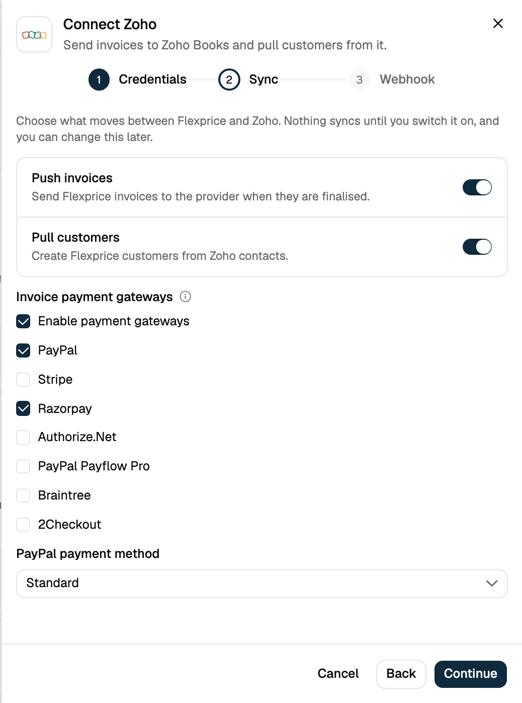
    </Frame>
  </Step>
  <Step title="Add the webhook secret">
    Copy the **Webhook URL** for Step 4. Enter the secret from Step 2 in **Webhook signing secret**.

    <Frame>
      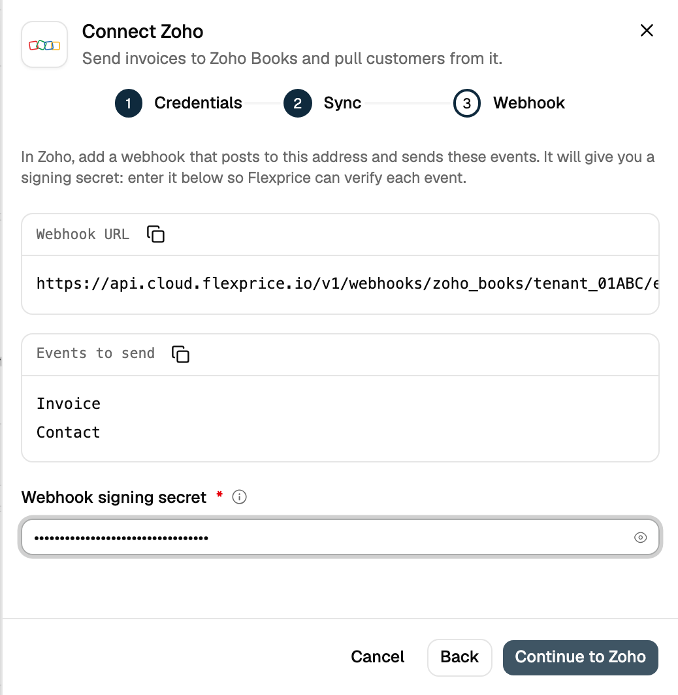
    </Frame>
  </Step>
  <Step title="Authorize in Zoho">
    Click **Continue to Zoho**, sign in to Zoho and accept the consent screen within 5 minutes. Zoho returns you to Flexprice and the Zoho card shows **Connected**. Flexprice refreshes the Zoho access token on its own from then on.

    <Frame>
      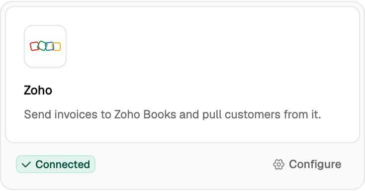
    </Frame>
  </Step>
</Steps>

Flexprice requests these Zoho scopes: settings, contacts, invoices and customer payments (each with read, create and update).

## Step 4: Register the Webhooks in Zoho Books

Zoho Books sends webhooks from **workflow rules**. Create one rule per module, both posting to the same Flexprice URL:

```
https://<flexprice-api-host>/v1/webhooks/zoho_books/<tenant_id>/<environment_id>
```

Copy the exact URL from the connection's **Webhook** section. For Flexprice cloud the host is `https://api.cloud.flexprice.io` (India) or `https://us.api.flexprice.io` (United States).

In Zoho Books, open **Settings** > **Automation** > **Workflow Rules**:

1. **Invoices rule.** Module **Invoices**, triggered when an invoice is **edited** and the **Status** field is updated. Add an immediate action of type **Webhook**: method **POST**, the Flexprice URL, body as the default **Invoice** entity JSON, and your secret in the webhook's secret field.

   <Frame>
     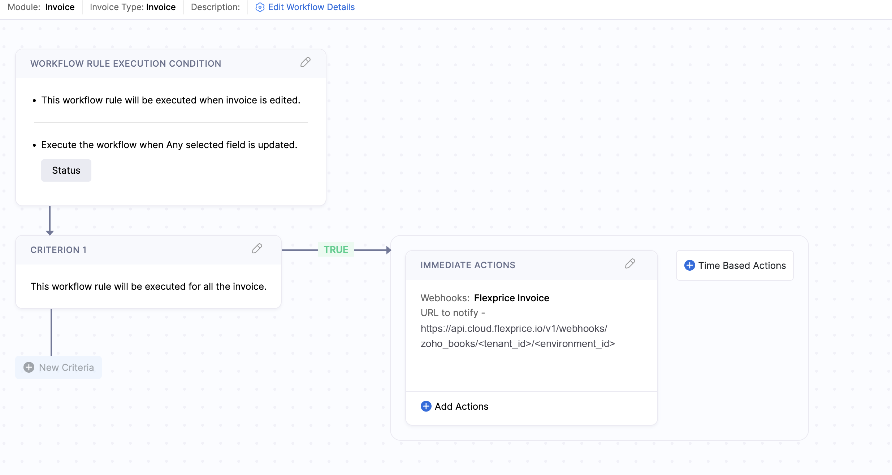
   </Frame>

2. **Customers rule** (only if **Pull customers** is on). Module **Customers**, triggered **On Create**, with the same webhook action.

   <Frame>
     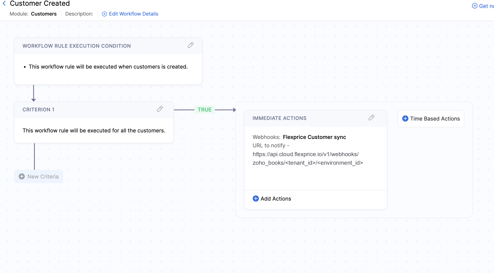
   </Frame>

<Note>
  If you connect more than one Zoho Books organization in the same environment (one per billing entity), append `?connection=<connection_id>` to the URL so Flexprice knows which connection the webhook belongs to.
</Note>

## Managing the Connection

Click **Configure** on the Zoho card to rename the connection, switch syncs on or off, change payment gateways, copy the webhook URL or replace the webhook signing secret. Leave the secret blank to keep the current one.

<Frame>
  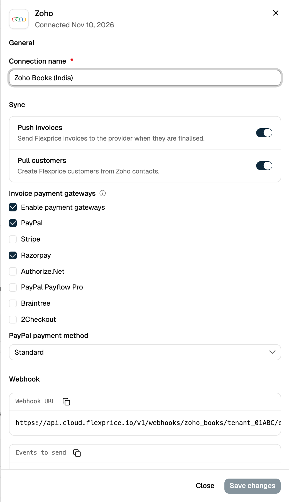
</Frame>

**Disconnect Zoho** archives the connection and stops all syncing. Nothing is deleted in Zoho Books. To change the client ID, client secret, organization or data center, disconnect and connect again.

<Frame>
  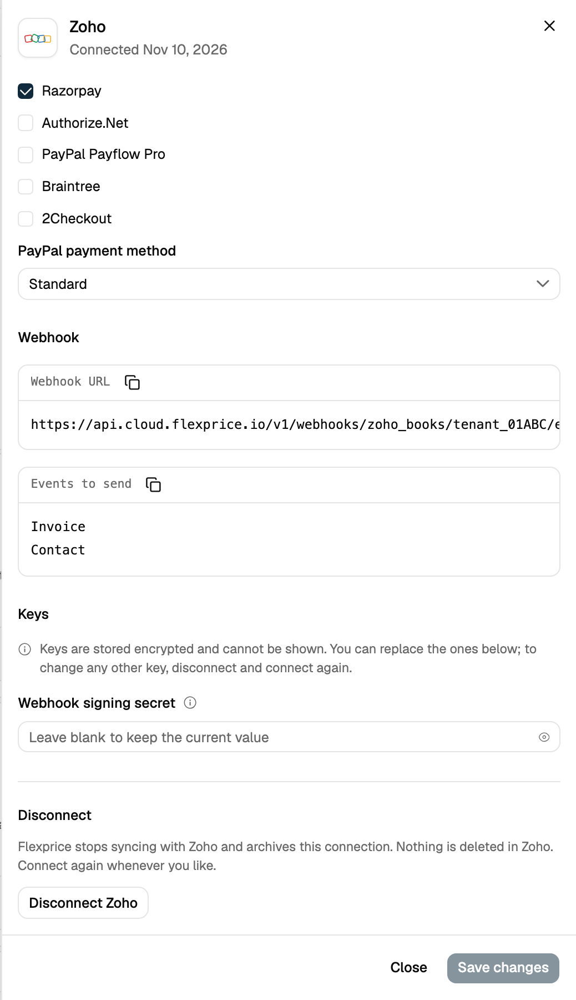
</Frame>

## Connecting Through the API

The console flow is a thin layer over two API calls. Start the OAuth flow:

```bash
curl -X POST https://api.cloud.flexprice.io/v1/oauth/init \
  -H "x-api-key: <API_KEY>" \
  -H "Content-Type: application/json" \
  -d '{
    "provider": "zoho_books",
    "name": "Zoho Books (India)",
    "credentials": {
      "client_id": "1000.XXXXXXXXXXXX",
      "client_secret": "<ZOHO_CLIENT_SECRET>",
      "webhook_secret": "<YOUR_WEBHOOK_SECRET>"
    },
    "metadata": {
      "organization_id": "60012345678",
      "accounts_server": "https://accounts.zoho.in"
    },
    "sync_config": {
      "invoice":  { "inbound": false, "outbound": true },
      "customer": { "inbound": true,  "outbound": false }
    }
  }'
```

The response holds an `oauth_url` and a `session_id`. Send the user to `oauth_url`. Zoho redirects back to your redirect URI with `code`, `state` and `accounts-server`. Finish within 5 minutes:

```bash
curl -X POST https://api.cloud.flexprice.io/v1/oauth/complete \
  -H "x-api-key: <API_KEY>" \
  -H "Content-Type: application/json" \
  -d '{
    "provider": "zoho_books",
    "session_id": "<SESSION_ID>",
    "code": "<CODE>",
    "state": "<STATE>",
    "organization_id": "60012345678",
    "accounts_server": "https://accounts.zoho.in"
  }'
```

Pass the same `accounts_server` on `/oauth/complete` as on `/oauth/init`. The API also accepts the data centers the console does not list: `https://accounts.zoho.com.cn`, `https://accounts.zoho.sa`, `https://accounts.zoho.uk` and `https://accounts.zohocloud.ca`.

To change settings later, use `PUT /v1/connections/{id}`. Invoice settings such as custom fields, approval and payment mode are only available through the API: see [Invoice Sync](/integrations/zohobooks/invoice-sync#invoice-sync-settings).

## Troubleshooting

| Problem | Cause | Fix |
|---|---|---|
| Zoho shows `Invalid Redirect Uri` | The redirect URI in the Zoho client does not match the one Flexprice sends | Copy the **Redirect URI** from the Connect sheet into **Authorized Redirect URIs** exactly |
| `Zoho token exchange failed` | Wrong data center, wrong client secret, or the 5-minute window passed | Pick the **Accounts server** your Zoho account signs in on and retry the connect flow |
| Webhook returns `401` | Secret missing on the connection or different from the one in Zoho | Set the same secret in the Zoho webhook and in **Configure** > **Webhook signing secret** |
| Webhook returns `200` but nothing changes in Flexprice | Tenant or environment in the URL is not the one holding the connection, or the Zoho invoice was not created by Flexprice | Copy the URL from **Configure**, and check that the invoice was synced from Flexprice |
| Webhook returns `404` | The `?connection=` value does not match a connection | Use the connection ID shown for this Zoho connection |

## Related Articles

<CardGroup cols={2}>
  <Card icon="file-invoice" href="/integrations/zohobooks/invoice-sync" title="Invoice Sync">
    What Flexprice sends to Zoho Books, and the settings that control it.
  </Card>
  <Card icon="arrow-right-arrow-left" href="/integrations/zohobooks/webhooks-and-customer-sync" title="Webhooks and Customer Sync">
    How paid and voided invoices and new Zoho customers reach Flexprice.
  </Card>
</CardGroup>
