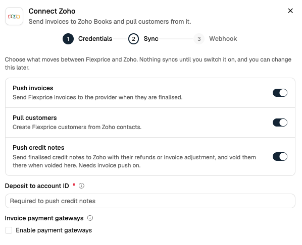

Credit note sync creates each Flexprice credit note in Zoho Books against its synced invoice. An adjustment credit note is credited to the invoice, a refund credit note is refunded, and a voided credit note is voided in Zoho Books.

A credit note syncs when:

- It is finalized, or voided after it synced.
- Its invoice is already in Zoho Books.

Changes made in Zoho Books do not sync back to Flexprice.

## Turning on credit note sync

Credit note sync needs **Push invoices** on and `submit_for_approval` off.

<Tabs>
  <Tab title="Dashboard">
    <Steps>
      <Step title="Open the connection">
        Go to **Integrations** and click **Configure** on the Zoho card.
      </Step>

      <Step title="Turn on Push credit notes">
        Switch on **Push credit notes**.
      </Step>

      <Step title="Enter the deposit account">
        Enter **Deposit to account ID**: the numeric ID of the Bank or Cash account in Zoho Books that credit notes are refunded from. Find it under **Accountant** > **Chart of Accounts**. Click **Save changes**.

        <Frame>
          
        </Frame>
      </Step>
    </Steps>
  </Tab>
  <Tab title="API">
    ```bash
    curl -X PUT "https://api.cloud.flexprice.io/v1/connections/$CONNECTION_ID" \
      -H "x-api-key: $FLEXPRICE_API_KEY" \
      -H "Content-Type: application/json" \
      -d '{
        "sync_config": {
          "invoice":     { "inbound": false, "outbound": true },
          "customer":    { "inbound": true,  "outbound": false },
          "credit_note": { "inbound": false, "outbound": true },
          "invoice_sync_settings": {
            "deposit_to_account_id": "4602000000000361"
          }
        }
      }'
    ```

    | Field | Description |
    | ----- | ----------- |
    | `credit_note.outbound` | `true` turns on credit note sync. Needs `invoice.outbound` |
    | `invoice_sync_settings.deposit_to_account_id` | Required with `credit_note.outbound`. Numeric ID of a Bank or Cash account in Zoho Books |

    `PUT /v1/connections/{id}` replaces the whole `sync_config`, so send every field you want to keep.
  </Tab>
</Tabs>

<Note>
  Connections authorized before credit note sync was released are missing its Zoho scopes. See [Connection Setup](/integrations/zohobooks/connection-setup#step-3-connect-zoho-in-flexprice).
</Note>

## How each credit note syncs

| Credit note | In Zoho Books |
| ----------- | ------------- |
| Adjustment | Created and credited to the invoice. The invoice's balance due goes down by the credit note total |
| Refund | Created once every refund on it has finished. One credit note refund is recorded for each succeeded refund, from the **Deposit to account ID** |
| Voided | The credit applied to the invoice is deleted, then the credit note is voided |

The credit note's reference number is the Flexprice credit note ID. Each refund's reference number is the Flexprice refund ID.

<Warning>
  Zoho Books does not accept credit notes on draft invoices, and Flexprice does not change the invoice's status. Mark the invoice as sent in Zoho Books, then [push the credit note](#pushing-a-credit-note). Until then the sync fails with `zoho invoice is a draft`.
</Warning>

## Pushing a credit note

Push a credit note to retry a failed sync. The push is refused if the credit note is already in Zoho Books, is a draft, or has a refund still processing.

<Tabs>
  <Tab title="Dashboard">
    Open the credit note (shown as **Credit memo** in the dashboard), open the **⋯** menu and select **Push to Zoho**.
  </Tab>
  <Tab title="API">
    ```bash
    curl -X POST "https://api.cloud.flexprice.io/v1/integrations/sync" \
      -H "x-api-key: $FLEXPRICE_API_KEY" \
      -H "Content-Type: application/json" \
      -d '{
        "entity_type": "credit_note",
        "entity_id": "cn_01KXXXXXXXXXXXXXXXXXXXXXXX"
      }'
    ```
  </Tab>
</Tabs>

## Troubleshooting

| Problem | Fix |
| ------- | --- |
| `zoho invoice is a draft` | Mark the invoice as sent in Zoho Books, then push the credit note |
| Zoho rejects the refund with `Involved account types are not applicable` | Set **Deposit to account ID** to a Bank or Cash account |
| Credit note is not in Zoho Books | Check that its invoice is in Zoho Books and its refunds have finished, then push it |

## Related Articles

<CardGroup cols={2}>
  <Card icon="plug" href="/integrations/zohobooks/connection-setup" title="Connection Setup">
    Connect Zoho Books over OAuth and choose what syncs.
  </Card>
  <Card icon="file-invoice" href="/integrations/zohobooks/invoice-sync" title="Invoice Sync">
    What Flexprice sends to Zoho Books for each finalized invoice.
  </Card>
</CardGroup>
