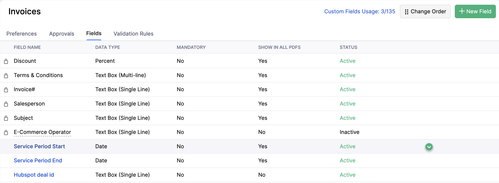
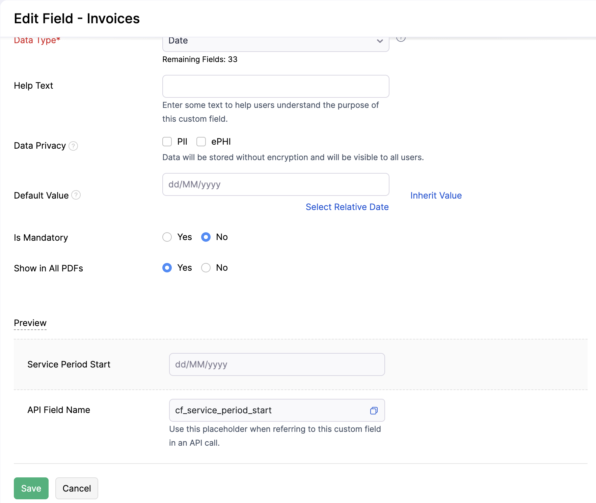
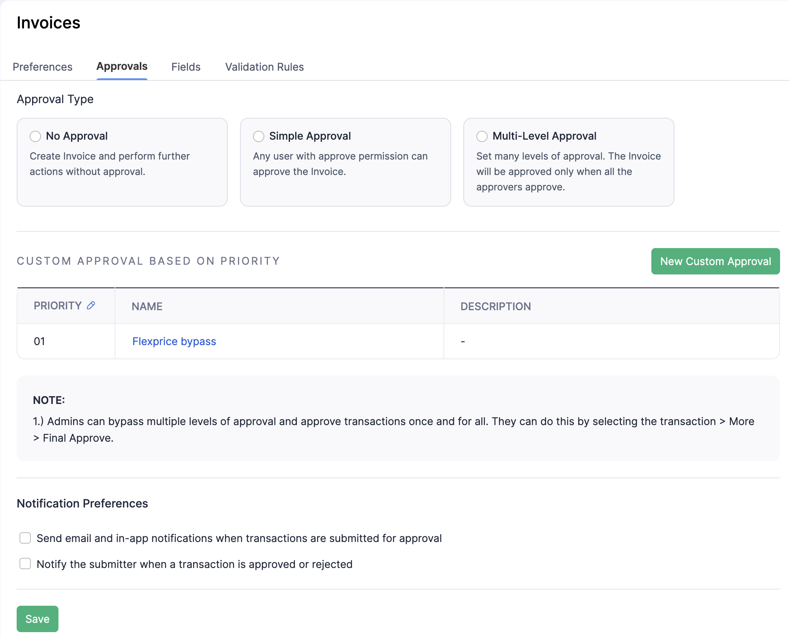

Your billing runs in Flexprice, but revenue, receivables and GST returns are reported from Zoho Books. With **Push invoices** on, every finalized Flexprice invoice is created in Zoho Books with the right contact, line items, service dates and tax codes. When the Flexprice invoice is paid, the payment is recorded in Zoho too, so the two ledgers close together.

## How It Works

1. **An invoice is finalized in Flexprice.** Flexprice creates the matching invoice in Zoho Books within moments. Draft invoices never sync.
2. **The customer is matched or created as a Zoho contact.** See [Contacts](#contacts).
3. **Each price becomes a Zoho item.** See [Items](#items).
4. **Flexprice adopts the Zoho invoice number.** The Flexprice invoice's number is replaced with the number Zoho assigned, and `metadata.zoho_invoice_id` stores the Zoho invoice ID. Both systems then show the same invoice number on PDFs and statements.
5. **The payment follows.** When the Flexprice invoice is fully paid, Flexprice records a customer payment against the Zoho invoice. If the invoice was already paid when it synced, the payment is recorded straight away. See [Payments](#payments).

An invoice syncs once. Later edits in Flexprice do not change the Zoho invoice unless you [re-sync](#re-syncing-an-invoice) it.

<Warning>
  Flexprice invoice numbers change after sync. If you hand out invoice numbers before they reach Zoho (for example in an email sent at finalization), use the number that appears after sync.
</Warning>

## What Zoho Receives

### Invoice header

| Zoho field | Source in Flexprice |
|---|---|
| Customer | The matched or created Zoho contact |
| Invoice date | Invoice issue date, in the subscription's timezone |
| Due date | Invoice due date, when it is on or after the invoice date |
| Payment terms | `Net N`, end of month or end of next month, when the subscription's payment terms produce exactly that due date |
| Currency and exchange rate | Invoice currency; the rate comes from Zoho (see [Currency](#currency)) |
| Place of supply | Customer metadata `place_of_supply`, otherwise the state code in the customer's GSTIN |
| Receivable account | Customer metadata `zoho_receivable_account_id`, when set |
| Adjustment | Prepaid credits and wallet balance applied, as a negative amount |
| Custom fields | See [Custom fields](#custom-fields) |
| Payment options | See [Payment gateways](#payment-gateways) |

Zoho creates the invoice with its default status, normally **Draft**. Flexprice does not send or email the invoice from Zoho.

### Line items

Each Flexprice line item becomes one Zoho line:

- **Quantity is 1 and rate is the line amount**, so line totals match exactly. Usage quantities and unit prices are not sent.
- **Name** is the line's display name. **Description** is the service period, for example `(2026-10-01 - 2026-10-31)`. For parent and child billing, the child customer's name appears above the period.
- **Discounts** (line discounts plus invoice-level coupons) are sent as an item-level amount, applied before tax.
- **HSN or SAC** comes from the price. See [GST, HSN and SAC](#gst-hsn-and-sac).
- **Lines with a zero amount are left out.** If every line is zero, the invoice is not synced.

To show a fixed charge as a quantity of months, set `normalize_fixed_to` in the [invoice sync settings](#invoice-sync-settings). A quarterly fixed price of 3,000 normalized to `MONTHLY` appears as quantity 3 at a rate of 1,000. The supported targets are `MONTHLY`, `QUARTERLY`, `HALF_YEARLY` and `ANNUAL`.

### Taxes

Flexprice does not send its own tax amounts. Zoho Books calculates tax from its own tax settings, the contact's place of supply and the item's HSN or SAC code. Items are created as taxable.

<Warning>
  Because Zoho calculates tax itself, the Zoho invoice total can differ from the Flexprice total. Configure your default tax and tax rules in Zoho Books before turning on sync, and compare the first few invoices.
</Warning>

## Contacts

For each invoice, Flexprice finds the Zoho contact for the customer in this order:

1. The contact already linked to this customer.
2. The first Zoho contact with the same email address. It is linked and left unchanged.
3. Otherwise a new **Customer** contact (sub-type **Business**) is created.

A new contact gets:

| Zoho contact field | Source |
|---|---|
| Contact, company and legal name | Customer name |
| Billing address | Customer address |
| Shipping address | Customer metadata `shipping_address_line1`, `shipping_address_line2`, `shipping_address_city`, `shipping_address_state`, `shipping_address_postal_code`, `shipping_address_country` |
| GSTIN | Customer metadata `gstin` |
| PAN | Customer metadata `pan`, otherwise taken from the GSTIN |
| Place of contact | Customer metadata `place_of_supply`, otherwise the GSTIN state code |
| Contact persons | Customer contact persons; the customer's own email and phone become the primary person when none is marked primary |

**Updating a Flexprice customer updates its linked Zoho contact** with the same fields. Contact persons added directly in Zoho are kept. GST treatment is not sent; set it on the contact in Zoho Books.

## Items

Each Flexprice price is linked to one Zoho Books item, created the first time an invoice uses that price:

- Type **Service**, taxable.
- **Name** is the line's display name; **SKU** and **description** are the Flexprice price ID.
- **HSN or SAC** is the price's code at the time the item is created.

If Zoho already has an item with the same name, Flexprice links to that item instead of creating a duplicate. Items are not synced on their own; they are only created as invoices need them.

## GST, HSN and SAC

For Indian organizations, set these on Flexprice records before the first sync:

| Where | Metadata key | Format | Used for |
|---|---|---|---|
| Customer | `gstin` | 15-character GSTIN | Contact GSTIN, PAN and place of supply |
| Customer | `pan` | 10 characters, must match the GSTIN | Contact PAN |
| Customer | `place_of_supply` | 2-character state code, for example `KA` or `29` | Place of supply; decides IGST versus CGST and SGST in Zoho |
| Price | `hsn_sac` | 4, 6 or 8 digits | Line and item HSN or SAC |

Flexprice rejects invalid values when the customer or price is saved. A price override without its own `hsn_sac` uses the code of the plan price it overrides.

```bash
curl -X PUT https://api.cloud.flexprice.io/v1/customers/<CUSTOMER_ID> \
  -H "x-api-key: <API_KEY>" \
  -H "Content-Type: application/json" \
  -d '{
    "metadata": {
      "gstin": "29ABCDE1234F1Z5",
      "place_of_supply": "29"
    }
  }'
```

## Currency

If the invoice currency is your Zoho organization's base currency, the exchange rate is 1. For any other currency, add it in Zoho Books under **Settings** > **Currencies** with a positive exchange rate. Otherwise the sync fails with `currency XXX is not enabled in Zoho Books`.

## Custom Fields

Flexprice can fill Zoho invoice custom fields in three ways:

| Setting | What it writes |
|---|---|
| `service_period_custom_fields` | The invoice's service start and end dates into two date fields. Set both or neither. |
| `metadata_custom_fields` | A Flexprice metadata value, from the invoice (`source: "invoice"`) or the customer (`source: "customer"`), copied as is. |
| `global_custom_fields` | The same fixed value on every invoice, for example `"Flexprice"` in a "Billing system" field. |

Create the fields in Zoho Books first: open **Settings** > **Sales** > **Invoices**, go to the **Fields** tab and click **New Field**. Refer to a field by its **API Field Name** (starting with `cf_`) or its numeric field ID. You can map up to 50 fields in total, and each Zoho field only once.

<Frame>
  
</Frame>

Open a field to find its API Field Name, and set **Show in All PDFs** to **Yes** to print it on the invoice PDF.

<Frame>
  
</Frame>

### Example: service period and PO number on the invoice PDF

A common setup shows the billing period and the customer's PO number in the invoice header:

| Zoho field (type) | API name | Filled by |
|---|---|---|
| Service Period Start (Date) | `cf_service_period_start` | `service_period_custom_fields.start_field_id` |
| Service Period End (Date) | `cf_service_period_end` | `service_period_custom_fields.end_field_id` |
| PO Number (Text) | `cf_po_number` | Invoice metadata `po_number` |

```json
"invoice_sync_settings": {
  "service_period_custom_fields": {
    "start_field_id": "cf_service_period_start",
    "end_field_id": "cf_service_period_end"
  },
  "metadata_custom_fields": [
    { "source": "invoice", "metadata_key": "po_number", "field": "cf_po_number" }
  ]
}
```

For a February subscription period, Zoho receives `2026-02-01` as the start and `2026-02-28` as the end: the end date is the last day of service, not the first day of the next period.

Metadata values are copied as they are. A metadata key that is missing or empty on an invoice or customer is skipped, so the Zoho field stays blank.

## Payment Gateways

With **Enable payment gateways** on, synced invoices carry the selected Zoho online payment options, so customers can pay from the Zoho invoice. Flexprice sends only gateway names, never gateway credentials. To choose the gateways, see [Connection Setup](/integrations/zohobooks/connection-setup#step-3-connect-zoho-in-flexprice).

## Payments

When a Flexprice invoice becomes fully paid, by any gateway, a manual payment or credits, Flexprice records a customer payment in Zoho Books:

| Zoho payment field | Value |
|---|---|
| Amount | The Zoho invoice's outstanding balance, including Zoho-calculated tax |
| Date | The day the payment is recorded |
| Payment mode | `payment_mode` setting, default `others` |
| Deposit to | `deposit_to_account_id` setting; empty uses Zoho's **Undeposited Funds** |
| Reference number | The gateway payment ID of the Flexprice payment, when there is one |

Partial payments are not recorded in Zoho; only the fully paid invoice is. If the Zoho invoice has no balance left, nothing is recorded, so an invoice paid in Zoho is never paid twice.

### Invoice approval

If your Zoho organization requires invoice approval, set `submit_for_approval` to `true`. Before recording a payment, Flexprice submits a draft Zoho invoice for approval and records the payment once Zoho approves it.

Approval is configured in Zoho Books under **Settings** > **Sales** > **Invoices** > **Approvals**. Use **New Custom Approval** to add a rule that approves invoices created by Flexprice without manual review.

<Frame>
  
</Frame>

<Warning>
  Add an approval rule in Zoho Books that approves invoices sent by Flexprice automatically. If an invoice is still pending approval after the wait, or was rejected, the payment is not recorded in Zoho. Approve the invoice and record the payment in Zoho Books.
</Warning>

## Invoice Sync Settings

Settings beyond the sync switches and payment gateways are set through the API, in `sync_config.invoice_sync_settings`:

| Field | Type | Default | Description |
|---|---|---|---|
| `normalize_fixed_to` | `MONTHLY`, `QUARTERLY`, `HALF_YEARLY`, `ANNUAL` | Off | Show fixed charges as a quantity of this period |
| `service_period_custom_fields` | `{ start_field_id, end_field_id }` | Off | Zoho fields for the service period dates |
| `metadata_custom_fields` | `[{ source, metadata_key, field }]` | None | Copy metadata into Zoho fields |
| `global_custom_fields` | `[{ field, value }]` | None | Fixed values for Zoho fields |
| `submit_for_approval` | boolean | `false` | Submit drafts for approval before recording payments |
| `payment_mode` | string, up to 100 characters | `others` | Zoho payment mode for recorded payments, for example `Bank Transfer` |
| `deposit_to_account_id` | numeric Zoho account ID | Undeposited Funds | Account recorded payments are deposited to |
| `payment_gateways` | `{ enabled, gateways, paypal_payment_method }` | Off | Online payment options on synced invoices |

`PUT /v1/connections/{id}` replaces the whole `sync_config`, so send every field you want to keep:

```bash
curl -X PUT https://api.cloud.flexprice.io/v1/connections/<CONNECTION_ID> \
  -H "x-api-key: <API_KEY>" \
  -H "Content-Type: application/json" \
  -d '{
    "sync_config": {
      "invoice":  { "inbound": false, "outbound": true },
      "customer": { "inbound": true,  "outbound": false },
      "invoice_sync_settings": {
        "normalize_fixed_to": "MONTHLY",
        "service_period_custom_fields": {
          "start_field_id": "cf_service_start",
          "end_field_id": "cf_service_end"
        },
        "metadata_custom_fields": [
          { "source": "invoice", "metadata_key": "po_number", "field": "cf_po_number" }
        ],
        "global_custom_fields": [
          { "field": "cf_billing_system", "value": "Flexprice" }
        ],
        "submit_for_approval": true,
        "payment_mode": "Bank Transfer",
        "deposit_to_account_id": "4602000000000361",
        "payment_gateways": {
          "enabled": true,
          "gateways": ["razorpay", "paypal"],
          "paypal_payment_method": "standard"
        }
      }
    }
  }'
```

## Re-syncing an Invoice

To push an invoice by hand, or to update a Zoho invoice after its Flexprice invoice or customer changed:

```bash
curl -X POST https://api.cloud.flexprice.io/v1/integrations/sync \
  -H "x-api-key: <API_KEY>" \
  -H "Content-Type: application/json" \
  -d '{
    "entity_type": "invoice",
    "entity_id": "<INVOICE_ID>",
    "method": "push",
    "resync": true
  }'
```

- Without `resync`, an invoice that is already in Zoho is left as it is.
- With `resync: true`, Flexprice updates the Zoho contact, then rebuilds the Zoho invoice. Invoices that are paid, partially paid or void in Zoho are not changed.
- The call returns once the sync is queued. Subscribe to the `invoice.sync.success` and `invoice.sync.failed` [webhook events](/developers/webhooks/event-catalog) to learn the outcome; failures carry Zoho's error message.

## Limitations

- Voiding an invoice in Flexprice does not void it in Zoho Books. Void it in Zoho too.
- Credit notes, refunds and payment reversals are not synced in either direction.
- Plans, prices and subscriptions are not synced on their own; items are created only for invoice lines.
- Zero-amount lines and Flexprice tax amounts are not sent.
- If Zoho Books rejects an invoice (for example for a missing currency or an unknown custom field), fix the cause in Zoho, then [re-sync](#re-syncing-an-invoice) the invoice.

## Troubleshooting

| Problem | Cause | Fix |
|---|---|---|
| `currency XXX is not enabled in Zoho Books` | Invoice currency missing in Zoho | Add it under **Settings** > **Currencies** with a positive rate |
| `invoice has no syncable line items` | Every line is zero | Nothing to sync; zero-amount invoices stay in Flexprice only |
| Zoho rejects the invoice after enabling gateways | A selected gateway is not set up in Zoho Books | Set it up under **Online Payments**, or deselect it |
| Custom field error from Zoho | Field API name or ID does not exist, or the value type does not match | Check the field in **Field Customization** |
| Zoho total differs from Flexprice | Zoho adds its own tax | Review tax settings and the customer's place of supply in Zoho |
| `You cannot submit this Invoice as it does not match your organization's approval criteria` | `submit_for_approval` is on, but no approval rule in Zoho Books applies to the invoice | Turn off `submit_for_approval`, or add an approval rule under **Settings** > **Sales** > **Invoices** > **Approvals** that covers invoices from Flexprice |
| Invoice paid in Flexprice, unpaid in Zoho | Approval still pending or rejected, or the invoice was never synced | Approve it in Zoho and record the payment there, or check the sync |

## Related Articles

<CardGroup cols={2}>
  <Card icon="plug" href="/integrations/zohobooks/connection-setup" title="Connection Setup">
    Connect Zoho Books over OAuth and register the webhooks.
  </Card>
  <Card icon="arrow-right-arrow-left" href="/integrations/zohobooks/webhooks-and-customer-sync" title="Webhooks and Customer Sync">
    Paid and voided invoices and new customers from Zoho.
  </Card>
</CardGroup>
